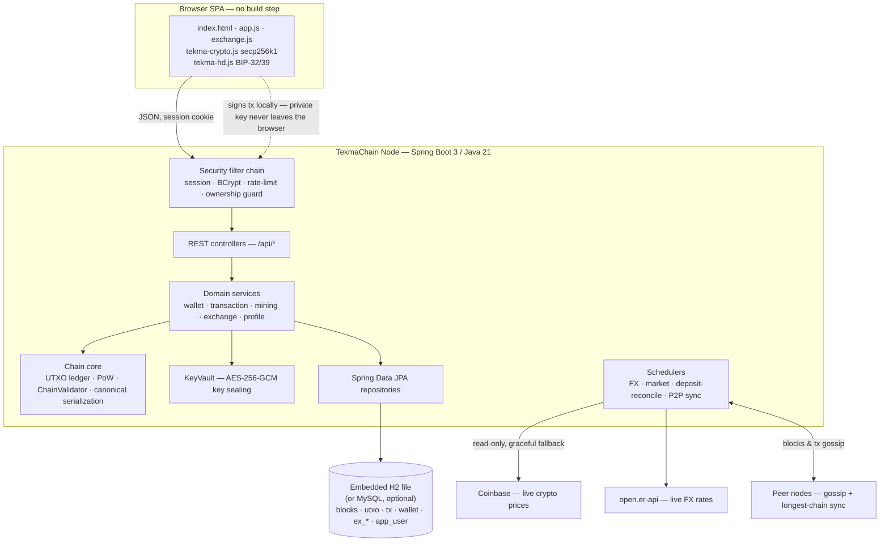
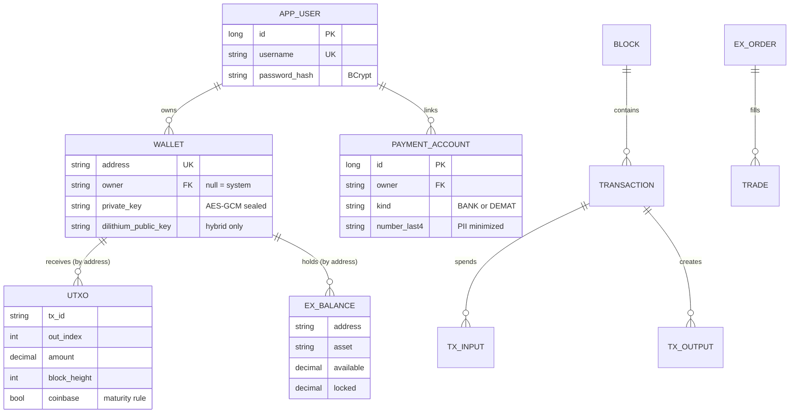
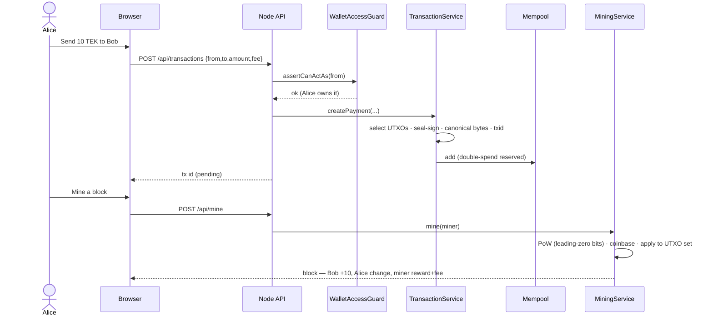
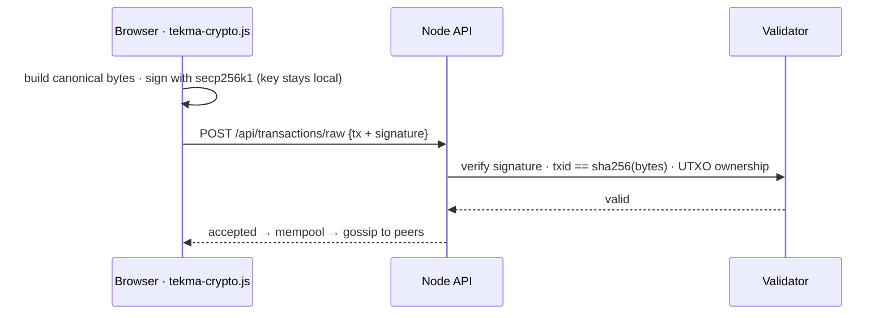
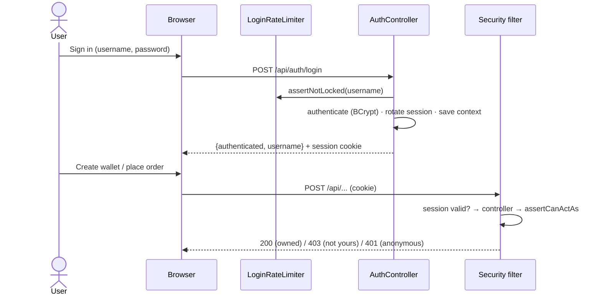

# TekmaChain

A **Bitcoin-inspired cryptocurrency network** running **Tekma Coin (TEK)** — proof of
concept, with real Bitcoin-style monetary policy (halving + 21M supply cap), a trading
terminal, live charts and a world-currency exchange.

### Run locally — just JDK 21 + Maven, no database to install

The node ships with an **embedded H2 database** (file-based), so there is nothing else to set up:

```bash
mvn spring-boot:run
```

Then open **http://localhost:8080**. Data persists in `./data/tekmachain.mv.db` across restarts,
and you can inspect the tables at **http://localhost:8080/h2-console** (JDBC URL
`jdbc:h2:file:./data/tekmachain`, user `sa`, no password). The front end is plain HTML/JS/SVG — no build step.

### Run with Docker (nothing to install but Docker)

```bash
docker compose up --build
```

One self-contained container (embedded H2 on a named volume); open **http://localhost:8080**.

### Prefer MySQL? (optional)

MySQL is a drop-in alternative — H2 runs in MySQL mode, so the schema is identical. Start a MySQL 8
on `localhost:3306` (defaults `root`/`root`; the `tekma_chain` database is auto-created) and run with
the `mysql` profile:

```bash
mvn spring-boot:run -Dspring-boot.run.profiles=mysql
```

Or in Docker: `docker compose -f docker-compose.mysql.yml up --build`. Override DB settings with
`TEKMACHAIN_DB_HOST`, `TEKMACHAIN_DB_PORT`, `TEKMACHAIN_DB_NAME`, `TEKMACHAIN_DB_USER`,
`TEKMACHAIN_DB_PASSWORD` (e.g. `TEKMACHAIN_DB_NAME=tekma_chain_8081` for a second local node).

## What's implemented (Phases 1–9 + UTXO)

| Area | What's real here |
|------|------------------|
| **Blockchain** | Genesis block, linked `previousHash`, block hash, Merkle root, chain validation, tamper detection |
| **Cryptography** | secp256k1 key pairs, ECDSA signing & verification, SHA-256, RIPEMD-160, Base58Check `TEK…` addresses |
| **Money model** | **UTXO** ledger (Bitcoin-style): inputs consume unspent outputs, outputs create new ones, change returns to sender |
| **Monetary policy** | Bitcoin-style **halving** block reward, a **21,000,000 TEK supply cap**, and a **genesis coinbase message** — all *enforced* by the miner and both validators (`EconomicsTest`) |
| **Transactions** | Built, signed, verified against the UTXO set, fee = inputs − outputs |
| **Canonical serialization** | Transactions are hashed & signed over one **strict length-prefixed binary form** with **exact 64-bit satoshi amounts** (never decimal text) — so no value can be reshaped to smuggle coins, and a browser-signed tx hashes & verifies identically on every node. Proven byte-for-byte across Java and the JS signer in `SigningDataVectorTest` |
| **Mempool** | Pending transactions with double-spend reservation |
| **Consensus** | **Proof-of-Work** + **longest-valid-chain** rule; a peer's chain is adopted only if it fully re-validates (every hash, link, PoW, signature, no double-spends, correct rewards) and is longer |
| **Mining & difficulty** | Coinbase reward + collected fees; PoW measured in **leading zero bits**; difficulty **retargets** on a schedule toward a target block time with a clamped (max 4×) step — Bitcoin-style — and every node re-derives and enforces the expected difficulty per height (`DifficultyPolicyTest`). UTXO set updated atomically |
| **Coinbase maturity** | Freshly mined rewards can't be spent until they gain enough confirmations (like Bitcoin); enforced by both validators and surfaced in the wallet as a **🔒 maturing** balance (`CoinbaseMaturityTest`) |
| **P2P (Phase 5)** | Multiple nodes over HTTP: peer discovery, transaction & block **gossip**, node **synchronisation**, fork resolution by rebuilding the UTXO set from the adopted chain |
| **Exchange (Phase 8)** | Custodied balances (TEK/USD/INR), **on-chain deposit & withdrawal** of TEK via an exchange hot wallet, simulated fiat, an **order book** and a real **price-time-priority matching engine** (LIMIT + MARKET orders, partial fills, price improvement, cancels), trades & a 24h ticker |
| **Self-custody (Phase 7)** | Wallets whose secp256k1 keys are generated **and signed entirely in the browser** (`tekma-crypto.js`, pure JS). The node never sees the private key — it only verifies the pre-signed transaction (`POST /api/transactions/raw`). Cross-checked against the Java verifier in `ClientCryptoVectorTest` |
| **Post-quantum (Phase 9)** | A **Security Lab** benchmarking ECDSA against **ML-DSA / CRYSTALS-Dilithium** and **Falcon** — real key/signature sizes and sign/verify timings, showing the quantum threat and the size cost of the defence |
| **Hybrid signatures** | **Quantum-safe wallets** sign every transaction input with BOTH ECDSA and ML-DSA (Dilithium); the address commits to both keys and the node verifies both (`HybridSignatureTest`). Even a broken ECDSA can't move the coins |
| **HD wallets** | **BIP-32 / BIP-39** hierarchical-deterministic wallets generated in the browser: a 12-word recovery phrase derives many addresses at `m/44'/0'/0'/0/i`. Validated against the official BIP-32 and BIP-39 (Trezor) test vectors |
| **World currencies** | A DB-backed catalogue of **130+ currencies** (`currencies.csv` → `currency` table) with a **live FX feed** (open.er-api.com) that refreshes USD rates on a schedule and falls back to seeded rates offline. Trade TEK against USD/EUR/GBP/JPY/INR, hold any currency, convert TEK → any currency, pick a **display currency** that reprices the app. `GET /api/currencies`, `/convert`, `/tek-usd`, `/status`, `POST /refresh` |
| **Key custody** | An **HSM stand-in** (`KeyVault`): private keys are sealed with **AES-256-GCM** under a master key and only ever decrypted inside the vault, which signs and returns just the result — no plaintext keys at rest or in app logic |
| **P2P scaling** | The mesh scales horizontally — a peer **cap**, **gossip fan-out** (broadcast to a random subset), and **health-based eviction** of dead peers keep cost bounded as nodes grow |
| **Accounts** | **Register / sign-in** with **Spring Security** and **BCrypt**-hashed passwords over a session cookie; each account owns the custodial wallets it creates, and the write endpoints (create wallet, send, mine, trade, deposit) require login while the market/explorer views stay public (`AuthTest`) |
| **Profile & portfolio** | A **profile** page aggregating what you hold — TEK across your wallets (spendable vs maturing) and assets on the exchange — with a live portfolio value, plus linked **bank** and **demat** accounts. **Fiat deposit/withdraw requires a linked bank account** and names it on the receipt; account numbers are stored but only ever shown masked (`ProfileTest`) |
| **Live crypto markets** | Real-world **BTC/ETH/SOL/…** prices pulled from **Coinbase's public feed** on a schedule and cached in a `market_price` table, shown as a live **Markets** panel repriced into your display currency — reference data only, never tradable (`MarketFeedTest`) |
| **AI guide** | An **embedded RAG assistant** (no cloud, no API keys): a local **BM25** retriever over a guidance knowledge base answers "what should I use, when", cites its sources and deep-links you to the right tab (`AssistantTest`) |
| **Live market** | Animated count-up prices, green/red **flash on change**, a pulsing **LIVE** badge and auto-refreshing ticker/book/trades for a real trading-desk feel |
| **Charts** | Live inline-**SVG** charts (no chart library): TEK price line/area graph, market-**depth** chart, 24h-volume and coins-minted **bar charts**, and per-market **sparklines** |
| **Persistence** | **Embedded H2** by default (file-based, zero-install) — or **MySQL 8** via the `mysql` profile; identical schema since H2 runs in MySQL mode. Schema auto-created by Hibernate; tests use in-memory H2 |
| **Wallet** | Create custodial or self-custody wallet, balance (= sum of its UTXOs), send, receive, history |
| **UI** | A single self-contained trading app: **Dashboard** (charts + converter), **Wallet**, **Exchange** terminal (price graph, depth chart, order book, trade feed, order form), **Explorer**, **Network**, and **Security** lab — no build step |

## Architecture

TekmaChain is a **single self-contained Spring Boot node** plus a **zero-build browser SPA**, backed by an **embedded H2 database** (or MySQL, optionally). Nodes form a peer-to-peer mesh; everything else — cryptography, the matching engine, the RAG assistant, the charts — is embedded. No external brokers, no cloud services, no API keys.

### High-Level Design (HLD)



**Key architectural decisions**

| Decision | Rationale |
|---|---|
| **UTXO ledger** (not account balances) | Mirrors Bitcoin: clear coin provenance, deterministic replay for consensus, and independent parallel validation of inputs. |
| **PoW + longest-valid-chain** | Permissionless, Sybil-resistant consensus. Every node **re-validates** an adopted chain end-to-end rather than trusting a peer. |
| **Canonical binary serialization** | Transactions hash & sign over a strict length-prefixed byte layout with **int64 satoshi** amounts, so the JS signer and the Java node produce **byte-identical** ids/signatures (no decimal drift, no delimiter injection). |
| **Session auth + BCrypt** (not JWT) | Same-origin SPA: the simplest correct posture. Server-side revocation is trivial (logout invalidates the session); no token to leak, store, or rotate. |
| **Custodial *and* self-custody wallets** | Custodial = frictionless demo UX; self-custody = keys are generated and signed **only in the browser**, the real-world posture, proven to interoperate with the node byte-for-byte. |
| **Graceful-degradation feeds** | External prices/FX are **best-effort**: seeded fallbacks mean the app always works offline and never hard-depends on a third party. |
| **Embedded H2 by default** | One command to run with zero external services; the same engine (in MySQL mode) powers a fast, network-free 58-test suite. MySQL is a drop-in profile when you want it. |

### Low-Level Design (LLD)

**Module map** (`com.tekmachain.*`)

| Package | Responsibility |
|---|---|
| `domain` | Chain primitives & JPA entities: `Block`, `Transaction`, `TxInput/Output`, `Utxo`, `Wallet`. |
| `crypto` | `CryptoUtil` (secp256k1, SHA-256, RIPEMD-160, Base58Check) and `SigningData` (canonical bytes). |
| `service` | `MiningService`, `TransactionService`, `WalletService`, `ChainService`, `ChainValidator`, `MempoolService`, `DifficultyPolicy`, `Economics`. |
| `web` / `web.dto` | REST controllers, DTOs + `Mapper`, and `ApiExceptionHandler` (domain errors → clean JSON status codes). |
| `auth` | `User`, `AuthService` (BCrypt + `UserDetailsService`), `SecurityConfig`, `AuthController`, `WalletAccessGuard` (ownership/IDOR), `LoginRateLimiter`, `OrphanWalletClaimer`. |
| `profile` | `PaymentAccount` (bank/demat, last-4 only) + `ProfileController` (portfolio aggregation). |
| `exchange` | `MatchingEngine` (price-time priority), `ExchangeService`, `BalanceService`, `MarketDataService`, `DepositReconciler`. |
| `market` | `MarketDataFeedService` — live crypto prices cached in `market_price`. |
| `currency` | `CurrencyService` + `FxRateService` — 130+ currencies, live USD rates. |
| `custody` | `KeyVault` — AES-256-GCM sealing of private keys at rest. |
| `p2p` | `PeerRegistry`, `NodeClient`, `NetworkService` — gossip, discovery, longest-chain sync. |
| `pq` | `PostQuantumService` — ECDSA vs ML-DSA/Falcon benchmark. |
| `assistant` | `KnowledgeBase` (BM25) + `AssistantService` — embedded RAG guide. |

**Data model** (core entities)



**Security model**
- **Authentication** — `POST /api/auth/login` authenticates against BCrypt hashes, rotates the session id (anti-fixation), and stores the `SecurityContext` in the HTTP session. `LoginRateLimiter` locks a username after N failed attempts.
- **Authorization** — the write endpoints call `WalletAccessGuard.assertCanActAs(address)`: you may act on a custodial wallet **only if you own it** (self-custody addresses, which the server holds no key for, are allowed; system wallets are denied). This closes horizontal privilege-escalation (IDOR).
- **Data at rest** — private keys are AES-256-GCM **sealed** by `KeyVault`; bank/demat numbers are stored **masked (last 4 only)**.
- **Public vs private** — market data, the explorer and the assistant are open; wallets, sends, mining, trading, funding and the profile require login.

### Core flows

**1 · Custodial payment lifecycle** (mine → send → confirm)



**2 · Self-custody signed transaction** (the node never sees the key)



**3 · Sign-in and an authorized action**



### Non-functional & operations

- **Health** — `GET /actuator/health` (plus `/health/liveness` and `/health/readiness`, used by the Kubernetes probes) reports app + DB status.
- **Scaling** — nodes scale horizontally via the P2P mesh (peer cap, gossip fan-out, health-based eviction). *Note:* the login rate-limiter and in-memory locks are per-node; a multi-node auth deployment would move that state to a shared store (e.g. Redis).
- **Resilience** — external feeds fail soft to seeded data; the deposit reconciler and schedulers isolate their own errors.
- **Config & secrets** — all knobs live in `application.properties` / env vars; the custody master key and DB credentials are injected via env (Kubernetes `Secret`).

## Try it (the demo loop)

1. **Create a wallet** — call it *Alice*. Create another — *Bob*.
2. Click **⛏ Mine here** on Alice. She earns the 50 TEK block reward (this is how coins enter existence).
3. In **Send TEK**, send `10` from Alice to Bob with a `0.1` fee → it lands in the **mempool**.
4. **Mine a block** to anyone. The transaction confirms: Bob gets 10, Alice gets change back, the miner gets 50 + 0.1 fee.
5. Expand blocks in the **Blockchain** explorer, and hit **✓ Validate chain**.
6. Inspect the raw tables in the **H2 console** at `/h2-console` — or your MySQL, if you chose that profile (`blocks`, `transaction`, `utxo`, `wallet`, `ex_order`, `currency`, …).

## Trade on the exchange (Phase 8)

Open the **Exchange** tab. Pick which wallet you're **Acting as** (top-right).

1. **Get TEK**: on the **Wallet** tab, mine a block to your wallet (50 TEK).
2. **Deposit** into the exchange: Exchange → Account → **Deposit** → TEK → amount → mine a block to confirm (it's credited automatically). Also **Deposit** some simulated **USD** so you can buy.
3. **Trade**: place a **LIMIT** or **MARKET** order in the buy/sell ticket. Orders match against the book by price-time priority; watch the **order book**, **recent trades** and your **balances** update.
4. **Withdraw** TEK back on-chain any time (mine to confirm), or top up/withdraw simulated fiat.

Exchange API lives under `/api/exchange/*` — `orderbook`, `ticker`, `trades`, `account/{addr}`, `orders/{addr}`, `POST orders`, `POST orders/{id}/cancel`, `deposit|withdraw/tek`, `deposit|withdraw/fiat`.

> The matching engine, balance locking, and the on-chain deposit/withdraw bridge are covered by `ExchangeTest`.

## Self-custody wallets (Phase 7)

On the **Wallet** tab, **🔐 Self-custody** generates a secp256k1 key pair entirely in your browser
(`tekma-crypto.js`) and stores it only in `localStorage`. Mine a block to its address to fund it, then
**Send** — the transaction is built and ECDSA-signed in the browser and posted already-signed to
`POST /api/transactions/raw`. The node verifies the signature against the UTXO set but **never receives the
private key**. `ClientCryptoVectorTest` pins browser-generated vectors (public key, address, signature) and
proves the Java node accepts them.

## Quantum-safe & HD wallets

On the **Wallet** tab you can create four kinds of wallet:

- **Custodial** — the node holds the key (simplest; used by the exchange hot wallet).
- **🔐 Self-custody** — key generated and used only in your browser (Phase 7).
- **🛡 Quantum-safe (hybrid)** — every spend is signed with **ECDSA *and* ML-DSA (Dilithium)**;
  the address binds both public keys and the node verifies both signatures. `HybridSignatureTest`
  proves a hybrid payment validates and that tampering the ML-DSA signature is rejected.
- **🌱 HD wallet** — a **BIP-39** 12-word recovery phrase derives many **BIP-32** addresses
  (`m/44'/0'/0'/0/i`) in the browser. The derivation matches the official BIP-32 and BIP-39
  (Trezor) test vectors exactly.

## Post-quantum Security Lab (Phase 9)

The **Security** tab benchmarks TekmaChain's ECDSA against post-quantum signature schemes
(`GET /api/pq/benchmark`, powered by Bouncy Castle's PQC provider): **ML-DSA / CRYSTALS-Dilithium-2 & -3**
and **Falcon-512**. It reports real public-key and signature sizes plus sign/verify timings, and visualises why
post-quantum security costs ~30–45× larger signatures. `PostQuantumTest` asserts every scheme actually signs
and verifies.

## Run a multi-node network (Phase 5)

Open two terminals. Each node runs on its own port with its **own H2 file** (auto-created)
and its own wallet UI at `http://localhost:<port>`.

```bash
mvn spring-boot:run
```
```bash
mvn spring-boot:run "-Dspring-boot.run.arguments=--server.port=8081 --spring.datasource.url=jdbc:h2:file:./data/tekmachain-8081;MODE=MySQL --tekmachain.node.peers=http://localhost:8080 --tekmachain.node.self-url=http://localhost:8081"
```

The second node connects to the first, discovers the mesh via gossip, and converges on the
longest valid chain. (In Kubernetes, `k8s/p2p-cluster.yaml` does this for N replicas.)

You can also wire peers at runtime from the **Network** panel in any node's UI, or:

```bash
curl -X POST http://localhost:8081/api/peers -H "Content-Type: application/json" -d "{\"url\":\"http://localhost:8080\"}"
```

**What to watch:** create a wallet on node 8080 and **mine** to it. Within a few seconds the
other nodes discover the longer chain and adopt it — their **Height** climbs and the block
appears in their explorers. Send a transaction on one node; it gossips to the others' mempools;
whoever mines next confirms it for everyone. Nodes reconcile automatically every ~12s, or press
**⟳ Sync now**.

### Node-to-node API (`/api/node/*`)

| Method | Path | Purpose |
|--------|------|---------|
| `GET`  | `/api/node/info` | this node's id, height, tip hash |
| `GET`  | `/api/node/blocks?from=0` | serve blocks for sync |
| `POST` | `/api/node/blocks` | receive a gossiped block |
| `POST` | `/api/node/transactions` | receive a gossiped transaction |
| `GET` · `POST` | `/api/node/peers` | list / register peers |

Human/UI network endpoints: `GET /api/peers` (peers + live heights), `POST /api/peers` (add a peer), `POST /api/sync` (force a reconcile).

## Tune it

Edit `src/main/resources/application.properties`:

```properties
tekmachain.difficulty=16                    # initial PoW difficulty in leading ZERO BITS the block hash needs
tekmachain.block-reward=50                  # coins minted per block (before halvings)
tekmachain.pow.retarget-interval=16         # blocks between difficulty retargets
tekmachain.pow.target-block-time-ms=30000   # the block time difficulty steers toward
tekmachain.coinbase-maturity=2              # confirmations before a mined reward is spendable
```

## REST API

| Method | Path | Purpose | Auth |
|--------|------|---------|------|
| `GET`  | `/api/chain/info` | height, difficulty, reward, mempool size, circulating supply | public |
| `GET`  | `/api/blocks` · `/api/blocks/{height}` | the chain | public |
| `GET`  | `/api/chain/validate` | full integrity check | public |
| `POST` | `/api/auth/register` · `/login` · `/logout` | account + session (BCrypt, rate-limited) | public |
| `GET`  | `/api/auth/me` | who am I (for the SPA gate) | public |
| `GET` · `POST` | `/api/wallets` | list your wallets / `{ "label" }` → new wallet | login |
| `POST` | `/api/wallets/hybrid` | new quantum-safe (ECDSA + ML-DSA) wallet | login |
| `GET`  | `/api/wallets/{address}/utxos` | that wallet's unspent outputs | login |
| `POST` | `/api/transactions` | `{ "from", "to", "amount", "fee" }` → sign + broadcast | login + **owns `from`** |
| `POST` | `/api/transactions/raw` | accept a browser-signed tx (self-custody) | signature-verified |
| `POST` | `/api/mine` | `{ "minerAddress": "TEK…" }` → mine one block | login |
| `GET`  | `/api/mempool` | pending transactions | login |
| `GET`  | `/api/profile` | your portfolio (holdings, wallets, linked accounts) | login |
| `GET` · `POST` · `DELETE` | `/api/profile/accounts` | manage linked bank / demat accounts | login |
| `GET` · `POST` | `/api/exchange/orders`, `…/deposit\|withdraw/*` | trade & fund | login + **owns address** |
| `GET`  | `/api/exchange/orderbook` · `/ticker` · `/trades` | market data | public |
| `GET`  | `/api/market` | live real-world crypto prices (Coinbase) | public |
| `GET`  | `/api/currencies` · `/convert` · `/tek-usd` | FX + display currency | public |
| `POST` | `/api/assistant` | ask the embedded RAG guide | public |
| `GET`  | `/actuator/health` | liveness / readiness (K8s probes) | public |

## POC boundaries (read me)

- This is a **fictional currency**. TEK is not connected to real money or any real exchange.
- **Custodial keys are stored on the node** (sealed by the KeyVault) so the demo can sign for you.
  For the real-world posture, use a **self-custody** wallet: its key is generated and signs entirely
  in your browser and the node only ever verifies the signed transaction.
- **Auth is POC-grade**: session cookies over the same origin with CSRF disabled and no TLS termination
  here. A production deployment would enable CSRF, serve over HTTPS, and move the login rate-limiter to a
  shared store (Redis) so the limit holds across a multi-node fleet.
- The P2P layer uses simple HTTP gossip and trusts peers to serve honest data (every chain is
  still fully re-validated before adoption). It has no authentication, NAT traversal, or
  eclipse/Sybil protection — it's a teaching network, not a hardened one.

## Roadmap (where this grows next)

- **Phase 5 — P2P** ✅ done: multiple nodes, gossip, discovery, longest-chain sync, fork resolution.
- **Phase 7 — Self-custody wallet** ✅ done: keys generated and signed in the browser, node never sees the private key.
- **Phase 8 — Exchange** ✅ done: order book + price-time matching engine, TEK/USD & TEK/INR, on-chain deposit/withdrawal, simulated fiat.
- **Phase 9 — Post-quantum research** ✅ done: ECDSA vs ML-DSA/Dilithium/Falcon benchmark (Security Lab). Next: hybrid ECDSA+ML-DSA transaction signing on-chain.
- **Protocol soundness** ✅ done: a Satoshi-style hardening pass — **difficulty retargeting** toward a target block time, **coinbase maturity**, and a **canonical binary transaction serialization** proven identical across the Java node and the browser signer.

Everything on the roadmap is implemented — the full Phases 1–9, an **embedded-H2 (or MySQL)** backend,
**Docker Compose** + **Kubernetes** deployment, a DB-backed **multi-currency** exchange with
live charts and a **live FX feed**, **hybrid ECDSA + ML-DSA** signatures, **BIP-32/39 HD wallets**,
**HSM-style key custody**, and a **horizontally-scaling P2P mesh**.

Deploy a single node with [`k8s/app.yaml`](k8s/README.md), or a multi-node gossiping mesh with
[`k8s/p2p-cluster.yaml`](k8s/p2p-cluster.yaml) (`kubectl scale statefulset/tekmachain-node --replicas=N`).
Remaining ideas are pure ops: wiring the master key to a real KMS/HSM, and a production FX
provider with historical candles.
