# $()

> God node · 58 connections · [D:\block-chain-crypto-money-electronic-transaction-quantum\src\main\resources\static\app.js](file:///D:/block-chain-crypto-money-electronic-transaction-quantum/src/main/resources/static/app.js#L16)

## Call Trace Diagram

```mermaid
sequenceDiagram
    participant P0 as $()
    participant P1 as toast()
    participant P2 as loadProfile()
    participant P3 as api()
    participant P4 as refreshView()
    participant P5 as curSym()
    participant P6 as fmt()
    participant P7 as escapeHtml()
    participant P8 as rateOf()
    participant P9 as linkAccount()
    participant P10 as holdingRow()
    participant P11 as removeAccount()
    participant P12 as openAuth()
    participant P13 as renderAccounts()
    participant P14 as doMine()
    participant P15 as validateChain()
    participant P16 as createHdWallet()
    participant P17 as sendTx()
    participant P18 as submitAuth()
    participant P19 as refreshFx()
    participant P20 as createSelfWallet()
    participant P21 as boot()
    participant P22 as placeOrder()
    participant P23 as submitFunding()
    participant P24 as createHybridWallet()
    participant P25 as createWallet()
    participant P26 as addPeer()
    participant P27 as syncNow()
    participant P28 as refreshMarkets()
    participant P29 as cancelOrder()
    participant P30 as loadWallets()
    participant P31 as loadDashboard()
    participant P32 as loadExchange()
    participant P33 as mine()
    participant P34 as loadTicker()
    participant P35 as loadLiveMarkets()
    participant P36 as showView()
    participant P37 as renderConverter()
    participant P38 as askAssistant()
    participant P39 as loadPeers()
    participant P40 as setUser()
    participant P41 as recalcTotal()
    participant P42 as loadOrderBook()
    participant P43 as loadTrades()
    participant P44 as toggleFunding()
    participant P45 as apEl()
    participant P46 as updateAvailHint()
    participant P47 as loadAccount()
    participant P48 as loadInfo()
    participant P49 as updateFxStatus()
    participant P50 as loadBlocks()
    participant P51 as syncOrderForm()
    participant P52 as fillIdentity()
    participant P53 as onIdentityChange()
    participant P54 as onDisplayCurChange()
    participant P55 as loadWalletHistory()
    participant P56 as updateSideNet()
    participant P57 as runPqBenchmark()
    participant P58 as onUnauthorized()
    participant P59 as toggleAssistant()
    participant P60 as loadOrders()
    participant P61 as setFundAsset()
    participant P62 as fillDisplayCur()
    participant P63 as fillSelect()
    participant P64 as setAuthMode()
    participant P65 as sendAssistant()
    participant P66 as gotoDeposit()
    participant P67 as renderPairList()
    participant P68 as fillPrice()
    participant P69 as renderFundAccount()
    participant P70 as browseAsGuest()
    P0->>+ P1: calls
    P1-->>- P0: return
    P1->>+ P0: calls
    P0-->>- P1: return
    P1->>+ P2: calls
    P2-->>- P1: return
    P2->>+ P0: calls
    P0-->>- P2: return
    P2->>+ P3: calls
    P3-->>- P2: return
    P2->>+ P1: calls
    P1-->>- P2: return
    P2->>+ P4: calls
    P4-->>- P2: return
    P2->>+ P5: calls
    P5-->>- P2: return
    P2->>+ P6: calls
    P6-->>- P2: return
    P2->>+ P7: calls
    P7-->>- P2: return
    P2->>+ P8: calls
    P8-->>- P2: return
    P2->>+ P9: calls
    P9-->>- P2: return
    P2->>+ P10: calls
    P10-->>- P2: return
    P2->>+ P11: calls
    P11-->>- P2: return
    P2->>+ P12: calls
    P12-->>- P2: return
    P2->>+ P13: calls
    P13-->>- P2: return
    P1->>+ P14: calls
    P14-->>- P1: return
    P1->>+ P15: calls
    P15-->>- P1: return
    P1->>+ P16: calls
    P16-->>- P1: return
    P1->>+ P17: calls
    P17-->>- P1: return
    P1->>+ P18: calls
    P18-->>- P1: return
    P1->>+ P19: calls
    P19-->>- P1: return
    P1->>+ P20: calls
    P20-->>- P1: return
    P1->>+ P21: calls
    P21-->>- P1: return
    P1->>+ P22: calls
    P22-->>- P1: return
    P1->>+ P23: calls
    P23-->>- P1: return
    P1->>+ P9: calls
    P9-->>- P1: return
    P1->>+ P24: calls
    P24-->>- P1: return
    P1->>+ P25: calls
    P25-->>- P1: return
    P1->>+ P26: calls
    P26-->>- P1: return
    P1->>+ P27: calls
    P27-->>- P1: return
    P1->>+ P28: calls
    P28-->>- P1: return
    P1->>+ P11: calls
    P11-->>- P1: return
    P1->>+ P29: calls
    P29-->>- P1: return
    P0->>+ P30: calls
    P30-->>- P0: return
    P0->>+ P31: calls
    P31-->>- P0: return
    P0->>+ P32: calls
    P32-->>- P0: return
    P0->>+ P2: calls
    P2-->>- P0: return
    P0->>+ P33: calls
    P33-->>- P0: return
    P0->>+ P34: calls
    P34-->>- P0: return
    P0->>+ P35: calls
    P35-->>- P0: return
    P0->>+ P14: calls
    P14-->>- P0: return
    P0->>+ P36: calls
    P36-->>- P0: return
    P0->>+ P37: calls
    P37-->>- P0: return
    P0->>+ P15: calls
    P15-->>- P0: return
    P0->>+ P38: calls
    P38-->>- P0: return
    P0->>+ P16: calls
    P16-->>- P0: return
    P0->>+ P17: calls
    P17-->>- P0: return
    P0->>+ P39: calls
    P39-->>- P0: return
    P0->>+ P40: calls
    P40-->>- P0: return
    P0->>+ P18: calls
    P18-->>- P0: return
    P0->>+ P41: calls
    P41-->>- P0: return
    P0->>+ P42: calls
    P42-->>- P0: return
    P0->>+ P43: calls
    P43-->>- P0: return
    P0->>+ P44: calls
    P44-->>- P0: return
    P0->>+ P20: calls
    P20-->>- P0: return
    P0->>+ P45: calls
    P45-->>- P0: return
    P0->>+ P46: calls
    P46-->>- P0: return
    P0->>+ P47: calls
    P47-->>- P0: return
    P0->>+ P22: calls
    P22-->>- P0: return
    P0->>+ P23: calls
    P23-->>- P0: return
    P0->>+ P48: calls
    P48-->>- P0: return
    P0->>+ P9: calls
    P9-->>- P0: return
    P0->>+ P49: calls
    P49-->>- P0: return
    P0->>+ P24: calls
    P24-->>- P0: return
    P0->>+ P25: calls
    P25-->>- P0: return
    P0->>+ P50: calls
    P50-->>- P0: return
    P0->>+ P26: calls
    P26-->>- P0: return
    P0->>+ P51: calls
    P51-->>- P0: return
    P0->>+ P52: calls
    P52-->>- P0: return
    P0->>+ P53: calls
    P53-->>- P0: return
    P0->>+ P54: calls
    P54-->>- P0: return
    P0->>+ P55: calls
    P55-->>- P0: return
    P0->>+ P56: calls
    P56-->>- P0: return
    P0->>+ P57: calls
    P57-->>- P0: return
    P0->>+ P58: calls
    P58-->>- P0: return
    P0->>+ P59: calls
    P59-->>- P0: return
    P0->>+ P60: calls
    P60-->>- P0: return
    P0->>+ P61: calls
    P61-->>- P0: return
    P0->>+ P62: calls
    P62-->>- P0: return
    P0->>+ P13: calls
    P13-->>- P0: return
    P0->>+ P63: calls
    P63-->>- P0: return
    P0->>+ P12: calls
    P12-->>- P0: return
    P0->>+ P64: calls
    P64-->>- P0: return
    P0->>+ P65: calls
    P65-->>- P0: return
    P0->>+ P66: calls
    P66-->>- P0: return
    P0->>+ P67: calls
    P67-->>- P0: return
    P0->>+ P68: calls
    P68-->>- P0: return
    P0->>+ P69: calls
    P69-->>- P0: return
    P0->>+ P70: calls
    P70-->>- P0: return
```

## Connections by Relation

### calls
- [[toast()]] `EXTRACTED`
- [[loadWallets()]] `EXTRACTED`
- [[loadDashboard()]] `EXTRACTED`
- [[loadExchange()]] `INFERRED`
- [[loadProfile()]] `EXTRACTED`
- [[mine()]] `EXTRACTED`
- [[loadTicker()]] `INFERRED`
- [[loadLiveMarkets()]] `EXTRACTED`
- [[doMine()]] `EXTRACTED`
- [[showView()]] `EXTRACTED`
- [[renderConverter()]] `EXTRACTED`
- [[validateChain()]] `EXTRACTED`
- [[askAssistant()]] `INFERRED`
- [[createHdWallet()]] `EXTRACTED`
- [[sendTx()]] `EXTRACTED`
- [[loadPeers()]] `EXTRACTED`
- [[setUser()]] `EXTRACTED`
- [[submitAuth()]] `EXTRACTED`
- [[recalcTotal()]] `INFERRED`
- [[loadOrderBook()]] `INFERRED`

### contains
- [[app.js]] `EXTRACTED`

---

*Part of the graphify knowledge wiki. See [[index]] to navigate.*