# Community 0

> 162 nodes · cohesion 0.03

## Key Concepts

- [.createPayment()](file:///D:/block-chain-crypto-money-electronic-transaction-quantum/src/main/java/com/tekmachain/service/TransactionService.java#L56) (39 connections)
- [.getAddress()](file:///D:/block-chain-crypto-money-electronic-transaction-quantum/src/main/java/com/tekmachain/exchange/domain/PendingDeposit.java#L49) (28 connections)
- [.validate()](file:///D:/block-chain-crypto-money-electronic-transaction-quantum/src/main/java/com/tekmachain/service/TransactionService.java#L132) (27 connections)
- [.validateBlockTransactions()](file:///D:/block-chain-crypto-money-electronic-transaction-quantum/src/main/java/com/tekmachain/service/ChainValidator.java#L112) (19 connections)
- [.tx()](file:///D:/block-chain-crypto-money-electronic-transaction-quantum/src/main/java/com/tekmachain/web/dto/Mapper.java#L17) (19 connections)
- [.profile()](file:///D:/block-chain-crypto-money-electronic-transaction-quantum/src/main/java/com/tekmachain/profile/ProfileController.java#L62) (19 connections)
- [.validateSpend()](file:///D:/block-chain-crypto-money-electronic-transaction-quantum/src/main/java/com/tekmachain/service/ChainValidator.java#L174) (18 connections)
- [Wallet](file:///D:/block-chain-crypto-money-electronic-transaction-quantum/src/main/java/com/tekmachain/domain/Wallet.java#L13) (18 connections)
- [.fullPaymentLifecycle()](file:///D:/block-chain-crypto-money-electronic-transaction-quantum/src/test/java/com/tekmachain/TekmaChainFlowTest.java#L35) (16 connections)
- [TxInput](file:///D:/block-chain-crypto-money-electronic-transaction-quantum/src/main/java/com/tekmachain/domain/TxInput.java#L10) (16 connections)
- [.create()](file:///D:/block-chain-crypto-money-electronic-transaction-quantum/src/main/java/com/tekmachain/web/WalletController.java#L34) (16 connections)
- [.hybridWalletSignsWithBothAndValidates()](file:///D:/block-chain-crypto-money-electronic-transaction-quantum/src/test/java/com/tekmachain/HybridSignatureTest.java#L31) (15 connections)
- [.txEntity()](file:///D:/block-chain-crypto-money-electronic-transaction-quantum/src/main/java/com/tekmachain/web/dto/Mapper.java#L47) (15 connections)
- [.getTxId()](file:///D:/block-chain-crypto-money-electronic-transaction-quantum/src/main/java/com/tekmachain/exchange/domain/PendingDeposit.java#L46) (15 connections)
- [Transaction](file:///D:/block-chain-crypto-money-electronic-transaction-quantum/src/main/java/com/tekmachain/domain/Transaction.java#L16) (15 connections)
- [WalletService](file:///D:/block-chain-crypto-money-electronic-transaction-quantum/src/main/java/com/tekmachain/service/WalletService.java#L20) (15 connections)
- [.getInputs()](file:///D:/block-chain-crypto-money-electronic-transaction-quantum/src/main/java/com/tekmachain/domain/Transaction.java#L75) (14 connections)
- [.applyBlockToLedger()](file:///D:/block-chain-crypto-money-electronic-transaction-quantum/src/main/java/com/tekmachain/service/ChainService.java#L55) (13 connections)
- [.tamperedMldsaSignatureIsRejected()](file:///D:/block-chain-crypto-money-electronic-transaction-quantum/src/test/java/com/tekmachain/HybridSignatureTest.java#L54) (13 connections)
- [PendingDeposit](file:///D:/block-chain-crypto-money-electronic-transaction-quantum/src/main/java/com/tekmachain/exchange/domain/PendingDeposit.java#L11) (13 connections)
- [.remove()](file:///D:/block-chain-crypto-money-electronic-transaction-quantum/src/main/java/com/tekmachain/service/MempoolService.java#L63) (12 connections)
- [.getAmount()](file:///D:/block-chain-crypto-money-electronic-transaction-quantum/src/main/java/com/tekmachain/exchange/domain/Trade.java#L51) (12 connections)
- [.signingBytes()](file:///D:/block-chain-crypto-money-electronic-transaction-quantum/src/main/java/com/tekmachain/domain/Transaction.java#L50) (12 connections)
- [mine()](file:///D:/block-chain-crypto-money-electronic-transaction-quantum/src/main/resources/static/app.js#L654) (11 connections)
- [.reconcileDeposits()](file:///D:/block-chain-crypto-money-electronic-transaction-quantum/src/main/java/com/tekmachain/exchange/service/ExchangeService.java#L122) (11 connections)
- *... and 137 more nodes in this community*

## Class Diagram

```mermaid
classDiagram
    class AddressController {
        +AddressController.java()
        +.AddressController()
        +.balance()
    }
    class ChainValidator {
        +ChainValidator.java()
        +.ChainValidator()
        +.validate()
        +.expectedDifficulty()
        +.validateBlockTransactions()
        +.validateSpend()
        +.shortId()
    }
    class CoinbaseMaturityTest {
        +CoinbaseMaturityTest.java()
        +.tek()
        +.immatureCoinbaseCannotBeSpentUntilItMatures()
    }
    class HybridSignatureTest {
        +HybridSignatureTest.java()
        +.tek()
        +.hybridWalletSignsWithBothAndValidates()
        +.tamperedMldsaSignatureIsRejected()
    }
    class OrphanWalletClaimTest {
        +OrphanWalletClaimTest.java()
        +.claimsUnownedUserWalletsButNotTheHotWallet()
    }
    class PendingDeposit {
        +PendingDeposit.java()
        +.PendingDeposit()
        +.getId()
        +.getTxId()
        +.setTxId()
        +.getAddress()
        +.setAddress()
        +.getAmount()
        +.setAmount()
        +.isCredited()
    }
    class PendingDepositRepository {
        +PendingDepositRepository.java()
        +.findByCreditedFalse()
    }
    class ProfileController {
        +ProfileController.java()
        +.ProfileController()
        +.profile()
        +.listAccounts()
        +.linkAccount()
        +.removeAccount()
        +.requireUser()
    }
    class TekmaChainFlowTest {
        +TekmaChainFlowTest.java()
        +.tek()
        +.fullPaymentLifecycle()
        +.genesisCarriesTheFoundingMessage()
        +.cannotSpendMoreThanYouHave()
        +.rejectsTransactionWithMismatchedId()
    }
    class Transaction {
        +Transaction.java()
        +.Transaction()
        +.signingBytes()
        +.computeAndSetTxId()
        +.outputSum()
        +.getTxId()
        +.setTxId()
        +.getTimestamp()
        +.setTimestamp()
        +.isCoinbase()
    }
    class TransactionController {
        +TransactionController.java()
        +.TransactionController()
        +.send()
        +.sendRaw()
        +.mempool()
    }
    class TransactionService {
        +TransactionService.java()
        +.TransactionService()
        +.isSpendable()
        +.norm()
        +.createPayment()
        +.validate()
    }
    class TxInput {
        +TxInput.java()
        +.TxInput()
        +.getId()
        +.getPrevTxId()
        +.setPrevTxId()
        +.getOutIndex()
        +.setOutIndex()
        +.getSignature()
        +.setSignature()
        +.getPublicKey()
    }
    class UtxoRepository {
        +UtxoRepository.java()
        +.findByAddress()
        +.findByTxIdAndOutIndex()
        +.deleteByTxIdAndOutIndex()
    }
    class Wallet {
        +Wallet.java()
        +.Wallet()
        +.isHybrid()
        +.getId()
        +.getLabel()
        +.setLabel()
        +.getAddress()
        +.setAddress()
        +.getPublicKey()
        +.setPublicKey()
    }
    class WalletController {
        +WalletController.java()
        +.WalletController()
        +.currentUser()
        +.list()
        +.create()
        +.createHybrid()
        +.get()
        +.utxos()
        +.toDto()
    }
    class WalletRepository {
        +WalletRepository.java()
        +.findByAddress()
        +.findFirstByLabel()
        +.existsByAddress()
        +.findByOwner()
        +.findByOwnerIsNull()
    }
    class WalletService {
        +WalletService.java()
        +.WalletService()
        +.mature()
        +.create()
        +.createHybrid()
        +.findAll()
        +.ownedBy()
        +.canActAs()
        +.assignOwner()
        +.claimUnownedWallets()
    }
```

## Relationships

- No strong cross-community connections detected

## Source Files

- [D:\block-chain-crypto-money-electronic-transaction-quantum\src\main\java\com\tekmachain\domain\Transaction.java](file:///D:/block-chain-crypto-money-electronic-transaction-quantum/src/main/java/com/tekmachain/domain/Transaction.java)
- [D:\block-chain-crypto-money-electronic-transaction-quantum\src\main\java\com\tekmachain\domain\TxInput.java](file:///D:/block-chain-crypto-money-electronic-transaction-quantum/src/main/java/com/tekmachain/domain/TxInput.java)
- [D:\block-chain-crypto-money-electronic-transaction-quantum\src\main\java\com\tekmachain\domain\TxOutput.java](file:///D:/block-chain-crypto-money-electronic-transaction-quantum/src/main/java/com/tekmachain/domain/TxOutput.java)
- [D:\block-chain-crypto-money-electronic-transaction-quantum\src\main\java\com\tekmachain\domain\Utxo.java](file:///D:/block-chain-crypto-money-electronic-transaction-quantum/src/main/java/com/tekmachain/domain/Utxo.java)
- [D:\block-chain-crypto-money-electronic-transaction-quantum\src\main\java\com\tekmachain\domain\Wallet.java](file:///D:/block-chain-crypto-money-electronic-transaction-quantum/src/main/java/com/tekmachain/domain/Wallet.java)
- [D:\block-chain-crypto-money-electronic-transaction-quantum\src\main\java\com\tekmachain\exchange\domain\PendingDeposit.java](file:///D:/block-chain-crypto-money-electronic-transaction-quantum/src/main/java/com/tekmachain/exchange/domain/PendingDeposit.java)
- [D:\block-chain-crypto-money-electronic-transaction-quantum\src\main\java\com\tekmachain\exchange\domain\Trade.java](file:///D:/block-chain-crypto-money-electronic-transaction-quantum/src/main/java/com/tekmachain/exchange/domain/Trade.java)
- [D:\block-chain-crypto-money-electronic-transaction-quantum\src\main\java\com\tekmachain\exchange\repo\PendingDepositRepository.java](file:///D:/block-chain-crypto-money-electronic-transaction-quantum/src/main/java/com/tekmachain/exchange/repo/PendingDepositRepository.java)
- [D:\block-chain-crypto-money-electronic-transaction-quantum\src\main\java\com\tekmachain\exchange\service\BalanceService.java](file:///D:/block-chain-crypto-money-electronic-transaction-quantum/src/main/java/com/tekmachain/exchange/service/BalanceService.java)
- [D:\block-chain-crypto-money-electronic-transaction-quantum\src\main\java\com\tekmachain\exchange\service\ExchangeService.java](file:///D:/block-chain-crypto-money-electronic-transaction-quantum/src/main/java/com/tekmachain/exchange/service/ExchangeService.java)
- [D:\block-chain-crypto-money-electronic-transaction-quantum\src\main\java\com\tekmachain\profile\PaymentAccount.java](file:///D:/block-chain-crypto-money-electronic-transaction-quantum/src/main/java/com/tekmachain/profile/PaymentAccount.java)
- [D:\block-chain-crypto-money-electronic-transaction-quantum\src\main\java\com\tekmachain\profile\ProfileController.java](file:///D:/block-chain-crypto-money-electronic-transaction-quantum/src/main/java/com/tekmachain/profile/ProfileController.java)
- [D:\block-chain-crypto-money-electronic-transaction-quantum\src\main\java\com\tekmachain\repo\UtxoRepository.java](file:///D:/block-chain-crypto-money-electronic-transaction-quantum/src/main/java/com/tekmachain/repo/UtxoRepository.java)
- [D:\block-chain-crypto-money-electronic-transaction-quantum\src\main\java\com\tekmachain\repo\WalletRepository.java](file:///D:/block-chain-crypto-money-electronic-transaction-quantum/src/main/java/com/tekmachain/repo/WalletRepository.java)
- [D:\block-chain-crypto-money-electronic-transaction-quantum\src\main\java\com\tekmachain\service\ChainService.java](file:///D:/block-chain-crypto-money-electronic-transaction-quantum/src/main/java/com/tekmachain/service/ChainService.java)
- [D:\block-chain-crypto-money-electronic-transaction-quantum\src\main\java\com\tekmachain\service\ChainValidator.java](file:///D:/block-chain-crypto-money-electronic-transaction-quantum/src/main/java/com/tekmachain/service/ChainValidator.java)
- [D:\block-chain-crypto-money-electronic-transaction-quantum\src\main\java\com\tekmachain\service\MempoolService.java](file:///D:/block-chain-crypto-money-electronic-transaction-quantum/src/main/java/com/tekmachain/service/MempoolService.java)
- [D:\block-chain-crypto-money-electronic-transaction-quantum\src\main\java\com\tekmachain\service\TransactionService.java](file:///D:/block-chain-crypto-money-electronic-transaction-quantum/src/main/java/com/tekmachain/service/TransactionService.java)
- [D:\block-chain-crypto-money-electronic-transaction-quantum\src\main\java\com\tekmachain\service\WalletService.java](file:///D:/block-chain-crypto-money-electronic-transaction-quantum/src/main/java/com/tekmachain/service/WalletService.java)
- [D:\block-chain-crypto-money-electronic-transaction-quantum\src\main\java\com\tekmachain\web\AddressController.java](file:///D:/block-chain-crypto-money-electronic-transaction-quantum/src/main/java/com/tekmachain/web/AddressController.java)

## Audit Trail

- EXTRACTED: 330 (39%)
- INFERRED: 525 (61%)
- AMBIGUOUS: 0 (0%)

---

*Part of the graphify knowledge wiki. See [[index]] to navigate.*