# Community 1

> 134 nodes · cohesion 0.03

## Key Concepts

- [.add()](file:///D:/block-chain-crypto-money-electronic-transaction-quantum/src/main/java/com/tekmachain/service/MempoolService.java#L27) (42 connections)
- [Order](file:///D:/block-chain-crypto-money-electronic-transaction-quantum/src/main/java/com/tekmachain/exchange/domain/Order.java#L13) (29 connections)
- [.doPlace()](file:///D:/block-chain-crypto-money-electronic-transaction-quantum/src/main/java/com/tekmachain/exchange/service/MatchingEngine.java#L51) (23 connections)
- [Trade](file:///D:/block-chain-crypto-money-electronic-transaction-quantum/src/main/java/com/tekmachain/exchange/domain/Trade.java#L8) (23 connections)
- [.fill()](file:///D:/block-chain-crypto-money-electronic-transaction-quantum/src/main/java/com/tekmachain/exchange/service/MatchingEngine.java#L117) (21 connections)
- [.credit()](file:///D:/block-chain-crypto-money-electronic-transaction-quantum/src/main/java/com/tekmachain/exchange/service/BalanceService.java#L85) (16 connections)
- [.recordTrade()](file:///D:/block-chain-crypto-money-electronic-transaction-quantum/src/main/java/com/tekmachain/exchange/service/MatchingEngine.java#L205) (16 connections)
- [.norm()](file:///D:/block-chain-crypto-money-electronic-transaction-quantum/src/main/java/com/tekmachain/service/TransactionService.java#L48) (16 connections)
- [.order()](file:///D:/block-chain-crypto-money-electronic-transaction-quantum/src/main/java/com/tekmachain/exchange/dto/ExDtos.java#L58) (14 connections)
- [.settleBuyerTaker()](file:///D:/block-chain-crypto-money-electronic-transaction-quantum/src/main/java/com/tekmachain/exchange/service/MatchingEngine.java#L162) (13 connections)
- [Balance](file:///D:/block-chain-crypto-money-electronic-transaction-quantum/src/main/java/com/tekmachain/exchange/domain/Balance.java#L11) (12 connections)
- [.cancel()](file:///D:/block-chain-crypto-money-electronic-transaction-quantum/src/main/java/com/tekmachain/exchange/service/MatchingEngine.java#L220) (12 connections)
- [ExchangeService](file:///D:/block-chain-crypto-money-electronic-transaction-quantum/src/main/java/com/tekmachain/exchange/service/ExchangeService.java#L36) (11 connections)
- [BalanceService](file:///D:/block-chain-crypto-money-electronic-transaction-quantum/src/main/java/com/tekmachain/exchange/service/BalanceService.java#L17) (10 connections)
- [.unlock()](file:///D:/block-chain-crypto-money-electronic-transaction-quantum/src/main/java/com/tekmachain/exchange/service/BalanceService.java#L57) (10 connections)
- [.ticker()](file:///D:/block-chain-crypto-money-electronic-transaction-quantum/src/main/java/com/tekmachain/exchange/service/MarketDataService.java#L72) (10 connections)
- [MatchingEngine](file:///D:/block-chain-crypto-money-electronic-transaction-quantum/src/main/java/com/tekmachain/exchange/service/MatchingEngine.java#L24) (10 connections)
- [.settleSellerTaker()](file:///D:/block-chain-crypto-money-electronic-transaction-quantum/src/main/java/com/tekmachain/exchange/service/MatchingEngine.java#L178) (10 connections)
- [.lock()](file:///D:/block-chain-crypto-money-electronic-transaction-quantum/src/main/java/com/tekmachain/exchange/service/BalanceService.java#L44) (9 connections)
- [.spendAvailable()](file:///D:/block-chain-crypto-money-electronic-transaction-quantum/src/main/java/com/tekmachain/exchange/service/BalanceService.java#L75) (9 connections)
- [.withdrawTek()](file:///D:/block-chain-crypto-money-electronic-transaction-quantum/src/main/java/com/tekmachain/exchange/service/ExchangeService.java#L102) (9 connections)
- [.spendLocked()](file:///D:/block-chain-crypto-money-electronic-transaction-quantum/src/main/java/com/tekmachain/exchange/service/BalanceService.java#L67) (8 connections)
- [.trade()](file:///D:/block-chain-crypto-money-electronic-transaction-quantum/src/main/java/com/tekmachain/exchange/dto/ExDtos.java#L63) (8 connections)
- [.setUpdatedAt()](file:///D:/block-chain-crypto-money-electronic-transaction-quantum/src/main/java/com/tekmachain/market/MarketPrice.java#L58) (8 connections)
- [.finalizeTaker()](file:///D:/block-chain-crypto-money-electronic-transaction-quantum/src/main/java/com/tekmachain/exchange/service/MatchingEngine.java#L188) (8 connections)
- *... and 109 more nodes in this community*

## Class Diagram

```mermaid
classDiagram
    class Balance {
        +Balance.java()
        +.Balance()
        +.getId()
        +.getAddress()
        +.setAddress()
        +.getAsset()
        +.setAsset()
        +.getAvailable()
        +.setAvailable()
        +.getLocked()
    }
    class BalanceRepository {
        +BalanceRepository.java()
        +.findByAddressAndAsset()
        +.findByAddress()
    }
    class BalanceService {
        +BalanceService.java()
        +.BalanceService()
        +.get()
        +.available()
        +.forAddress()
        +.lock()
        +.unlock()
        +.spendLocked()
        +.spendAvailable()
        +.credit()
    }
    class ExchangeService {
        +ExchangeService.java()
        +.ExchangeService()
        +.ensureHotWallet()
        +.hotWalletAddress()
        +.account()
        +.depositTek()
        +.withdrawTek()
        +.reconcileDeposits()
        +.depositFiat()
        +.withdrawFiat()
    }
    class ExDtos {
        +ExDtos.java()
        +.ExDtos()
        +.order()
        +.trade()
        +.balance()
    }
    class MarketDataService {
        +MarketDataService.java()
        +.MarketDataService()
        +.orderBook()
        +.aggregate()
        +.recentTrades()
        +.ticker()
        +.pairs()
    }
    class MatchingEngine {
        +MatchingEngine.java()
        +.MatchingEngine()
        +.place()
        +.doPlace()
        +.fill()
        +.settleBuyerTaker()
        +.settleSellerTaker()
        +.finalizeTaker()
        +.recordTrade()
        +.cancel()
    }
    class Money {
        +Money.java()
        +.Money()
        +.norm()
        +.gtZero()
    }
    class Order {
        +Order.java()
        +.Order()
        +.remaining()
        +.quoteAsset()
        +.baseAsset()
        +.getId()
        +.setId()
        +.getAddress()
        +.setAddress()
        +.getPair()
    }
    class OrderRepository {
        +OrderRepository.java()
        +.findByPairAndSideAndStatusInOrderByPriceAscCreatedAtAsc()
        +.findByPairAndSideAndStatusInOrderByPriceDescCreatedAtAsc()
        +.findByPairAndStatusIn()
        +.findByAddressOrderByCreatedAtDesc()
    }
    class Trade {
        +Trade.java()
        +.Trade()
        +.getId()
        +.getPair()
        +.setPair()
        +.getPrice()
        +.setPrice()
        +.getAmount()
        +.setAmount()
        +.getQuoteAmount()
    }
    class TradeRepository {
        +TradeRepository.java()
        +.findTop50ByPairOrderByCreatedAtDesc()
        +.findByPairAndCreatedAtGreaterThanEqual()
    }
```

## Relationships

- No strong cross-community connections detected

## Source Files

- [D:\block-chain-crypto-money-electronic-transaction-quantum\src\main\java\com\tekmachain\exchange\Money.java](file:///D:/block-chain-crypto-money-electronic-transaction-quantum/src/main/java/com/tekmachain/exchange/Money.java)
- [D:\block-chain-crypto-money-electronic-transaction-quantum\src\main\java\com\tekmachain\exchange\domain\Balance.java](file:///D:/block-chain-crypto-money-electronic-transaction-quantum/src/main/java/com/tekmachain/exchange/domain/Balance.java)
- [D:\block-chain-crypto-money-electronic-transaction-quantum\src\main\java\com\tekmachain\exchange\domain\Order.java](file:///D:/block-chain-crypto-money-electronic-transaction-quantum/src/main/java/com/tekmachain/exchange/domain/Order.java)
- [D:\block-chain-crypto-money-electronic-transaction-quantum\src\main\java\com\tekmachain\exchange\domain\OrderStatus.java](file:///D:/block-chain-crypto-money-electronic-transaction-quantum/src/main/java/com/tekmachain/exchange/domain/OrderStatus.java)
- [D:\block-chain-crypto-money-electronic-transaction-quantum\src\main\java\com\tekmachain\exchange\domain\Trade.java](file:///D:/block-chain-crypto-money-electronic-transaction-quantum/src/main/java/com/tekmachain/exchange/domain/Trade.java)
- [D:\block-chain-crypto-money-electronic-transaction-quantum\src\main\java\com\tekmachain\exchange\dto\ExDtos.java](file:///D:/block-chain-crypto-money-electronic-transaction-quantum/src/main/java/com/tekmachain/exchange/dto/ExDtos.java)
- [D:\block-chain-crypto-money-electronic-transaction-quantum\src\main\java\com\tekmachain\exchange\repo\BalanceRepository.java](file:///D:/block-chain-crypto-money-electronic-transaction-quantum/src/main/java/com/tekmachain/exchange/repo/BalanceRepository.java)
- [D:\block-chain-crypto-money-electronic-transaction-quantum\src\main\java\com\tekmachain\exchange\repo\OrderRepository.java](file:///D:/block-chain-crypto-money-electronic-transaction-quantum/src/main/java/com/tekmachain/exchange/repo/OrderRepository.java)
- [D:\block-chain-crypto-money-electronic-transaction-quantum\src\main\java\com\tekmachain\exchange\repo\TradeRepository.java](file:///D:/block-chain-crypto-money-electronic-transaction-quantum/src/main/java/com/tekmachain/exchange/repo/TradeRepository.java)
- [D:\block-chain-crypto-money-electronic-transaction-quantum\src\main\java\com\tekmachain\exchange\service\BalanceService.java](file:///D:/block-chain-crypto-money-electronic-transaction-quantum/src/main/java/com/tekmachain/exchange/service/BalanceService.java)
- [D:\block-chain-crypto-money-electronic-transaction-quantum\src\main\java\com\tekmachain\exchange\service\ExchangeService.java](file:///D:/block-chain-crypto-money-electronic-transaction-quantum/src/main/java/com/tekmachain/exchange/service/ExchangeService.java)
- [D:\block-chain-crypto-money-electronic-transaction-quantum\src\main\java\com\tekmachain\exchange\service\MarketDataService.java](file:///D:/block-chain-crypto-money-electronic-transaction-quantum/src/main/java/com/tekmachain/exchange/service/MarketDataService.java)
- [D:\block-chain-crypto-money-electronic-transaction-quantum\src\main\java\com\tekmachain\exchange\service\MatchingEngine.java](file:///D:/block-chain-crypto-money-electronic-transaction-quantum/src/main/java/com/tekmachain/exchange/service/MatchingEngine.java)
- [D:\block-chain-crypto-money-electronic-transaction-quantum\src\main\java\com\tekmachain\exchange\web\ExchangeController.java](file:///D:/block-chain-crypto-money-electronic-transaction-quantum/src/main/java/com/tekmachain/exchange/web/ExchangeController.java)
- [D:\block-chain-crypto-money-electronic-transaction-quantum\src\main\java\com\tekmachain\market\MarketPrice.java](file:///D:/block-chain-crypto-money-electronic-transaction-quantum/src/main/java/com/tekmachain/market/MarketPrice.java)
- [D:\block-chain-crypto-money-electronic-transaction-quantum\src\main\java\com\tekmachain\profile\PaymentAccount.java](file:///D:/block-chain-crypto-money-electronic-transaction-quantum/src/main/java/com/tekmachain/profile/PaymentAccount.java)
- [D:\block-chain-crypto-money-electronic-transaction-quantum\src\main\java\com\tekmachain\service\MempoolService.java](file:///D:/block-chain-crypto-money-electronic-transaction-quantum/src/main/java/com/tekmachain/service/MempoolService.java)
- [D:\block-chain-crypto-money-electronic-transaction-quantum\src\main\java\com\tekmachain\service\TransactionService.java](file:///D:/block-chain-crypto-money-electronic-transaction-quantum/src/main/java/com/tekmachain/service/TransactionService.java)

## Audit Trail

- EXTRACTED: 276 (43%)
- INFERRED: 364 (57%)
- AMBIGUOUS: 0 (0%)

---

*Part of the graphify knowledge wiki. See [[index]] to navigate.*