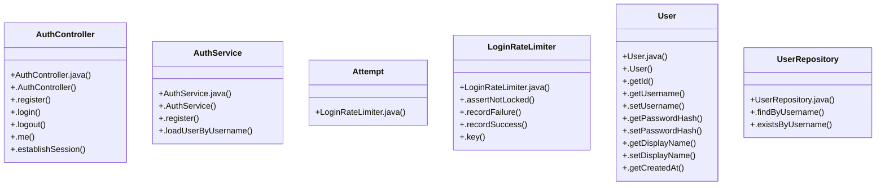

# Community 10

> 36 nodes · cohesion 0.07

## Key Concepts

- [User](file:///D:/block-chain-crypto-money-electronic-transaction-quantum/src/main/java/com/tekmachain/auth/User.java#L10) (11 connections)
- [AuthController](file:///D:/block-chain-crypto-money-electronic-transaction-quantum/src/main/java/com/tekmachain/auth/AuthController.java#L23) (7 connections)
- [.login()](file:///D:/block-chain-crypto-money-electronic-transaction-quantum/src/main/java/com/tekmachain/auth/AuthController.java#L55) (6 connections)
- [.me()](file:///D:/block-chain-crypto-money-electronic-transaction-quantum/src/main/java/com/tekmachain/auth/AuthController.java#L79) (5 connections)
- [.loadUserByUsername()](file:///D:/block-chain-crypto-money-electronic-transaction-quantum/src/main/java/com/tekmachain/auth/AuthService.java#L43) (5 connections)
- [LoginRateLimiter](file:///D:/block-chain-crypto-money-electronic-transaction-quantum/src/main/java/com/tekmachain/auth/LoginRateLimiter.java#L20) (5 connections)
- [.register()](file:///D:/block-chain-crypto-money-electronic-transaction-quantum/src/main/java/com/tekmachain/auth/AuthController.java#L47) (4 connections)
- [AuthService](file:///D:/block-chain-crypto-money-electronic-transaction-quantum/src/main/java/com/tekmachain/auth/AuthService.java#L15) (4 connections)
- [.assertNotLocked()](file:///D:/block-chain-crypto-money-electronic-transaction-quantum/src/main/java/com/tekmachain/auth/LoginRateLimiter.java#L37) (4 connections)
- [.key()](file:///D:/block-chain-crypto-money-electronic-transaction-quantum/src/main/java/com/tekmachain/auth/LoginRateLimiter.java#L61) (4 connections)
- [.recordSuccess()](file:///D:/block-chain-crypto-money-electronic-transaction-quantum/src/main/java/com/tekmachain/auth/LoginRateLimiter.java#L57) (4 connections)
- [.getUsername()](file:///D:/block-chain-crypto-money-electronic-transaction-quantum/src/main/java/com/tekmachain/auth/User.java#L42) (4 connections)
- [.findByUsername()](file:///D:/block-chain-crypto-money-electronic-transaction-quantum/src/main/java/com/tekmachain/auth/UserRepository.java#L8) (4 connections)
- [.establishSession()](file:///D:/block-chain-crypto-money-electronic-transaction-quantum/src/main/java/com/tekmachain/auth/AuthController.java#L91) (3 connections)
- [.register()](file:///D:/block-chain-crypto-money-electronic-transaction-quantum/src/main/java/com/tekmachain/auth/AuthService.java#L27) (3 connections)
- [.recordFailure()](file:///D:/block-chain-crypto-money-electronic-transaction-quantum/src/main/java/com/tekmachain/auth/LoginRateLimiter.java#L46) (3 connections)
- [UserRepository](file:///D:/block-chain-crypto-money-electronic-transaction-quantum/src/main/java/com/tekmachain/auth/UserRepository.java#L7) (3 connections)
- [.existsByUsername()](file:///D:/block-chain-crypto-money-electronic-transaction-quantum/src/main/java/com/tekmachain/auth/UserRepository.java#L10) (3 connections)
- [LoginRateLimiter.java](file:///D:/block-chain-crypto-money-electronic-transaction-quantum/src/main/java/com/tekmachain/auth/LoginRateLimiter.java#L1) (2 connections)
- [.getDisplayName()](file:///D:/block-chain-crypto-money-electronic-transaction-quantum/src/main/java/com/tekmachain/auth/User.java#L48) (2 connections)
- [.getPasswordHash()](file:///D:/block-chain-crypto-money-electronic-transaction-quantum/src/main/java/com/tekmachain/auth/User.java#L45) (2 connections)
- [.AuthController()](file:///D:/block-chain-crypto-money-electronic-transaction-quantum/src/main/java/com/tekmachain/auth/AuthController.java#L34) (1 connections)
- [.logout()](file:///D:/block-chain-crypto-money-electronic-transaction-quantum/src/main/java/com/tekmachain/auth/AuthController.java#L69) (1 connections)
- [.AuthService()](file:///D:/block-chain-crypto-money-electronic-transaction-quantum/src/main/java/com/tekmachain/auth/AuthService.java#L21) (1 connections)
- [AuthController.java](file:///D:/block-chain-crypto-money-electronic-transaction-quantum/src/main/java/com/tekmachain/auth/AuthController.java#L1) (1 connections)
- *... and 11 more nodes in this community*

## Class Diagram

## Relationships

- No strong cross-community connections detected

## Source Files

- [D:\block-chain-crypto-money-electronic-transaction-quantum\src\main\java\com\tekmachain\auth\AuthController.java](file:///D:/block-chain-crypto-money-electronic-transaction-quantum/src/main/java/com/tekmachain/auth/AuthController.java)
- [D:\block-chain-crypto-money-electronic-transaction-quantum\src\main\java\com\tekmachain\auth\AuthService.java](file:///D:/block-chain-crypto-money-electronic-transaction-quantum/src/main/java/com/tekmachain/auth/AuthService.java)
- [D:\block-chain-crypto-money-electronic-transaction-quantum\src\main\java\com\tekmachain\auth\LoginRateLimiter.java](file:///D:/block-chain-crypto-money-electronic-transaction-quantum/src/main/java/com/tekmachain/auth/LoginRateLimiter.java)
- [D:\block-chain-crypto-money-electronic-transaction-quantum\src\main\java\com\tekmachain\auth\User.java](file:///D:/block-chain-crypto-money-electronic-transaction-quantum/src/main/java/com/tekmachain/auth/User.java)
- [D:\block-chain-crypto-money-electronic-transaction-quantum\src\main\java\com\tekmachain\auth\UserRepository.java](file:///D:/block-chain-crypto-money-electronic-transaction-quantum/src/main/java/com/tekmachain/auth/UserRepository.java)

## Audit Trail

- EXTRACTED: 76 (74%)
- INFERRED: 27 (26%)
- AMBIGUOUS: 0 (0%)

---

*Part of the graphify knowledge wiki. See [[index]] to navigate.*