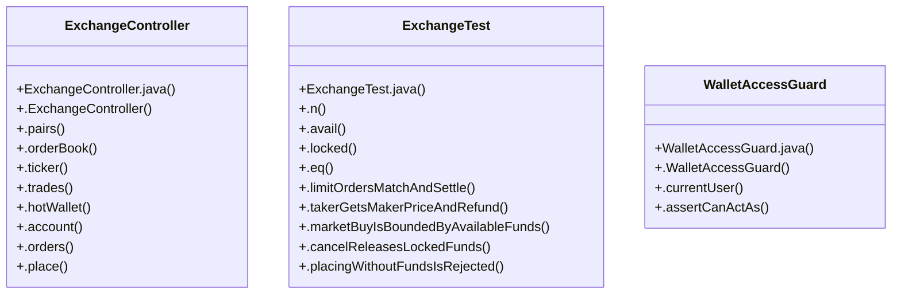

# Community 11

> 31 nodes · cohesion 0.14

## Key Concepts

- [ExchangeController](file:///D:/block-chain-crypto-money-electronic-transaction-quantum/src/main/java/com/tekmachain/exchange/web/ExchangeController.java#L22) (15 connections)
- [.assertCanActAs()](file:///D:/block-chain-crypto-money-electronic-transaction-quantum/src/main/java/com/tekmachain/auth/WalletAccessGuard.java#L33) (12 connections)
- [ExchangeTest](file:///D:/block-chain-crypto-money-electronic-transaction-quantum/src/test/java/com/tekmachain/ExchangeTest.java#L27) (11 connections)
- [.cancelReleasesLockedFunds()](file:///D:/block-chain-crypto-money-electronic-transaction-quantum/src/test/java/com/tekmachain/ExchangeTest.java#L100) (10 connections)
- [.depositAndWithdrawBridgeChainAndExchange()](file:///D:/block-chain-crypto-money-electronic-transaction-quantum/src/test/java/com/tekmachain/ExchangeTest.java#L118) (10 connections)
- [.limitOrdersMatchAndSettle()](file:///D:/block-chain-crypto-money-electronic-transaction-quantum/src/test/java/com/tekmachain/ExchangeTest.java#L47) (10 connections)
- [.place()](file:///D:/block-chain-crypto-money-electronic-transaction-quantum/src/main/java/com/tekmachain/exchange/web/ExchangeController.java#L99) (9 connections)
- [.marketBuyIsBoundedByAvailableFunds()](file:///D:/block-chain-crypto-money-electronic-transaction-quantum/src/test/java/com/tekmachain/ExchangeTest.java#L85) (8 connections)
- [.n()](file:///D:/block-chain-crypto-money-electronic-transaction-quantum/src/test/java/com/tekmachain/ExchangeTest.java#L40) (8 connections)
- [.takerGetsMakerPriceAndRefund()](file:///D:/block-chain-crypto-money-electronic-transaction-quantum/src/test/java/com/tekmachain/ExchangeTest.java#L70) (8 connections)
- [.getStatus()](file:///D:/block-chain-crypto-money-electronic-transaction-quantum/src/main/java/com/tekmachain/exchange/domain/Order.java#L99) (8 connections)
- [.avail()](file:///D:/block-chain-crypto-money-electronic-transaction-quantum/src/test/java/com/tekmachain/ExchangeTest.java#L41) (7 connections)
- [.eq()](file:///D:/block-chain-crypto-money-electronic-transaction-quantum/src/test/java/com/tekmachain/ExchangeTest.java#L43) (7 connections)
- [.locked()](file:///D:/block-chain-crypto-money-electronic-transaction-quantum/src/test/java/com/tekmachain/ExchangeTest.java#L42) (6 connections)
- [.cancel()](file:///D:/block-chain-crypto-money-electronic-transaction-quantum/src/main/java/com/tekmachain/exchange/web/ExchangeController.java#L108) (4 connections)
- [.hotWalletAddress()](file:///D:/block-chain-crypto-money-electronic-transaction-quantum/src/main/java/com/tekmachain/exchange/service/ExchangeService.java#L78) (4 connections)
- [WalletAccessGuard](file:///D:/block-chain-crypto-money-electronic-transaction-quantum/src/main/java/com/tekmachain/auth/WalletAccessGuard.java#L17) (4 connections)
- [.depositTek()](file:///D:/block-chain-crypto-money-electronic-transaction-quantum/src/main/java/com/tekmachain/exchange/web/ExchangeController.java#L116) (3 connections)
- [.orders()](file:///D:/block-chain-crypto-money-electronic-transaction-quantum/src/main/java/com/tekmachain/exchange/web/ExchangeController.java#L91) (3 connections)
- [.withdrawTek()](file:///D:/block-chain-crypto-money-electronic-transaction-quantum/src/main/java/com/tekmachain/exchange/web/ExchangeController.java#L122) (3 connections)
- [.placingWithoutFundsIsRejected()](file:///D:/block-chain-crypto-money-electronic-transaction-quantum/src/test/java/com/tekmachain/ExchangeTest.java#L112) (3 connections)
- [.currentUser()](file:///D:/block-chain-crypto-money-electronic-transaction-quantum/src/main/java/com/tekmachain/auth/WalletAccessGuard.java#L27) (3 connections)
- [.hotWallet()](file:///D:/block-chain-crypto-money-electronic-transaction-quantum/src/main/java/com/tekmachain/exchange/web/ExchangeController.java#L67) (2 connections)
- [.orderBook()](file:///D:/block-chain-crypto-money-electronic-transaction-quantum/src/main/java/com/tekmachain/exchange/web/ExchangeController.java#L52) (2 connections)
- [.findByAddressOrderByCreatedAtDesc()](file:///D:/block-chain-crypto-money-electronic-transaction-quantum/src/main/java/com/tekmachain/exchange/repo/OrderRepository.java#L22) (2 connections)
- *... and 6 more nodes in this community*

## Class Diagram

## Relationships

- No strong cross-community connections detected

## Source Files

- [D:\block-chain-crypto-money-electronic-transaction-quantum\src\main\java\com\tekmachain\auth\WalletAccessGuard.java](file:///D:/block-chain-crypto-money-electronic-transaction-quantum/src/main/java/com/tekmachain/auth/WalletAccessGuard.java)
- [D:\block-chain-crypto-money-electronic-transaction-quantum\src\main\java\com\tekmachain\exchange\domain\Order.java](file:///D:/block-chain-crypto-money-electronic-transaction-quantum/src/main/java/com/tekmachain/exchange/domain/Order.java)
- [D:\block-chain-crypto-money-electronic-transaction-quantum\src\main\java\com\tekmachain\exchange\repo\OrderRepository.java](file:///D:/block-chain-crypto-money-electronic-transaction-quantum/src/main/java/com/tekmachain/exchange/repo/OrderRepository.java)
- [D:\block-chain-crypto-money-electronic-transaction-quantum\src\main\java\com\tekmachain\exchange\service\ExchangeService.java](file:///D:/block-chain-crypto-money-electronic-transaction-quantum/src/main/java/com/tekmachain/exchange/service/ExchangeService.java)
- [D:\block-chain-crypto-money-electronic-transaction-quantum\src\main\java\com\tekmachain\exchange\web\ExchangeController.java](file:///D:/block-chain-crypto-money-electronic-transaction-quantum/src/main/java/com/tekmachain/exchange/web/ExchangeController.java)
- [D:\block-chain-crypto-money-electronic-transaction-quantum\src\test\java\com\tekmachain\ExchangeTest.java](file:///D:/block-chain-crypto-money-electronic-transaction-quantum/src/test/java/com/tekmachain/ExchangeTest.java)

## Audit Trail

- EXTRACTED: 100 (60%)
- INFERRED: 68 (40%)
- AMBIGUOUS: 0 (0%)

---

*Part of the graphify knowledge wiki. See [[index]] to navigate.*