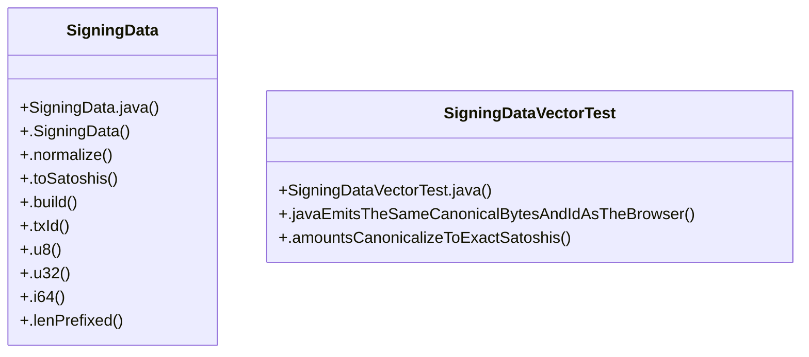

# Community 12

> 15 nodes · cohesion 0.22

## Key Concepts

- [SigningData](file:///D:/block-chain-crypto-money-electronic-transaction-quantum/src/main/java/com/tekmachain/crypto/SigningData.java#L32) (10 connections)
- [.build()](file:///D:/block-chain-crypto-money-electronic-transaction-quantum/src/main/java/com/tekmachain/crypto/SigningData.java#L58) (8 connections)
- [.txId()](file:///D:/block-chain-crypto-money-electronic-transaction-quantum/src/main/java/com/tekmachain/crypto/SigningData.java#L77) (7 connections)
- [.toSatoshis()](file:///D:/block-chain-crypto-money-electronic-transaction-quantum/src/main/java/com/tekmachain/crypto/SigningData.java#L53) (4 connections)
- [.javaEmitsTheSameCanonicalBytesAndIdAsTheBrowser()](file:///D:/block-chain-crypto-money-electronic-transaction-quantum/src/test/java/com/tekmachain/SigningDataVectorTest.java#L33) (4 connections)
- [.lenPrefixed()](file:///D:/block-chain-crypto-money-electronic-transaction-quantum/src/main/java/com/tekmachain/crypto/SigningData.java#L101) (3 connections)
- [.u32()](file:///D:/block-chain-crypto-money-electronic-transaction-quantum/src/main/java/com/tekmachain/crypto/SigningData.java#L88) (3 connections)
- [SigningDataVectorTest](file:///D:/block-chain-crypto-money-electronic-transaction-quantum/src/test/java/com/tekmachain/SigningDataVectorTest.java#L23) (3 connections)
- [.i64()](file:///D:/block-chain-crypto-money-electronic-transaction-quantum/src/main/java/com/tekmachain/crypto/SigningData.java#L95) (2 connections)
- [.normalize()](file:///D:/block-chain-crypto-money-electronic-transaction-quantum/src/main/java/com/tekmachain/crypto/SigningData.java#L48) (2 connections)
- [.u8()](file:///D:/block-chain-crypto-money-electronic-transaction-quantum/src/main/java/com/tekmachain/crypto/SigningData.java#L84) (2 connections)
- [.amountsCanonicalizeToExactSatoshis()](file:///D:/block-chain-crypto-money-electronic-transaction-quantum/src/test/java/com/tekmachain/SigningDataVectorTest.java#L49) (2 connections)
- [SigningData.java](file:///D:/block-chain-crypto-money-electronic-transaction-quantum/src/main/java/com/tekmachain/crypto/SigningData.java#L1) (1 connections)
- [SigningDataVectorTest.java](file:///D:/block-chain-crypto-money-electronic-transaction-quantum/src/test/java/com/tekmachain/SigningDataVectorTest.java#L1) (1 connections)
- [.SigningData()](file:///D:/block-chain-crypto-money-electronic-transaction-quantum/src/main/java/com/tekmachain/crypto/SigningData.java#L44) (1 connections)

## Class Diagram

## Relationships

- No strong cross-community connections detected

## Source Files

- [D:\block-chain-crypto-money-electronic-transaction-quantum\src\main\java\com\tekmachain\crypto\SigningData.java](file:///D:/block-chain-crypto-money-electronic-transaction-quantum/src/main/java/com/tekmachain/crypto/SigningData.java)
- [D:\block-chain-crypto-money-electronic-transaction-quantum\src\test\java\com\tekmachain\SigningDataVectorTest.java](file:///D:/block-chain-crypto-money-electronic-transaction-quantum/src/test/java/com/tekmachain/SigningDataVectorTest.java)

## Audit Trail

- EXTRACTED: 42 (79%)
- INFERRED: 11 (21%)
- AMBIGUOUS: 0 (0%)

---

*Part of the graphify knowledge wiki. See [[index]] to navigate.*