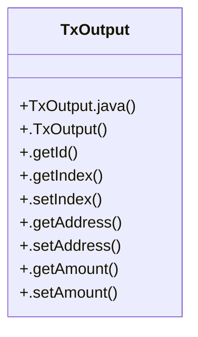

# Community 13

> 9 nodes · cohesion 0.22

## Key Concepts

- [TxOutput](file:///D:/block-chain-crypto-money-electronic-transaction-quantum/src/main/java/com/tekmachain/domain/TxOutput.java#L11) (9 connections)
- [TxOutput.java](file:///D:/block-chain-crypto-money-electronic-transaction-quantum/src/main/java/com/tekmachain/domain/TxOutput.java#L1) (1 connections)
- [.getAddress()](file:///D:/block-chain-crypto-money-electronic-transaction-quantum/src/main/java/com/tekmachain/domain/TxOutput.java#L43) (1 connections)
- [.getAmount()](file:///D:/block-chain-crypto-money-electronic-transaction-quantum/src/main/java/com/tekmachain/domain/TxOutput.java#L46) (1 connections)
- [.getId()](file:///D:/block-chain-crypto-money-electronic-transaction-quantum/src/main/java/com/tekmachain/domain/TxOutput.java#L38) (1 connections)
- [.setAddress()](file:///D:/block-chain-crypto-money-electronic-transaction-quantum/src/main/java/com/tekmachain/domain/TxOutput.java#L44) (1 connections)
- [.setAmount()](file:///D:/block-chain-crypto-money-electronic-transaction-quantum/src/main/java/com/tekmachain/domain/TxOutput.java#L47) (1 connections)
- [.setIndex()](file:///D:/block-chain-crypto-money-electronic-transaction-quantum/src/main/java/com/tekmachain/domain/TxOutput.java#L41) (1 connections)
- [.TxOutput()](file:///D:/block-chain-crypto-money-electronic-transaction-quantum/src/main/java/com/tekmachain/domain/TxOutput.java#L29) (1 connections)

## Class Diagram

## Relationships

- No strong cross-community connections detected

## Source Files

- [D:\block-chain-crypto-money-electronic-transaction-quantum\src\main\java\com\tekmachain\domain\TxOutput.java](file:///D:/block-chain-crypto-money-electronic-transaction-quantum/src/main/java/com/tekmachain/domain/TxOutput.java)

## Audit Trail

- EXTRACTED: 17 (100%)
- INFERRED: 0 (0%)
- AMBIGUOUS: 0 (0%)

---

*Part of the graphify knowledge wiki. See [[index]] to navigate.*