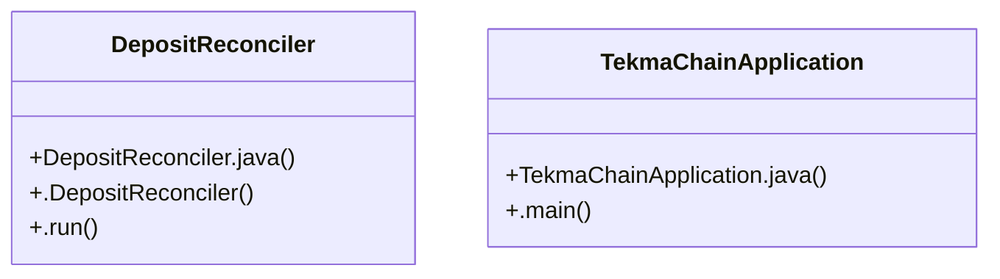

# Community 14

> 7 nodes · cohesion 0.29

## Key Concepts

- [DepositReconciler](file:///D:/block-chain-crypto-money-electronic-transaction-quantum/src/main/java/com/tekmachain/exchange/service/DepositReconciler.java#L14) (3 connections)
- [.run()](file:///D:/block-chain-crypto-money-electronic-transaction-quantum/src/main/java/com/tekmachain/exchange/service/DepositReconciler.java#L25) (3 connections)
- [TekmaChainApplication](file:///D:/block-chain-crypto-money-electronic-transaction-quantum/src/main/java/com/tekmachain/TekmaChainApplication.java#L14) (2 connections)
- [.main()](file:///D:/block-chain-crypto-money-electronic-transaction-quantum/src/main/java/com/tekmachain/TekmaChainApplication.java#L17) (2 connections)
- [DepositReconciler.java](file:///D:/block-chain-crypto-money-electronic-transaction-quantum/src/main/java/com/tekmachain/exchange/service/DepositReconciler.java#L1) (1 connections)
- [TekmaChainApplication.java](file:///D:/block-chain-crypto-money-electronic-transaction-quantum/src/main/java/com/tekmachain/TekmaChainApplication.java#L1) (1 connections)
- [.DepositReconciler()](file:///D:/block-chain-crypto-money-electronic-transaction-quantum/src/main/java/com/tekmachain/exchange/service/DepositReconciler.java#L21) (1 connections)

## Class Diagram

## Relationships

- No strong cross-community connections detected

## Source Files

- [D:\block-chain-crypto-money-electronic-transaction-quantum\src\main\java\com\tekmachain\TekmaChainApplication.java](file:///D:/block-chain-crypto-money-electronic-transaction-quantum/src/main/java/com/tekmachain/TekmaChainApplication.java)
- [D:\block-chain-crypto-money-electronic-transaction-quantum\src\main\java\com\tekmachain\exchange\service\DepositReconciler.java](file:///D:/block-chain-crypto-money-electronic-transaction-quantum/src/main/java/com/tekmachain/exchange/service/DepositReconciler.java)

## Audit Trail

- EXTRACTED: 10 (77%)
- INFERRED: 3 (23%)
- AMBIGUOUS: 0 (0%)

---

*Part of the graphify knowledge wiki. See [[index]] to navigate.*