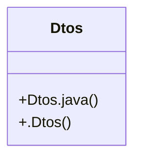

# Community 15

> 3 nodes · cohesion 0.67

## Key Concepts

- [Dtos](file:///D:/block-chain-crypto-money-electronic-transaction-quantum/src/main/java/com/tekmachain/web/dto/Dtos.java#L7) (2 connections)
- [Dtos.java](file:///D:/block-chain-crypto-money-electronic-transaction-quantum/src/main/java/com/tekmachain/web/dto/Dtos.java#L1) (1 connections)
- [.Dtos()](file:///D:/block-chain-crypto-money-electronic-transaction-quantum/src/main/java/com/tekmachain/web/dto/Dtos.java#L9) (1 connections)

## Class Diagram

## Relationships

- No strong cross-community connections detected

## Source Files

- [D:\block-chain-crypto-money-electronic-transaction-quantum\src\main\java\com\tekmachain\web\dto\Dtos.java](file:///D:/block-chain-crypto-money-electronic-transaction-quantum/src/main/java/com/tekmachain/web/dto/Dtos.java)

## Audit Trail

- EXTRACTED: 4 (100%)
- INFERRED: 0 (0%)
- AMBIGUOUS: 0 (0%)

---

*Part of the graphify knowledge wiki. See [[index]] to navigate.*