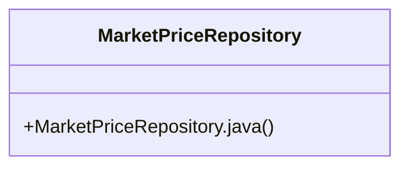

# Community 18

> 2 nodes · cohesion 1.00

## Key Concepts

- [MarketPriceRepository.java](file:///D:/block-chain-crypto-money-electronic-transaction-quantum/src/main/java/com/tekmachain/market/MarketPriceRepository.java#L1) (1 connections)
- [MarketPriceRepository](file:///D:/block-chain-crypto-money-electronic-transaction-quantum/src/main/java/com/tekmachain/market/MarketPriceRepository.java#L5) (1 connections)

## Class Diagram

## Relationships

- No strong cross-community connections detected

## Source Files

- [D:\block-chain-crypto-money-electronic-transaction-quantum\src\main\java\com\tekmachain\market\MarketPriceRepository.java](file:///D:/block-chain-crypto-money-electronic-transaction-quantum/src/main/java/com/tekmachain/market/MarketPriceRepository.java)

## Audit Trail

- EXTRACTED: 2 (100%)
- INFERRED: 0 (0%)
- AMBIGUOUS: 0 (0%)

---

*Part of the graphify knowledge wiki. See [[index]] to navigate.*