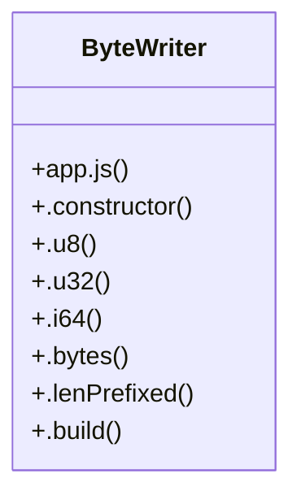

# Community 2

> 128 nodes · cohesion 0.05

## Key Concepts

- [app.js](file:///D:/block-chain-crypto-money-electronic-transaction-quantum/src/main/resources/static/app.js#L1) (83 connections)
- [$()](file:///D:/block-chain-crypto-money-electronic-transaction-quantum/src/main/resources/static/app.js#L16) (58 connections)
- [api()](file:///D:/block-chain-crypto-money-electronic-transaction-quantum/src/main/resources/static/app.js#L43) (39 connections)
- [exchange.js](file:///D:/block-chain-crypto-money-electronic-transaction-quantum/src/main/resources/static/exchange.js#L1) (24 connections)
- [toast()](file:///D:/block-chain-crypto-money-electronic-transaction-quantum/src/main/resources/static/app.js#L63) (21 connections)
- [loadWallets()](file:///D:/block-chain-crypto-money-electronic-transaction-quantum/src/main/resources/static/app.js#L450) (19 connections)
- [loadDashboard()](file:///D:/block-chain-crypto-money-electronic-transaction-quantum/src/main/resources/static/app.js#L175) (17 connections)
- [loadExchange()](file:///D:/block-chain-crypto-money-electronic-transaction-quantum/src/main/resources/static/exchange.js#L54) (17 connections)
- [loadProfile()](file:///D:/block-chain-crypto-money-electronic-transaction-quantum/src/main/resources/static/app.js#L299) (14 connections)
- [assistant.js](file:///D:/block-chain-crypto-money-electronic-transaction-quantum/src/main/resources/static/assistant.js#L1) (12 connections)
- [curSym()](file:///D:/block-chain-crypto-money-electronic-transaction-quantum/src/main/resources/static/app.js#L34) (11 connections)
- [price()](file:///D:/block-chain-crypto-money-electronic-transaction-quantum/src/main/resources/static/app.js#L59) (11 connections)
- [refreshView()](file:///D:/block-chain-crypto-money-electronic-transaction-quantum/src/main/resources/static/app.js#L105) (11 connections)
- [loadTicker()](file:///D:/block-chain-crypto-money-electronic-transaction-quantum/src/main/resources/static/exchange.js#L77) (10 connections)
- [.all()](file:///D:/block-chain-crypto-money-electronic-transaction-quantum/src/main/java/com/tekmachain/service/MempoolService.java#L73) (10 connections)
- [doMine()](file:///D:/block-chain-crypto-money-electronic-transaction-quantum/src/main/resources/static/app.js#L656) (9 connections)
- [fmt()](file:///D:/block-chain-crypto-money-electronic-transaction-quantum/src/main/resources/static/app.js#L51) (9 connections)
- [loadLiveMarkets()](file:///D:/block-chain-crypto-money-electronic-transaction-quantum/src/main/resources/static/app.js#L252) (9 connections)
- [buildSigningBytes()](file:///D:/block-chain-crypto-money-electronic-transaction-quantum/src/main/resources/static/app.js#L612) (8 connections)
- [ByteWriter](file:///D:/block-chain-crypto-money-electronic-transaction-quantum/src/main/resources/static/app.js#L597) (8 connections)
- [escapeHtml()](file:///D:/block-chain-crypto-money-electronic-transaction-quantum/src/main/resources/static/app.js#L61) (8 connections)
- [renderConverter()](file:///D:/block-chain-crypto-money-electronic-transaction-quantum/src/main/resources/static/app.js#L390) (8 connections)
- [showView()](file:///D:/block-chain-crypto-money-electronic-transaction-quantum/src/main/resources/static/app.js#L94) (8 connections)
- [validateChain()](file:///D:/block-chain-crypto-money-electronic-transaction-quantum/src/main/resources/static/app.js#L715) (8 connections)
- [askAssistant()](file:///D:/block-chain-crypto-money-electronic-transaction-quantum/src/main/resources/static/assistant.js#L41) (8 connections)
- *... and 103 more nodes in this community*

## Class Diagram

## Relationships

- No strong cross-community connections detected

## Source Files

- [D:\block-chain-crypto-money-electronic-transaction-quantum\src\main\java\com\tekmachain\service\MempoolService.java](file:///D:/block-chain-crypto-money-electronic-transaction-quantum/src/main/java/com/tekmachain/service/MempoolService.java)
- [D:\block-chain-crypto-money-electronic-transaction-quantum\src\main\resources\static\app.js](file:///D:/block-chain-crypto-money-electronic-transaction-quantum/src/main/resources/static/app.js)
- [D:\block-chain-crypto-money-electronic-transaction-quantum\src\main\resources\static\assistant.js](file:///D:/block-chain-crypto-money-electronic-transaction-quantum/src/main/resources/static/assistant.js)
- [D:\block-chain-crypto-money-electronic-transaction-quantum\src\main\resources\static\exchange.js](file:///D:/block-chain-crypto-money-electronic-transaction-quantum/src/main/resources/static/exchange.js)

## Audit Trail

- EXTRACTED: 676 (81%)
- INFERRED: 162 (19%)
- AMBIGUOUS: 0 (0%)

---

*Part of the graphify knowledge wiki. See [[index]] to navigate.*