# Community 3

> 90 nodes · cohesion 0.04

## Key Concepts

- [.contains()](file:///D:/block-chain-crypto-money-electronic-transaction-quantum/src/main/java/com/tekmachain/service/MempoolService.java#L44) (19 connections)
- [.size()](file:///D:/block-chain-crypto-money-electronic-transaction-quantum/src/main/java/com/tekmachain/service/MempoolService.java#L58) (18 connections)
- [.info()](file:///D:/block-chain-crypto-money-electronic-transaction-quantum/src/main/java/com/tekmachain/web/NodeController.java#L36) (17 connections)
- [.isBlank()](file:///D:/block-chain-crypto-money-electronic-transaction-quantum/src/main/java/com/tekmachain/profile/PaymentAccountService.java#L86) (15 connections)
- [.list()](file:///D:/block-chain-crypto-money-electronic-transaction-quantum/src/main/java/com/tekmachain/web/WalletController.java#L29) (14 connections)
- [.answer()](file:///D:/block-chain-crypto-money-electronic-transaction-quantum/src/main/java/com/tekmachain/assistant/AssistantService.java#L28) (13 connections)
- [.syncWithPeers()](file:///D:/block-chain-crypto-money-electronic-transaction-quantum/src/main/java/com/tekmachain/p2p/NetworkService.java#L131) (12 connections)
- [.discoverPeers()](file:///D:/block-chain-crypto-money-electronic-transaction-quantum/src/main/java/com/tekmachain/p2p/NetworkService.java#L115) (11 connections)
- [PeerRegistry](file:///D:/block-chain-crypto-money-electronic-transaction-quantum/src/main/java/com/tekmachain/p2p/PeerRegistry.java#L23) (11 connections)
- [NetworkService](file:///D:/block-chain-crypto-money-electronic-transaction-quantum/src/main/java/com/tekmachain/p2p/NetworkService.java#L25) (10 connections)
- [MempoolService](file:///D:/block-chain-crypto-money-electronic-transaction-quantum/src/main/java/com/tekmachain/service/MempoolService.java#L21) (9 connections)
- [.broadcastTransaction()](file:///D:/block-chain-crypto-money-electronic-transaction-quantum/src/main/java/com/tekmachain/p2p/NetworkService.java#L61) (8 connections)
- [NodeController](file:///D:/block-chain-crypto-money-electronic-transaction-quantum/src/main/java/com/tekmachain/web/NodeController.java#L19) (8 connections)
- [.normalize()](file:///D:/block-chain-crypto-money-electronic-transaction-quantum/src/main/java/com/tekmachain/p2p/PeerRegistry.java#L115) (8 connections)
- [KnowledgeBase](file:///D:/block-chain-crypto-money-electronic-transaction-quantum/src/main/java/com/tekmachain/assistant/KnowledgeBase.java#L21) (7 connections)
- [.receiveTransaction()](file:///D:/block-chain-crypto-money-electronic-transaction-quantum/src/main/java/com/tekmachain/p2p/NetworkService.java#L78) (7 connections)
- [.add()](file:///D:/block-chain-crypto-money-electronic-transaction-quantum/src/main/java/com/tekmachain/p2p/PeerRegistry.java#L66) (7 connections)
- [.evictsAfterRepeatedFailuresAndResetsOnSeen()](file:///D:/block-chain-crypto-money-electronic-transaction-quantum/src/test/java/com/tekmachain/PeerRegistryTest.java#L48) (7 connections)
- [AssistantService](file:///D:/block-chain-crypto-money-electronic-transaction-quantum/src/main/java/com/tekmachain/assistant/AssistantService.java#L13) (6 connections)
- [.load()](file:///D:/block-chain-crypto-money-electronic-transaction-quantum/src/main/java/com/tekmachain/assistant/KnowledgeBase.java#L42) (6 connections)
- [.parse()](file:///D:/block-chain-crypto-money-electronic-transaction-quantum/src/main/java/com/tekmachain/assistant/KnowledgeBase.java#L107) (6 connections)
- [.search()](file:///D:/block-chain-crypto-money-electronic-transaction-quantum/src/main/java/com/tekmachain/assistant/KnowledgeBase.java#L69) (6 connections)
- [.run()](file:///D:/block-chain-crypto-money-electronic-transaction-quantum/src/main/java/com/tekmachain/auth/OrphanWalletClaimer.java#L37) (6 connections)
- [.markFailed()](file:///D:/block-chain-crypto-money-electronic-transaction-quantum/src/main/java/com/tekmachain/p2p/PeerRegistry.java#L107) (6 connections)
- [.markSeen()](file:///D:/block-chain-crypto-money-electronic-transaction-quantum/src/main/java/com/tekmachain/p2p/PeerRegistry.java#L102) (6 connections)
- *... and 65 more nodes in this community*

## Class Diagram

```mermaid
classDiagram
    class AssistantController {
        +AssistantController.java()
        +.AssistantController()
        +.ask()
        +.examples()
    }
    class AssistantService {
        +AssistantService.java()
        +.AssistantService()
        +.answer()
        +.examples()
        +.fallback()
        +.actionLabel()
    }
    class AssistantTest {
        +AssistantTest.java()
        +.routesWalletQuestionToWalletGuidance()
        +.routesTradingQuestionToExchange()
        +.routesMiningAndQuantumQuestions()
        +.unknownQuestionFallsBackGracefully()
    }
    class KnowledgeBase {
        +KnowledgeBase.java()
        +.load()
        +.search()
        +.all()
        +.termFreq()
        +.tokenize()
        +.parse()
    }
    class MempoolService {
        +MempoolService.java()
        +.add()
        +.isReserved()
        +.contains()
        +.clearAll()
        +.snapshot()
        +.size()
        +.remove()
        +.all()
    }
    class NetworkController {
        +NetworkController.java()
        +.NetworkController()
        +.status()
        +.addPeer()
        +.sync()
    }
    class NetworkService {
        +NetworkService.java()
        +.NetworkService()
        +.broadcastTransaction()
        +.broadcastBlock()
        +.receiveTransaction()
        +.receiveBlock()
        +.discoverPeers()
        +.syncWithPeers()
        +.triggerSync()
        +.periodic()
    }
    class NodeController {
        +NodeController.java()
        +.NodeController()
        +.info()
        +.blocks()
        +.receiveBlock()
        +.receiveTransaction()
        +.peers()
        +.addPeer()
    }
    class OrphanWalletClaimer {
        +OrphanWalletClaimer.java()
        +.OrphanWalletClaimer()
        +.run()
    }
    class Pairs {
        +Pairs.java()
        +.Pairs()
        +.isSupported()
        +.quoteOf()
    }
    class PeerRegistry {
        +PeerRegistry.java()
        +.init()
        +.nodeId()
        +.selfUrl()
        +.add()
        +.remove()
        +.list()
        +.sample()
        +.markSeen()
        +.markFailed()
    }
    class PeerRegistryTest {
        +PeerRegistryTest.java()
        +.set()
        +.registry()
        +.capsPeersAndIgnoresSelf()
        +.gossipSampleIsBoundedSubset()
        +.evictsAfterRepeatedFailuresAndResetsOnSeen()
    }
```

## Relationships

- No strong cross-community connections detected

## Source Files

- [D:\block-chain-crypto-money-electronic-transaction-quantum\src\main\java\com\tekmachain\assistant\AssistantController.java](file:///D:/block-chain-crypto-money-electronic-transaction-quantum/src/main/java/com/tekmachain/assistant/AssistantController.java)
- [D:\block-chain-crypto-money-electronic-transaction-quantum\src\main\java\com\tekmachain\assistant\AssistantService.java](file:///D:/block-chain-crypto-money-electronic-transaction-quantum/src/main/java/com/tekmachain/assistant/AssistantService.java)
- [D:\block-chain-crypto-money-electronic-transaction-quantum\src\main\java\com\tekmachain\assistant\KnowledgeBase.java](file:///D:/block-chain-crypto-money-electronic-transaction-quantum/src/main/java/com/tekmachain/assistant/KnowledgeBase.java)
- [D:\block-chain-crypto-money-electronic-transaction-quantum\src\main\java\com\tekmachain\auth\OrphanWalletClaimer.java](file:///D:/block-chain-crypto-money-electronic-transaction-quantum/src/main/java/com/tekmachain/auth/OrphanWalletClaimer.java)
- [D:\block-chain-crypto-money-electronic-transaction-quantum\src\main\java\com\tekmachain\currency\CurrencyService.java](file:///D:/block-chain-crypto-money-electronic-transaction-quantum/src/main/java/com/tekmachain/currency/CurrencyService.java)
- [D:\block-chain-crypto-money-electronic-transaction-quantum\src\main\java\com\tekmachain\exchange\Pairs.java](file:///D:/block-chain-crypto-money-electronic-transaction-quantum/src/main/java/com/tekmachain/exchange/Pairs.java)
- [D:\block-chain-crypto-money-electronic-transaction-quantum\src\main\java\com\tekmachain\market\MarketDataFeedService.java](file:///D:/block-chain-crypto-money-electronic-transaction-quantum/src/main/java/com/tekmachain/market/MarketDataFeedService.java)
- [D:\block-chain-crypto-money-electronic-transaction-quantum\src\main\java\com\tekmachain\p2p\NetworkService.java](file:///D:/block-chain-crypto-money-electronic-transaction-quantum/src/main/java/com/tekmachain/p2p/NetworkService.java)
- [D:\block-chain-crypto-money-electronic-transaction-quantum\src\main\java\com\tekmachain\p2p\PeerRegistry.java](file:///D:/block-chain-crypto-money-electronic-transaction-quantum/src/main/java/com/tekmachain/p2p/PeerRegistry.java)
- [D:\block-chain-crypto-money-electronic-transaction-quantum\src\main\java\com\tekmachain\profile\PaymentAccountService.java](file:///D:/block-chain-crypto-money-electronic-transaction-quantum/src/main/java/com/tekmachain/profile/PaymentAccountService.java)
- [D:\block-chain-crypto-money-electronic-transaction-quantum\src\main\java\com\tekmachain\service\MempoolService.java](file:///D:/block-chain-crypto-money-electronic-transaction-quantum/src/main/java/com/tekmachain/service/MempoolService.java)
- [D:\block-chain-crypto-money-electronic-transaction-quantum\src\main\java\com\tekmachain\web\NetworkController.java](file:///D:/block-chain-crypto-money-electronic-transaction-quantum/src/main/java/com/tekmachain/web/NetworkController.java)
- [D:\block-chain-crypto-money-electronic-transaction-quantum\src\main\java\com\tekmachain\web\NodeController.java](file:///D:/block-chain-crypto-money-electronic-transaction-quantum/src/main/java/com/tekmachain/web/NodeController.java)
- [D:\block-chain-crypto-money-electronic-transaction-quantum\src\main\java\com\tekmachain\web\WalletController.java](file:///D:/block-chain-crypto-money-electronic-transaction-quantum/src/main/java/com/tekmachain/web/WalletController.java)
- [D:\block-chain-crypto-money-electronic-transaction-quantum\src\test\java\com\tekmachain\AssistantTest.java](file:///D:/block-chain-crypto-money-electronic-transaction-quantum/src/test/java/com/tekmachain/AssistantTest.java)
- [D:\block-chain-crypto-money-electronic-transaction-quantum\src\test\java\com\tekmachain\PeerRegistryTest.java](file:///D:/block-chain-crypto-money-electronic-transaction-quantum/src/test/java/com/tekmachain/PeerRegistryTest.java)

## Audit Trail

- EXTRACTED: 214 (51%)
- INFERRED: 203 (49%)
- AMBIGUOUS: 0 (0%)

---

*Part of the graphify knowledge wiki. See [[index]] to navigate.*