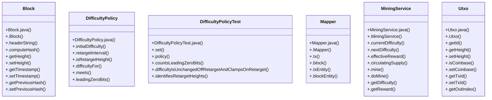

# Community 4

> 79 nodes · cohesion 0.06

## Key Concepts

- [.doTryAppend()](file:///D:/block-chain-crypto-money-electronic-transaction-quantum/src/main/java/com/tekmachain/service/ChainService.java#L82) (32 connections)
- [.doMine()](file:///D:/block-chain-crypto-money-electronic-transaction-quantum/src/main/java/com/tekmachain/service/MiningService.java#L82) (29 connections)
- [Block](file:///D:/block-chain-crypto-money-electronic-transaction-quantum/src/main/java/com/tekmachain/domain/Block.java#L14) (22 connections)
- [.initGenesis()](file:///D:/block-chain-crypto-money-electronic-transaction-quantum/src/main/java/com/tekmachain/service/BlockchainService.java#L38) (18 connections)
- [Utxo](file:///D:/block-chain-crypto-money-electronic-transaction-quantum/src/main/java/com/tekmachain/domain/Utxo.java#L13) (16 connections)
- [.validate()](file:///D:/block-chain-crypto-money-electronic-transaction-quantum/src/main/java/com/tekmachain/service/ChainValidator.java#L54) (15 connections)
- [.blockEntity()](file:///D:/block-chain-crypto-money-electronic-transaction-quantum/src/main/java/com/tekmachain/web/dto/Mapper.java#L70) (14 connections)
- [.getHeight()](file:///D:/block-chain-crypto-money-electronic-transaction-quantum/src/main/java/com/tekmachain/domain/Utxo.java#L59) (13 connections)
- [.validate()](file:///D:/block-chain-crypto-money-electronic-transaction-quantum/src/main/java/com/tekmachain/web/ChainController.java#L57) (12 connections)
- [.merkleRoot()](file:///D:/block-chain-crypto-money-electronic-transaction-quantum/src/main/java/com/tekmachain/crypto/CryptoUtil.java#L235) (12 connections)
- [.sha256Hex()](file:///D:/block-chain-crypto-money-electronic-transaction-quantum/src/main/java/com/tekmachain/crypto/CryptoUtil.java#L54) (12 connections)
- [.block()](file:///D:/block-chain-crypto-money-electronic-transaction-quantum/src/main/java/com/tekmachain/web/dto/Mapper.java#L32) (10 connections)
- [MiningService](file:///D:/block-chain-crypto-money-electronic-transaction-quantum/src/main/java/com/tekmachain/service/MiningService.java#L21) (10 connections)
- [.getDifficulty()](file:///D:/block-chain-crypto-money-electronic-transaction-quantum/src/main/java/com/tekmachain/service/MiningService.java#L149) (10 connections)
- [.expectedDifficulty()](file:///D:/block-chain-crypto-money-electronic-transaction-quantum/src/main/java/com/tekmachain/service/ChainValidator.java#L99) (9 connections)
- [.nextDifficulty()](file:///D:/block-chain-crypto-money-electronic-transaction-quantum/src/main/java/com/tekmachain/service/MiningService.java#L54) (9 connections)
- [.computeHash()](file:///D:/block-chain-crypto-money-electronic-transaction-quantum/src/main/java/com/tekmachain/domain/Block.java#L55) (7 connections)
- [.getHash()](file:///D:/block-chain-crypto-money-electronic-transaction-quantum/src/main/java/com/tekmachain/domain/Block.java#L80) (7 connections)
- [DifficultyPolicy](file:///D:/block-chain-crypto-money-electronic-transaction-quantum/src/main/java/com/tekmachain/service/DifficultyPolicy.java#L17) (7 connections)
- [.difficultyFor()](file:///D:/block-chain-crypto-money-electronic-transaction-quantum/src/main/java/com/tekmachain/service/DifficultyPolicy.java#L47) (7 connections)
- [.effectiveReward()](file:///D:/block-chain-crypto-money-electronic-transaction-quantum/src/main/java/com/tekmachain/service/MiningService.java#L65) (7 connections)
- [.setTimestamp()](file:///D:/block-chain-crypto-money-electronic-transaction-quantum/src/main/java/com/tekmachain/domain/Transaction.java#L70) (7 connections)
- [.getTransactions()](file:///D:/block-chain-crypto-money-electronic-transaction-quantum/src/main/java/com/tekmachain/domain/Block.java#L83) (6 connections)
- [.requireLastBlock()](file:///D:/block-chain-crypto-money-electronic-transaction-quantum/src/main/java/com/tekmachain/service/BlockchainService.java#L75) (6 connections)
- [.isRetargetHeight()](file:///D:/block-chain-crypto-money-electronic-transaction-quantum/src/main/java/com/tekmachain/service/DifficultyPolicy.java#L38) (6 connections)
- *... and 54 more nodes in this community*

## Class Diagram

## Relationships

- No strong cross-community connections detected

## Source Files

- [D:\block-chain-crypto-money-electronic-transaction-quantum\src\main\java\com\tekmachain\crypto\CryptoUtil.java](file:///D:/block-chain-crypto-money-electronic-transaction-quantum/src/main/java/com/tekmachain/crypto/CryptoUtil.java)
- [D:\block-chain-crypto-money-electronic-transaction-quantum\src\main\java\com\tekmachain\domain\Block.java](file:///D:/block-chain-crypto-money-electronic-transaction-quantum/src/main/java/com/tekmachain/domain/Block.java)
- [D:\block-chain-crypto-money-electronic-transaction-quantum\src\main\java\com\tekmachain\domain\Transaction.java](file:///D:/block-chain-crypto-money-electronic-transaction-quantum/src/main/java/com/tekmachain/domain/Transaction.java)
- [D:\block-chain-crypto-money-electronic-transaction-quantum\src\main\java\com\tekmachain\domain\Utxo.java](file:///D:/block-chain-crypto-money-electronic-transaction-quantum/src/main/java/com/tekmachain/domain/Utxo.java)
- [D:\block-chain-crypto-money-electronic-transaction-quantum\src\main\java\com\tekmachain\service\BlockchainService.java](file:///D:/block-chain-crypto-money-electronic-transaction-quantum/src/main/java/com/tekmachain/service/BlockchainService.java)
- [D:\block-chain-crypto-money-electronic-transaction-quantum\src\main\java\com\tekmachain\service\ChainService.java](file:///D:/block-chain-crypto-money-electronic-transaction-quantum/src/main/java/com/tekmachain/service/ChainService.java)
- [D:\block-chain-crypto-money-electronic-transaction-quantum\src\main\java\com\tekmachain\service\ChainValidator.java](file:///D:/block-chain-crypto-money-electronic-transaction-quantum/src/main/java/com/tekmachain/service/ChainValidator.java)
- [D:\block-chain-crypto-money-electronic-transaction-quantum\src\main\java\com\tekmachain\service\DifficultyPolicy.java](file:///D:/block-chain-crypto-money-electronic-transaction-quantum/src/main/java/com/tekmachain/service/DifficultyPolicy.java)
- [D:\block-chain-crypto-money-electronic-transaction-quantum\src\main\java\com\tekmachain\service\MiningService.java](file:///D:/block-chain-crypto-money-electronic-transaction-quantum/src/main/java/com/tekmachain/service/MiningService.java)
- [D:\block-chain-crypto-money-electronic-transaction-quantum\src\main\java\com\tekmachain\web\ChainController.java](file:///D:/block-chain-crypto-money-electronic-transaction-quantum/src/main/java/com/tekmachain/web/ChainController.java)
- [D:\block-chain-crypto-money-electronic-transaction-quantum\src\main\java\com\tekmachain\web\dto\Mapper.java](file:///D:/block-chain-crypto-money-electronic-transaction-quantum/src/main/java/com/tekmachain/web/dto/Mapper.java)
- [D:\block-chain-crypto-money-electronic-transaction-quantum\src\test\java\com\tekmachain\DifficultyPolicyTest.java](file:///D:/block-chain-crypto-money-electronic-transaction-quantum/src/test/java/com/tekmachain/DifficultyPolicyTest.java)

## Audit Trail

- EXTRACTED: 179 (40%)
- INFERRED: 267 (60%)
- AMBIGUOUS: 0 (0%)

---

*Part of the graphify knowledge wiki. See [[index]] to navigate.*