# Community 5

> 67 nodes · cohesion 0.05

## Key Concepts

- [.get()](file:///D:/block-chain-crypto-money-electronic-transaction-quantum/src/main/java/com/tekmachain/web/WalletController.java#L47) (44 connections)
- [.status()](file:///D:/block-chain-crypto-money-electronic-transaction-quantum/src/main/java/com/tekmachain/web/NetworkController.java#L34) (25 connections)
- [.build()](file:///D:/block-chain-crypto-money-electronic-transaction-quantum/src/main/resources/static/app.js#L610) (10 connections)
- [.applyUsdRates()](file:///D:/block-chain-crypto-money-electronic-transaction-quantum/src/main/java/com/tekmachain/currency/FxRateService.java#L73) (8 connections)
- [MarketDataFeedService](file:///D:/block-chain-crypto-money-electronic-transaction-quantum/src/main/java/com/tekmachain/market/MarketDataFeedService.java#L29) (8 connections)
- [NodeClient](file:///D:/block-chain-crypto-money-electronic-transaction-quantum/src/main/java/com/tekmachain/p2p/NodeClient.java#L18) (8 connections)
- [FxRateService](file:///D:/block-chain-crypto-money-electronic-transaction-quantum/src/main/java/com/tekmachain/currency/FxRateService.java#L23) (7 connections)
- [AuthTest](file:///D:/block-chain-crypto-money-electronic-transaction-quantum/src/test/java/com/tekmachain/AuthTest.java#L22) (6 connections)
- [.refresh()](file:///D:/block-chain-crypto-money-electronic-transaction-quantum/src/main/java/com/tekmachain/currency/FxRateService.java#L56) (6 connections)
- [.refresh()](file:///D:/block-chain-crypto-money-electronic-transaction-quantum/src/main/java/com/tekmachain/market/MarketDataFeedService.java#L92) (6 connections)
- [ProfileTest](file:///D:/block-chain-crypto-money-electronic-transaction-quantum/src/test/java/com/tekmachain/ProfileTest.java#L20) (6 connections)
- [.registerAlice()](file:///D:/block-chain-crypto-money-electronic-transaction-quantum/src/test/java/com/tekmachain/ProfileTest.java#L27) (6 connections)
- [.oneUserCannotActOnAnothersWallet()](file:///D:/block-chain-crypto-money-electronic-transaction-quantum/src/test/java/com/tekmachain/AuthorizationTest.java#L35) (5 connections)
- [.dematAccountCanBeLinkedAndRemoved()](file:///D:/block-chain-crypto-money-electronic-transaction-quantum/src/test/java/com/tekmachain/ProfileTest.java#L82) (5 connections)
- [.profileShowsAccountAndOwnedWallets()](file:///D:/block-chain-crypto-money-electronic-transaction-quantum/src/test/java/com/tekmachain/ProfileTest.java#L35) (5 connections)
- [ApiExceptionHandler](file:///D:/block-chain-crypto-money-electronic-transaction-quantum/src/main/java/com/tekmachain/web/ApiExceptionHandler.java#L11) (4 connections)
- [AuthorizationTest](file:///D:/block-chain-crypto-money-electronic-transaction-quantum/src/test/java/com/tekmachain/AuthorizationTest.java#L20) (4 connections)
- [.register()](file:///D:/block-chain-crypto-money-electronic-transaction-quantum/src/test/java/com/tekmachain/AuthorizationTest.java#L27) (4 connections)
- [.linkedBankAccountNumberIsMasked()](file:///D:/block-chain-crypto-money-electronic-transaction-quantum/src/test/java/com/tekmachain/ProfileTest.java#L49) (4 connections)
- [SecurityConfig](file:///D:/block-chain-crypto-money-electronic-transaction-quantum/src/main/java/com/tekmachain/auth/SecurityConfig.java#L27) (4 connections)
- [.filterChain()](file:///D:/block-chain-crypto-money-electronic-transaction-quantum/src/main/java/com/tekmachain/auth/SecurityConfig.java#L46) (4 connections)
- [.publicMarketDataStaysOpenButPersonalDataNeedsAuth()](file:///D:/block-chain-crypto-money-electronic-transaction-quantum/src/test/java/com/tekmachain/AuthorizationTest.java#L59) (3 connections)
- [.anonymousCannotUseProtectedEndpoints()](file:///D:/block-chain-crypto-money-electronic-transaction-quantum/src/test/java/com/tekmachain/AuthTest.java#L31) (3 connections)
- [.publicMarketDataIsBrowsableWithoutLogin()](file:///D:/block-chain-crypto-money-electronic-transaction-quantum/src/test/java/com/tekmachain/AuthTest.java#L91) (3 connections)
- [.registerOpensASessionAndScopesWalletsToTheUser()](file:///D:/block-chain-crypto-money-electronic-transaction-quantum/src/test/java/com/tekmachain/AuthTest.java#L38) (3 connections)
- *... and 42 more nodes in this community*

## Class Diagram

```mermaid
classDiagram
    class ApiExceptionHandler {
        +ApiExceptionHandler.java()
        +.badRequest()
        +.conflict()
        +.unauthorized()
    }
    class AuthorizationTest {
        +AuthorizationTest.java()
        +.register()
        +.oneUserCannotActOnAnothersWallet()
        +.publicMarketDataStaysOpenButPersonalDataNeedsAuth()
    }
    class AuthTest {
        +AuthTest.java()
        +.anonymousCannotUseProtectedEndpoints()
        +.registerOpensASessionAndScopesWalletsToTheUser()
        +.wrongPasswordIsRejected()
        +.duplicateUsernameIsRejected()
        +.publicMarketDataIsBrowsableWithoutLogin()
    }
    class FxRateService {
        +FxRateService.java()
        +.FxRateService()
        +.status()
        +.refresh()
        +.applyUsdRates()
        +.fetchUsdRates()
        +.scheduledRefresh()
    }
    class LoginRateLimitTest {
        +LoginRateLimitTest.java()
        +.lockoutAfterRepeatedFailures()
        +.healthEndpointIsPublic()
    }
    class MarketDataFeedService {
        +MarketDataFeedService.java()
        +.MarketDataFeedService()
        +.seed()
        +.status()
        +.refresh()
        +.applyUsdPrices()
        +.fetchUsdPrices()
        +.scheduledRefresh()
    }
    class NodeClient {
        +NodeClient.java()
        +.NodeClient()
        +.info()
        +.blocksFrom()
        +.sendBlock()
        +.sendTransaction()
        +.peers()
        +.register()
    }
    class PostQuantumTest {
        +PostQuantumTest.java()
        +.benchmarksClassicalAndPostQuantumSignatures()
    }
    class PqController {
        +PqController.java()
        +.PqController()
        +.benchmark()
    }
    class ProfileTest {
        +ProfileTest.java()
        +.registerAlice()
        +.profileShowsAccountAndOwnedWallets()
        +.linkedBankAccountNumberIsMasked()
        +.fiatDepositRequiresALinkedBankAccount()
        +.dematAccountCanBeLinkedAndRemoved()
    }
    class SecurityConfig {
        +SecurityConfig.java()
        +.securityContextRepository()
        +.authenticationManager()
        +.filterChain()
    }
```

## Relationships

- No strong cross-community connections detected

## Source Files

- [D:\block-chain-crypto-money-electronic-transaction-quantum\src\main\java\com\tekmachain\auth\SecurityConfig.java](file:///D:/block-chain-crypto-money-electronic-transaction-quantum/src/main/java/com/tekmachain/auth/SecurityConfig.java)
- [D:\block-chain-crypto-money-electronic-transaction-quantum\src\main\java\com\tekmachain\currency\FxRateService.java](file:///D:/block-chain-crypto-money-electronic-transaction-quantum/src/main/java/com/tekmachain/currency/FxRateService.java)
- [D:\block-chain-crypto-money-electronic-transaction-quantum\src\main\java\com\tekmachain\market\MarketDataFeedService.java](file:///D:/block-chain-crypto-money-electronic-transaction-quantum/src/main/java/com/tekmachain/market/MarketDataFeedService.java)
- [D:\block-chain-crypto-money-electronic-transaction-quantum\src\main\java\com\tekmachain\p2p\NodeClient.java](file:///D:/block-chain-crypto-money-electronic-transaction-quantum/src/main/java/com/tekmachain/p2p/NodeClient.java)
- [D:\block-chain-crypto-money-electronic-transaction-quantum\src\main\java\com\tekmachain\pq\PqController.java](file:///D:/block-chain-crypto-money-electronic-transaction-quantum/src/main/java/com/tekmachain/pq/PqController.java)
- [D:\block-chain-crypto-money-electronic-transaction-quantum\src\main\java\com\tekmachain\web\ApiExceptionHandler.java](file:///D:/block-chain-crypto-money-electronic-transaction-quantum/src/main/java/com/tekmachain/web/ApiExceptionHandler.java)
- [D:\block-chain-crypto-money-electronic-transaction-quantum\src\main\java\com\tekmachain\web\NetworkController.java](file:///D:/block-chain-crypto-money-electronic-transaction-quantum/src/main/java/com/tekmachain/web/NetworkController.java)
- [D:\block-chain-crypto-money-electronic-transaction-quantum\src\main\java\com\tekmachain\web\WalletController.java](file:///D:/block-chain-crypto-money-electronic-transaction-quantum/src/main/java/com/tekmachain/web/WalletController.java)
- [D:\block-chain-crypto-money-electronic-transaction-quantum\src\main\resources\static\app.js](file:///D:/block-chain-crypto-money-electronic-transaction-quantum/src/main/resources/static/app.js)
- [D:\block-chain-crypto-money-electronic-transaction-quantum\src\test\java\com\tekmachain\AuthTest.java](file:///D:/block-chain-crypto-money-electronic-transaction-quantum/src/test/java/com/tekmachain/AuthTest.java)
- [D:\block-chain-crypto-money-electronic-transaction-quantum\src\test\java\com\tekmachain\AuthorizationTest.java](file:///D:/block-chain-crypto-money-electronic-transaction-quantum/src/test/java/com/tekmachain/AuthorizationTest.java)
- [D:\block-chain-crypto-money-electronic-transaction-quantum\src\test\java\com\tekmachain\LoginRateLimitTest.java](file:///D:/block-chain-crypto-money-electronic-transaction-quantum/src/test/java/com/tekmachain/LoginRateLimitTest.java)
- [D:\block-chain-crypto-money-electronic-transaction-quantum\src\test\java\com\tekmachain\PostQuantumTest.java](file:///D:/block-chain-crypto-money-electronic-transaction-quantum/src/test/java/com/tekmachain/PostQuantumTest.java)
- [D:\block-chain-crypto-money-electronic-transaction-quantum\src\test\java\com\tekmachain\ProfileTest.java](file:///D:/block-chain-crypto-money-electronic-transaction-quantum/src/test/java/com/tekmachain/ProfileTest.java)

## Audit Trail

- EXTRACTED: 137 (51%)
- INFERRED: 130 (49%)
- AMBIGUOUS: 0 (0%)

---

*Part of the graphify knowledge wiki. See [[index]] to navigate.*