# Community 6

> 59 nodes · cohesion 0.08

## Key Concepts

- [CryptoUtil](file:///D:/block-chain-crypto-money-electronic-transaction-quantum/src/main/java/com/tekmachain/crypto/CryptoUtil.java#L27) (26 connections)
- [.buildClientTx()](file:///D:/block-chain-crypto-money-electronic-transaction-quantum/src/test/java/com/tekmachain/RawTransactionTest.java#L36) (15 connections)
- [.createHybrid()](file:///D:/block-chain-crypto-money-electronic-transaction-quantum/src/main/java/com/tekmachain/service/WalletService.java#L54) (12 connections)
- [.addressFromKeys()](file:///D:/block-chain-crypto-money-electronic-transaction-quantum/src/main/java/com/tekmachain/crypto/CryptoUtil.java#L155) (11 connections)
- [.verify()](file:///D:/block-chain-crypto-money-electronic-transaction-quantum/src/main/java/com/tekmachain/crypto/CryptoUtil.java#L130) (11 connections)
- [.addressFromPublicKeyHex()](file:///D:/block-chain-crypto-money-electronic-transaction-quantum/src/main/java/com/tekmachain/crypto/CryptoUtil.java#L145) (10 connections)
- [.generateKeyPair()](file:///D:/block-chain-crypto-money-electronic-transaction-quantum/src/main/java/com/tekmachain/crypto/CryptoUtil.java#L79) (10 connections)
- [.toHex()](file:///D:/block-chain-crypto-money-electronic-transaction-quantum/src/main/java/com/tekmachain/crypto/CryptoUtil.java#L257) (10 connections)
- [.nodeAcceptsAClientBuiltSignedTransaction()](file:///D:/block-chain-crypto-money-electronic-transaction-quantum/src/test/java/com/tekmachain/RawTransactionTest.java#L58) (10 connections)
- [.encodePublicKey()](file:///D:/block-chain-crypto-money-electronic-transaction-quantum/src/main/java/com/tekmachain/crypto/CryptoUtil.java#L93) (9 connections)
- [.sealsKeysAndSignsWithoutExposingThem()](file:///D:/block-chain-crypto-money-electronic-transaction-quantum/src/test/java/com/tekmachain/KeyVaultTest.java#L20) (9 connections)
- [.fromHex()](file:///D:/block-chain-crypto-money-electronic-transaction-quantum/src/main/java/com/tekmachain/crypto/CryptoUtil.java#L266) (8 connections)
- [.browserGeneratedKeyAndSignatureInteroperateWithTheNode()](file:///D:/block-chain-crypto-money-electronic-transaction-quantum/src/test/java/com/tekmachain/ClientCryptoVectorTest.java#L36) (7 connections)
- [.sign()](file:///D:/block-chain-crypto-money-electronic-transaction-quantum/src/main/java/com/tekmachain/crypto/CryptoUtil.java#L119) (7 connections)
- [KeyVault](file:///D:/block-chain-crypto-money-electronic-transaction-quantum/src/main/java/com/tekmachain/custody/KeyVault.java#L26) (7 connections)
- [.signEcdsa()](file:///D:/block-chain-crypto-money-electronic-transaction-quantum/src/main/java/com/tekmachain/custody/KeyVault.java#L98) (7 connections)
- [.bench()](file:///D:/block-chain-crypto-money-electronic-transaction-quantum/src/main/java/com/tekmachain/pq/PostQuantumService.java#L77) (7 connections)
- [.create()](file:///D:/block-chain-crypto-money-electronic-transaction-quantum/src/main/java/com/tekmachain/service/WalletService.java#L42) (7 connections)
- [.encodePrivateKey()](file:///D:/block-chain-crypto-money-electronic-transaction-quantum/src/main/java/com/tekmachain/crypto/CryptoUtil.java#L89) (6 connections)
- [.sha256()](file:///D:/block-chain-crypto-money-electronic-transaction-quantum/src/main/java/com/tekmachain/crypto/CryptoUtil.java#L50) (6 connections)
- [.acceptsLegacyPlaintextKeysForBackwardCompatibility()](file:///D:/block-chain-crypto-money-electronic-transaction-quantum/src/test/java/com/tekmachain/KeyVaultTest.java#L39) (6 connections)
- [PostQuantumService](file:///D:/block-chain-crypto-money-electronic-transaction-quantum/src/main/java/com/tekmachain/pq/PostQuantumService.java#L31) (6 connections)
- [.addressFromHash160()](file:///D:/block-chain-crypto-money-electronic-transaction-quantum/src/main/java/com/tekmachain/crypto/CryptoUtil.java#L163) (5 connections)
- [.verifyDilithium()](file:///D:/block-chain-crypto-money-electronic-transaction-quantum/src/main/java/com/tekmachain/crypto/CryptoUtil.java#L217) (5 connections)
- [.signAndVerifyRoundTrip()](file:///D:/block-chain-crypto-money-electronic-transaction-quantum/src/test/java/com/tekmachain/crypto/CryptoUtilTest.java#L14) (5 connections)
- *... and 34 more nodes in this community*

## Class Diagram

```mermaid
classDiagram
    class ClientCryptoVectorTest {
        +ClientCryptoVectorTest.java()
        +.browserGeneratedKeyAndSignatureInteroperateWithTheNode()
    }
    class CryptoUtil {
        +CryptoUtil.java()
        +.CryptoUtil()
        +.sha256()
        +.sha256Hex()
        +.ripemd160()
        +.digest()
        +.generateKeyPair()
        +.encodePrivateKey()
        +.encodePublicKey()
        +.privateKeyFromHex()
    }
    class CryptoUtilTest {
        +CryptoUtilTest.java()
        +.signAndVerifyRoundTrip()
        +.addressIsDeterministicAndUnique()
        +.merkleRootIsStableAndSensitive()
    }
    class KeyVault {
        +KeyVault.java()
        +.init()
        +.seal()
        +.unseal()
        +.signEcdsa()
        +.signDilithium()
        +.isSealed()
    }
    class KeyVaultTest {
        +KeyVaultTest.java()
        +.sealsKeysAndSignsWithoutExposingThem()
        +.acceptsLegacyPlaintextKeysForBackwardCompatibility()
    }
    class PostQuantumService {
        +PostQuantumService.java()
        +.benchmark()
        +.add()
        +.bench()
        +.msPer()
        +.round()
    }
    class RawTransactionTest {
        +RawTransactionTest.java()
        +.buildClientTx()
        +.nodeAcceptsAClientBuiltSignedTransaction()
    }
```

## Relationships

- No strong cross-community connections detected

## Source Files

- [D:\block-chain-crypto-money-electronic-transaction-quantum\src\main\java\com\tekmachain\crypto\CryptoUtil.java](file:///D:/block-chain-crypto-money-electronic-transaction-quantum/src/main/java/com/tekmachain/crypto/CryptoUtil.java)
- [D:\block-chain-crypto-money-electronic-transaction-quantum\src\main\java\com\tekmachain\custody\KeyVault.java](file:///D:/block-chain-crypto-money-electronic-transaction-quantum/src/main/java/com/tekmachain/custody/KeyVault.java)
- [D:\block-chain-crypto-money-electronic-transaction-quantum\src\main\java\com\tekmachain\exchange\domain\PendingDeposit.java](file:///D:/block-chain-crypto-money-electronic-transaction-quantum/src/main/java/com/tekmachain/exchange/domain/PendingDeposit.java)
- [D:\block-chain-crypto-money-electronic-transaction-quantum\src\main\java\com\tekmachain\pq\PostQuantumService.java](file:///D:/block-chain-crypto-money-electronic-transaction-quantum/src/main/java/com/tekmachain/pq/PostQuantumService.java)
- [D:\block-chain-crypto-money-electronic-transaction-quantum\src\main\java\com\tekmachain\service\WalletService.java](file:///D:/block-chain-crypto-money-electronic-transaction-quantum/src/main/java/com/tekmachain/service/WalletService.java)
- [D:\block-chain-crypto-money-electronic-transaction-quantum\src\test\java\com\tekmachain\ClientCryptoVectorTest.java](file:///D:/block-chain-crypto-money-electronic-transaction-quantum/src/test/java/com/tekmachain/ClientCryptoVectorTest.java)
- [D:\block-chain-crypto-money-electronic-transaction-quantum\src\test\java\com\tekmachain\KeyVaultTest.java](file:///D:/block-chain-crypto-money-electronic-transaction-quantum/src/test/java/com/tekmachain/KeyVaultTest.java)
- [D:\block-chain-crypto-money-electronic-transaction-quantum\src\test\java\com\tekmachain\RawTransactionTest.java](file:///D:/block-chain-crypto-money-electronic-transaction-quantum/src/test/java/com/tekmachain/RawTransactionTest.java)
- [D:\block-chain-crypto-money-electronic-transaction-quantum\src\test\java\com\tekmachain\crypto\CryptoUtilTest.java](file:///D:/block-chain-crypto-money-electronic-transaction-quantum/src/test/java/com/tekmachain/crypto/CryptoUtilTest.java)

## Audit Trail

- EXTRACTED: 181 (58%)
- INFERRED: 131 (42%)
- AMBIGUOUS: 0 (0%)

---

*Part of the graphify knowledge wiki. See [[index]] to navigate.*