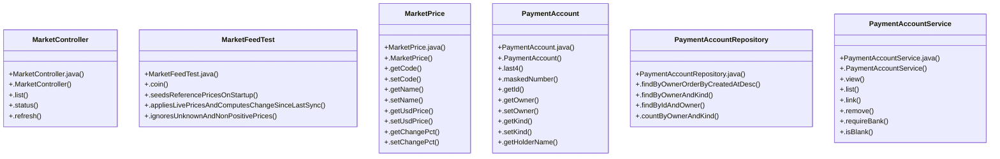

# Community 7

> 59 nodes · cohesion 0.05

## Key Concepts

- [PaymentAccount](file:///D:/block-chain-crypto-money-electronic-transaction-quantum/src/main/java/com/tekmachain/profile/PaymentAccount.java#L14) (19 connections)
- [MarketPrice](file:///D:/block-chain-crypto-money-electronic-transaction-quantum/src/main/java/com/tekmachain/market/MarketPrice.java#L14) (12 connections)
- [.applyUsdPrices()](file:///D:/block-chain-crypto-money-electronic-transaction-quantum/src/main/java/com/tekmachain/market/MarketDataFeedService.java#L112) (11 connections)
- [.view()](file:///D:/block-chain-crypto-money-electronic-transaction-quantum/src/main/java/com/tekmachain/profile/PaymentAccountService.java#L26) (9 connections)
- [PaymentAccountService](file:///D:/block-chain-crypto-money-electronic-transaction-quantum/src/main/java/com/tekmachain/profile/PaymentAccountService.java#L12) (8 connections)
- [.findAll()](file:///D:/block-chain-crypto-money-electronic-transaction-quantum/src/main/java/com/tekmachain/service/WalletService.java#L69) (8 connections)
- [.requireBank()](file:///D:/block-chain-crypto-money-electronic-transaction-quantum/src/main/java/com/tekmachain/profile/PaymentAccountService.java#L72) (7 connections)
- [.currentUser()](file:///D:/block-chain-crypto-money-electronic-transaction-quantum/src/main/java/com/tekmachain/web/WalletController.java#L24) (7 connections)
- [.depositFiat()](file:///D:/block-chain-crypto-money-electronic-transaction-quantum/src/main/java/com/tekmachain/exchange/web/ExchangeController.java#L128) (6 connections)
- [.withdrawFiat()](file:///D:/block-chain-crypto-money-electronic-transaction-quantum/src/main/java/com/tekmachain/exchange/web/ExchangeController.java#L136) (6 connections)
- [.getName()](file:///D:/block-chain-crypto-money-electronic-transaction-quantum/src/main/java/com/tekmachain/market/MarketPrice.java#L48) (6 connections)
- [MarketController](file:///D:/block-chain-crypto-money-electronic-transaction-quantum/src/main/java/com/tekmachain/market/MarketController.java#L12) (5 connections)
- [MarketFeedTest](file:///D:/block-chain-crypto-money-electronic-transaction-quantum/src/test/java/com/tekmachain/MarketFeedTest.java#L21) (5 connections)
- [.appliesLivePricesAndComputesChangeSinceLastSync()](file:///D:/block-chain-crypto-money-electronic-transaction-quantum/src/test/java/com/tekmachain/MarketFeedTest.java#L38) (5 connections)
- [PaymentAccountRepository](file:///D:/block-chain-crypto-money-electronic-transaction-quantum/src/main/java/com/tekmachain/profile/PaymentAccountRepository.java#L8) (5 connections)
- [.link()](file:///D:/block-chain-crypto-money-electronic-transaction-quantum/src/main/java/com/tekmachain/profile/PaymentAccountService.java#L36) (5 connections)
- [.seedsReferencePricesOnStartup()](file:///D:/block-chain-crypto-money-electronic-transaction-quantum/src/test/java/com/tekmachain/MarketFeedTest.java#L32) (4 connections)
- [.getUsdPrice()](file:///D:/block-chain-crypto-money-electronic-transaction-quantum/src/main/java/com/tekmachain/market/MarketPrice.java#L51) (4 connections)
- [.getCode()](file:///D:/block-chain-crypto-money-electronic-transaction-quantum/src/main/java/com/tekmachain/profile/PaymentAccount.java#L96) (4 connections)
- [.getInstitution()](file:///D:/block-chain-crypto-money-electronic-transaction-quantum/src/main/java/com/tekmachain/profile/PaymentAccount.java#L90) (4 connections)
- [.maskedNumber()](file:///D:/block-chain-crypto-money-electronic-transaction-quantum/src/main/java/com/tekmachain/profile/PaymentAccount.java#L75) (4 connections)
- [.list()](file:///D:/block-chain-crypto-money-electronic-transaction-quantum/src/main/java/com/tekmachain/market/MarketController.java#L24) (3 connections)
- [.coin()](file:///D:/block-chain-crypto-money-electronic-transaction-quantum/src/test/java/com/tekmachain/MarketFeedTest.java#L28) (3 connections)
- [.getKind()](file:///D:/block-chain-crypto-money-electronic-transaction-quantum/src/main/java/com/tekmachain/profile/PaymentAccount.java#L84) (3 connections)
- [.setCreatedAt()](file:///D:/block-chain-crypto-money-electronic-transaction-quantum/src/main/java/com/tekmachain/profile/PaymentAccount.java#L100) (3 connections)
- *... and 34 more nodes in this community*

## Class Diagram

## Relationships

- No strong cross-community connections detected

## Source Files

- [D:\block-chain-crypto-money-electronic-transaction-quantum\src\main\java\com\tekmachain\exchange\web\ExchangeController.java](file:///D:/block-chain-crypto-money-electronic-transaction-quantum/src/main/java/com/tekmachain/exchange/web/ExchangeController.java)
- [D:\block-chain-crypto-money-electronic-transaction-quantum\src\main\java\com\tekmachain\market\MarketController.java](file:///D:/block-chain-crypto-money-electronic-transaction-quantum/src/main/java/com/tekmachain/market/MarketController.java)
- [D:\block-chain-crypto-money-electronic-transaction-quantum\src\main\java\com\tekmachain\market\MarketDataFeedService.java](file:///D:/block-chain-crypto-money-electronic-transaction-quantum/src/main/java/com/tekmachain/market/MarketDataFeedService.java)
- [D:\block-chain-crypto-money-electronic-transaction-quantum\src\main\java\com\tekmachain\market\MarketPrice.java](file:///D:/block-chain-crypto-money-electronic-transaction-quantum/src/main/java/com/tekmachain/market/MarketPrice.java)
- [D:\block-chain-crypto-money-electronic-transaction-quantum\src\main\java\com\tekmachain\profile\PaymentAccount.java](file:///D:/block-chain-crypto-money-electronic-transaction-quantum/src/main/java/com/tekmachain/profile/PaymentAccount.java)
- [D:\block-chain-crypto-money-electronic-transaction-quantum\src\main\java\com\tekmachain\profile\PaymentAccountRepository.java](file:///D:/block-chain-crypto-money-electronic-transaction-quantum/src/main/java/com/tekmachain/profile/PaymentAccountRepository.java)
- [D:\block-chain-crypto-money-electronic-transaction-quantum\src\main\java\com\tekmachain\profile\PaymentAccountService.java](file:///D:/block-chain-crypto-money-electronic-transaction-quantum/src/main/java/com/tekmachain/profile/PaymentAccountService.java)
- [D:\block-chain-crypto-money-electronic-transaction-quantum\src\main\java\com\tekmachain\service\WalletService.java](file:///D:/block-chain-crypto-money-electronic-transaction-quantum/src/main/java/com/tekmachain/service/WalletService.java)
- [D:\block-chain-crypto-money-electronic-transaction-quantum\src\main\java\com\tekmachain\web\WalletController.java](file:///D:/block-chain-crypto-money-electronic-transaction-quantum/src/main/java/com/tekmachain/web/WalletController.java)
- [D:\block-chain-crypto-money-electronic-transaction-quantum\src\test\java\com\tekmachain\MarketFeedTest.java](file:///D:/block-chain-crypto-money-electronic-transaction-quantum/src/test/java/com/tekmachain/MarketFeedTest.java)

## Audit Trail

- EXTRACTED: 122 (59%)
- INFERRED: 84 (41%)
- AMBIGUOUS: 0 (0%)

---

*Part of the graphify knowledge wiki. See [[index]] to navigate.*