# Community 8

> 50 nodes · cohesion 0.07

## Key Concepts

- [.height()](file:///D:/block-chain-crypto-money-electronic-transaction-quantum/src/main/java/com/tekmachain/service/BlockchainService.java#L86) (17 connections)
- [.freshNodeAdoptsLongerChainAndRebuildsUtxoSet()](file:///D:/block-chain-crypto-money-electronic-transaction-quantum/src/test/java/com/tekmachain/P2PConsensusTest.java#L80) (10 connections)
- [.nodeAcceptsGossipedBlocksOneByOne()](file:///D:/block-chain-crypto-money-electronic-transaction-quantum/src/test/java/com/tekmachain/P2PConsensusTest.java#L107) (10 connections)
- [BlockchainService](file:///D:/block-chain-crypto-money-electronic-transaction-quantum/src/main/java/com/tekmachain/service/BlockchainService.java#L20) (9 connections)
- [.info()](file:///D:/block-chain-crypto-money-electronic-transaction-quantum/src/main/java/com/tekmachain/web/ChainController.java#L62) (9 connections)
- [.buildReferenceChain()](file:///D:/block-chain-crypto-money-electronic-transaction-quantum/src/test/java/com/tekmachain/P2PConsensusTest.java#L44) (9 connections)
- [.validatorAcceptsGoodChainAndRejectsTampering()](file:///D:/block-chain-crypto-money-electronic-transaction-quantum/src/test/java/com/tekmachain/P2PConsensusTest.java#L60) (9 connections)
- [.chain()](file:///D:/block-chain-crypto-money-electronic-transaction-quantum/src/main/java/com/tekmachain/service/BlockchainService.java#L65) (8 connections)
- [ChainController](file:///D:/block-chain-crypto-money-electronic-transaction-quantum/src/main/java/com/tekmachain/web/ChainController.java#L17) (7 connections)
- [ChainService](file:///D:/block-chain-crypto-money-electronic-transaction-quantum/src/main/java/com/tekmachain/service/ChainService.java#L24) (7 connections)
- [.doReplaceChain()](file:///D:/block-chain-crypto-money-electronic-transaction-quantum/src/main/java/com/tekmachain/service/ChainService.java#L167) (7 connections)
- [Economics](file:///D:/block-chain-crypto-money-electronic-transaction-quantum/src/main/java/com/tekmachain/service/Economics.java#L15) (7 connections)
- [EconomicsTest](file:///D:/block-chain-crypto-money-electronic-transaction-quantum/src/test/java/com/tekmachain/EconomicsTest.java#L12) (7 connections)
- [P2PConsensusTest](file:///D:/block-chain-crypto-money-electronic-transaction-quantum/src/test/java/com/tekmachain/P2PConsensusTest.java#L26) (7 connections)
- [.economics()](file:///D:/block-chain-crypto-money-electronic-transaction-quantum/src/test/java/com/tekmachain/EconomicsTest.java#L20) (5 connections)
- [.resetToGenesisOnly()](file:///D:/block-chain-crypto-money-electronic-transaction-quantum/src/test/java/com/tekmachain/P2PConsensusTest.java#L52) (5 connections)
- [.tek()](file:///D:/block-chain-crypto-money-electronic-transaction-quantum/src/test/java/com/tekmachain/P2PConsensusTest.java#L39) (5 connections)
- [.lastBlock()](file:///D:/block-chain-crypto-money-electronic-transaction-quantum/src/main/java/com/tekmachain/service/BlockchainService.java#L70) (4 connections)
- [BlockRepository](file:///D:/block-chain-crypto-money-electronic-transaction-quantum/src/main/java/com/tekmachain/repo/BlockRepository.java#L9) (4 connections)
- [.replaceChain()](file:///D:/block-chain-crypto-money-electronic-transaction-quantum/src/main/java/com/tekmachain/service/ChainService.java#L160) (4 connections)
- [.tryAppendExternalBlock()](file:///D:/block-chain-crypto-money-electronic-transaction-quantum/src/main/java/com/tekmachain/service/ChainService.java#L75) (4 connections)
- [.rewardHalvesEveryInterval()](file:///D:/block-chain-crypto-money-electronic-transaction-quantum/src/test/java/com/tekmachain/EconomicsTest.java#L32) (4 connections)
- [.supplyCapClampsTheReward()](file:///D:/block-chain-crypto-money-electronic-transaction-quantum/src/test/java/com/tekmachain/EconomicsTest.java#L42) (4 connections)
- [.validateChain()](file:///D:/block-chain-crypto-money-electronic-transaction-quantum/src/main/java/com/tekmachain/service/BlockchainService.java#L97) (3 connections)
- [.block()](file:///D:/block-chain-crypto-money-electronic-transaction-quantum/src/main/java/com/tekmachain/web/ChainController.java#L52) (3 connections)
- *... and 25 more nodes in this community*

## Class Diagram

```mermaid
classDiagram
    class BlockchainService {
        +BlockchainService.java()
        +.BlockchainService()
        +.initGenesis()
        +.chain()
        +.lastBlock()
        +.requireLastBlock()
        +.requireBlock()
        +.height()
        +.validateChain()
    }
    class BlockRepository {
        +BlockRepository.java()
        +.findTopByOrderByHeightDesc()
        +.findAllByOrderByHeightAsc()
        +.findAllByOrderByHeightDesc()
    }
    class ChainController {
        +ChainController.java()
        +.ChainController()
        +.mine()
        +.blocks()
        +.block()
        +.validate()
        +.info()
    }
    class ChainService {
        +ChainService.java()
        +.ChainService()
        +.applyBlockToLedger()
        +.tryAppendExternalBlock()
        +.doTryAppend()
        +.replaceChain()
        +.doReplaceChain()
    }
    class Economics {
        +Economics.java()
        +.rewardForHeight()
        +.effectiveReward()
        +.blocksUntilHalving()
        +.initialReward()
        +.halvingInterval()
        +.maxSupply()
    }
    class EconomicsTest {
        +EconomicsTest.java()
        +.set()
        +.economics()
        +.eq()
        +.rewardHalvesEveryInterval()
        +.supplyCapClampsTheReward()
        +.countsBlocksUntilNextHalving()
    }
    class P2PConsensusTest {
        +P2PConsensusTest.java()
        +.tek()
        +.buildReferenceChain()
        +.resetToGenesisOnly()
        +.validatorAcceptsGoodChainAndRejectsTampering()
        +.freshNodeAdoptsLongerChainAndRebuildsUtxoSet()
        +.nodeAcceptsGossipedBlocksOneByOne()
    }
```

## Relationships

- No strong cross-community connections detected

## Source Files

- [D:\block-chain-crypto-money-electronic-transaction-quantum\src\main\java\com\tekmachain\repo\BlockRepository.java](file:///D:/block-chain-crypto-money-electronic-transaction-quantum/src/main/java/com/tekmachain/repo/BlockRepository.java)
- [D:\block-chain-crypto-money-electronic-transaction-quantum\src\main\java\com\tekmachain\service\BlockchainService.java](file:///D:/block-chain-crypto-money-electronic-transaction-quantum/src/main/java/com/tekmachain/service/BlockchainService.java)
- [D:\block-chain-crypto-money-electronic-transaction-quantum\src\main\java\com\tekmachain\service\ChainService.java](file:///D:/block-chain-crypto-money-electronic-transaction-quantum/src/main/java/com/tekmachain/service/ChainService.java)
- [D:\block-chain-crypto-money-electronic-transaction-quantum\src\main\java\com\tekmachain\service\Economics.java](file:///D:/block-chain-crypto-money-electronic-transaction-quantum/src/main/java/com/tekmachain/service/Economics.java)
- [D:\block-chain-crypto-money-electronic-transaction-quantum\src\main\java\com\tekmachain\web\ChainController.java](file:///D:/block-chain-crypto-money-electronic-transaction-quantum/src/main/java/com/tekmachain/web/ChainController.java)
- [D:\block-chain-crypto-money-electronic-transaction-quantum\src\test\java\com\tekmachain\EconomicsTest.java](file:///D:/block-chain-crypto-money-electronic-transaction-quantum/src/test/java/com/tekmachain/EconomicsTest.java)
- [D:\block-chain-crypto-money-electronic-transaction-quantum\src\test\java\com\tekmachain\P2PConsensusTest.java](file:///D:/block-chain-crypto-money-electronic-transaction-quantum/src/test/java/com/tekmachain/P2PConsensusTest.java)

## Audit Trail

- EXTRACTED: 133 (63%)
- INFERRED: 78 (37%)
- AMBIGUOUS: 0 (0%)

---

*Part of the graphify knowledge wiki. See [[index]] to navigate.*