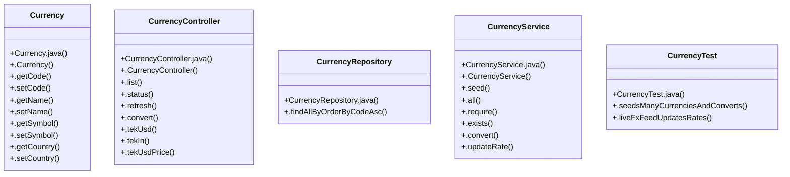

# Community 9

> 42 nodes · cohesion 0.06

## Key Concepts

- [Currency](file:///D:/block-chain-crypto-money-electronic-transaction-quantum/src/main/java/com/tekmachain/currency/Currency.java#L12) (14 connections)
- [.require()](file:///D:/block-chain-crypto-money-electronic-transaction-quantum/src/main/java/com/tekmachain/service/WalletService.java#L120) (10 connections)
- [CurrencyController](file:///D:/block-chain-crypto-money-electronic-transaction-quantum/src/main/java/com/tekmachain/currency/CurrencyController.java#L11) (9 connections)
- [CurrencyService](file:///D:/block-chain-crypto-money-electronic-transaction-quantum/src/main/java/com/tekmachain/currency/CurrencyService.java#L23) (8 connections)
- [.seedsManyCurrenciesAndConverts()](file:///D:/block-chain-crypto-money-electronic-transaction-quantum/src/test/java/com/tekmachain/CurrencyTest.java#L23) (7 connections)
- [.getUsdRate()](file:///D:/block-chain-crypto-money-electronic-transaction-quantum/src/main/java/com/tekmachain/currency/Currency.java#L58) (5 connections)
- [.tekIn()](file:///D:/block-chain-crypto-money-electronic-transaction-quantum/src/main/java/com/tekmachain/currency/CurrencyController.java#L57) (5 connections)
- [.convert()](file:///D:/block-chain-crypto-money-electronic-transaction-quantum/src/main/java/com/tekmachain/currency/CurrencyService.java#L75) (5 connections)
- [.liveFxFeedUpdatesRates()](file:///D:/block-chain-crypto-money-electronic-transaction-quantum/src/test/java/com/tekmachain/CurrencyTest.java#L40) (5 connections)
- [.tekUsdPrice()](file:///D:/block-chain-crypto-money-electronic-transaction-quantum/src/main/java/com/tekmachain/currency/CurrencyController.java#L64) (4 connections)
- [.exists()](file:///D:/block-chain-crypto-money-electronic-transaction-quantum/src/main/java/com/tekmachain/currency/CurrencyService.java#L70) (4 connections)
- [.updateRate()](file:///D:/block-chain-crypto-money-electronic-transaction-quantum/src/main/java/com/tekmachain/currency/CurrencyService.java#L84) (4 connections)
- [.setUsdRate()](file:///D:/block-chain-crypto-money-electronic-transaction-quantum/src/main/java/com/tekmachain/currency/Currency.java#L59) (3 connections)
- [.require()](file:///D:/block-chain-crypto-money-electronic-transaction-quantum/src/main/java/com/tekmachain/currency/CurrencyService.java#L64) (3 connections)
- [CurrencyTest](file:///D:/block-chain-crypto-money-electronic-transaction-quantum/src/test/java/com/tekmachain/CurrencyTest.java#L16) (3 connections)
- [.ticker()](file:///D:/block-chain-crypto-money-electronic-transaction-quantum/src/main/java/com/tekmachain/exchange/web/ExchangeController.java#L57) (3 connections)
- [.getSymbol()](file:///D:/block-chain-crypto-money-electronic-transaction-quantum/src/main/java/com/tekmachain/currency/Currency.java#L52) (2 connections)
- [.list()](file:///D:/block-chain-crypto-money-electronic-transaction-quantum/src/main/java/com/tekmachain/currency/CurrencyController.java#L25) (2 connections)
- [.refresh()](file:///D:/block-chain-crypto-money-electronic-transaction-quantum/src/main/java/com/tekmachain/currency/CurrencyController.java#L37) (2 connections)
- [.status()](file:///D:/block-chain-crypto-money-electronic-transaction-quantum/src/main/java/com/tekmachain/currency/CurrencyController.java#L31) (2 connections)
- [.tekUsd()](file:///D:/block-chain-crypto-money-electronic-transaction-quantum/src/main/java/com/tekmachain/currency/CurrencyController.java#L51) (2 connections)
- [CurrencyRepository](file:///D:/block-chain-crypto-money-electronic-transaction-quantum/src/main/java/com/tekmachain/currency/CurrencyRepository.java#L7) (2 connections)
- [.findAllByOrderByCodeAsc()](file:///D:/block-chain-crypto-money-electronic-transaction-quantum/src/main/java/com/tekmachain/currency/CurrencyRepository.java#L9) (2 connections)
- [.all()](file:///D:/block-chain-crypto-money-electronic-transaction-quantum/src/main/java/com/tekmachain/currency/CurrencyService.java#L59) (2 connections)
- [.Currency()](file:///D:/block-chain-crypto-money-electronic-transaction-quantum/src/main/java/com/tekmachain/currency/Currency.java#L34) (1 connections)
- *... and 17 more nodes in this community*

## Class Diagram

## Relationships

- No strong cross-community connections detected

## Source Files

- [D:\block-chain-crypto-money-electronic-transaction-quantum\src\main\java\com\tekmachain\currency\Currency.java](file:///D:/block-chain-crypto-money-electronic-transaction-quantum/src/main/java/com/tekmachain/currency/Currency.java)
- [D:\block-chain-crypto-money-electronic-transaction-quantum\src\main\java\com\tekmachain\currency\CurrencyController.java](file:///D:/block-chain-crypto-money-electronic-transaction-quantum/src/main/java/com/tekmachain/currency/CurrencyController.java)
- [D:\block-chain-crypto-money-electronic-transaction-quantum\src\main\java\com\tekmachain\currency\CurrencyRepository.java](file:///D:/block-chain-crypto-money-electronic-transaction-quantum/src/main/java/com/tekmachain/currency/CurrencyRepository.java)
- [D:\block-chain-crypto-money-electronic-transaction-quantum\src\main\java\com\tekmachain\currency\CurrencyService.java](file:///D:/block-chain-crypto-money-electronic-transaction-quantum/src/main/java/com/tekmachain/currency/CurrencyService.java)
- [D:\block-chain-crypto-money-electronic-transaction-quantum\src\main\java\com\tekmachain\exchange\web\ExchangeController.java](file:///D:/block-chain-crypto-money-electronic-transaction-quantum/src/main/java/com/tekmachain/exchange/web/ExchangeController.java)
- [D:\block-chain-crypto-money-electronic-transaction-quantum\src\main\java\com\tekmachain\service\WalletService.java](file:///D:/block-chain-crypto-money-electronic-transaction-quantum/src/main/java/com/tekmachain/service/WalletService.java)
- [D:\block-chain-crypto-money-electronic-transaction-quantum\src\test\java\com\tekmachain\CurrencyTest.java](file:///D:/block-chain-crypto-money-electronic-transaction-quantum/src/test/java/com/tekmachain/CurrencyTest.java)

## Audit Trail

- EXTRACTED: 83 (66%)
- INFERRED: 43 (34%)
- AMBIGUOUS: 0 (0%)

---

*Part of the graphify knowledge wiki. See [[index]] to navigate.*