# api()

> God node · 39 connections · [D:\block-chain-crypto-money-electronic-transaction-quantum\src\main\resources\static\app.js](file:///D:/block-chain-crypto-money-electronic-transaction-quantum/src/main/resources/static/app.js#L43)

## Call Trace Diagram

```mermaid
sequenceDiagram
    participant P0 as api()
    participant P1 as loadWallets()
    participant P2 as $()
    participant P3 as toast()
    participant P4 as loadDashboard()
    participant P5 as loadExchange()
    participant P6 as loadProfile()
    participant P7 as mine()
    participant P8 as loadTicker()
    participant P9 as loadLiveMarkets()
    participant P10 as doMine()
    participant P11 as showView()
    participant P12 as renderConverter()
    participant P13 as validateChain()
    participant P14 as askAssistant()
    participant P15 as createHdWallet()
    participant P16 as sendTx()
    participant P17 as loadPeers()
    participant P18 as setUser()
    participant P19 as submitAuth()
    participant P20 as recalcTotal()
    participant P21 as loadOrderBook()
    participant P22 as loadTrades()
    participant P23 as toggleFunding()
    participant P24 as createSelfWallet()
    participant P25 as apEl()
    participant P26 as updateAvailHint()
    participant P27 as loadAccount()
    participant P28 as placeOrder()
    participant P29 as submitFunding()
    participant P30 as loadInfo()
    participant P31 as linkAccount()
    participant P32 as updateFxStatus()
    participant P33 as createHybridWallet()
    participant P34 as createWallet()
    participant P35 as loadBlocks()
    participant P36 as addPeer()
    participant P37 as syncOrderForm()
    participant P38 as fillIdentity()
    participant P39 as onIdentityChange()
    participant P40 as onDisplayCurChange()
    participant P41 as loadWalletHistory()
    participant P42 as updateSideNet()
    participant P43 as runPqBenchmark()
    participant P44 as onUnauthorized()
    participant P45 as toggleAssistant()
    participant P46 as loadOrders()
    participant P47 as setFundAsset()
    participant P48 as fillDisplayCur()
    participant P49 as renderAccounts()
    participant P50 as fillSelect()
    participant P51 as openAuth()
    participant P52 as setAuthMode()
    participant P53 as sendAssistant()
    participant P54 as gotoDeposit()
    participant P55 as renderPairList()
    participant P56 as fillPrice()
    participant P57 as renderFundAccount()
    participant P58 as browseAsGuest()
    participant P59 as refreshView()
    participant P60 as .all()
    participant P61 as refreshFx()
    participant P62 as boot()
    participant P63 as getSelfWallets()
    participant P64 as logout()
    participant P65 as loadCurrencies()
    participant P66 as selfCustodySend()
    participant P67 as syncNow()
    participant P68 as refreshMarkets()
    participant P69 as removeAccount()
    participant P70 as loadAuth()
    participant P71 as greetAssistant()
    participant P72 as cancelOrder()
    P0->>+ P1: calls
    P1-->>- P0: return
    P1->>+ P2: calls
    P2-->>- P1: return
    P2->>+ P3: calls
    P3-->>- P2: return
    P2->>+ P1: calls
    P1-->>- P2: return
    P2->>+ P4: calls
    P4-->>- P2: return
    P2->>+ P5: calls
    P5-->>- P2: return
    P2->>+ P6: calls
    P6-->>- P2: return
    P2->>+ P7: calls
    P7-->>- P2: return
    P2->>+ P8: calls
    P8-->>- P2: return
    P2->>+ P9: calls
    P9-->>- P2: return
    P2->>+ P10: calls
    P10-->>- P2: return
    P2->>+ P11: calls
    P11-->>- P2: return
    P2->>+ P12: calls
    P12-->>- P2: return
    P2->>+ P13: calls
    P13-->>- P2: return
    P2->>+ P14: calls
    P14-->>- P2: return
    P2->>+ P15: calls
    P15-->>- P2: return
    P2->>+ P16: calls
    P16-->>- P2: return
    P2->>+ P17: calls
    P17-->>- P2: return
    P2->>+ P18: calls
    P18-->>- P2: return
    P2->>+ P19: calls
    P19-->>- P2: return
    P2->>+ P20: calls
    P20-->>- P2: return
    P2->>+ P21: calls
    P21-->>- P2: return
    P2->>+ P22: calls
    P22-->>- P2: return
    P2->>+ P23: calls
    P23-->>- P2: return
    P2->>+ P24: calls
    P24-->>- P2: return
    P2->>+ P25: calls
    P25-->>- P2: return
    P2->>+ P26: calls
    P26-->>- P2: return
    P2->>+ P27: calls
    P27-->>- P2: return
    P2->>+ P28: calls
    P28-->>- P2: return
    P2->>+ P29: calls
    P29-->>- P2: return
    P2->>+ P30: calls
    P30-->>- P2: return
    P2->>+ P31: calls
    P31-->>- P2: return
    P2->>+ P32: calls
    P32-->>- P2: return
    P2->>+ P33: calls
    P33-->>- P2: return
    P2->>+ P34: calls
    P34-->>- P2: return
    P2->>+ P35: calls
    P35-->>- P2: return
    P2->>+ P36: calls
    P36-->>- P2: return
    P2->>+ P37: calls
    P37-->>- P2: return
    P2->>+ P38: calls
    P38-->>- P2: return
    P2->>+ P39: calls
    P39-->>- P2: return
    P2->>+ P40: calls
    P40-->>- P2: return
    P2->>+ P41: calls
    P41-->>- P2: return
    P2->>+ P42: calls
    P42-->>- P2: return
    P2->>+ P43: calls
    P43-->>- P2: return
    P2->>+ P44: calls
    P44-->>- P2: return
    P2->>+ P45: calls
    P45-->>- P2: return
    P2->>+ P46: calls
    P46-->>- P2: return
    P2->>+ P47: calls
    P47-->>- P2: return
    P2->>+ P48: calls
    P48-->>- P2: return
    P2->>+ P49: calls
    P49-->>- P2: return
    P2->>+ P50: calls
    P50-->>- P2: return
    P2->>+ P51: calls
    P51-->>- P2: return
    P2->>+ P52: calls
    P52-->>- P2: return
    P2->>+ P53: calls
    P53-->>- P2: return
    P2->>+ P54: calls
    P54-->>- P2: return
    P2->>+ P55: calls
    P55-->>- P2: return
    P2->>+ P56: calls
    P56-->>- P2: return
    P2->>+ P57: calls
    P57-->>- P2: return
    P2->>+ P58: calls
    P58-->>- P2: return
    P1->>+ P0: calls
    P0-->>- P1: return
    P1->>+ P59: calls
    P59-->>- P1: return
    P1->>+ P60: calls
    P60-->>- P1: return
    P1->>+ P10: calls
    P10-->>- P1: return
    P1->>+ P15: calls
    P15-->>- P1: return
    P1->>+ P16: calls
    P16-->>- P1: return
    P1->>+ P19: calls
    P19-->>- P1: return
    P1->>+ P61: calls
    P61-->>- P1: return
    P1->>+ P24: calls
    P24-->>- P1: return
    P1->>+ P62: calls
    P62-->>- P1: return
    P1->>+ P29: calls
    P29-->>- P1: return
    P1->>+ P63: calls
    P63-->>- P1: return
    P1->>+ P33: calls
    P33-->>- P1: return
    P1->>+ P34: calls
    P34-->>- P1: return
    P1->>+ P40: calls
    P40-->>- P1: return
    P1->>+ P38: calls
    P38-->>- P1: return
    P1->>+ P50: calls
    P50-->>- P1: return
    P0->>+ P4: calls
    P4-->>- P0: return
    P0->>+ P6: calls
    P6-->>- P0: return
    P0->>+ P8: calls
    P8-->>- P0: return
    P0->>+ P9: calls
    P9-->>- P0: return
    P0->>+ P10: calls
    P10-->>- P0: return
    P0->>+ P13: calls
    P13-->>- P0: return
    P0->>+ P14: calls
    P14-->>- P0: return
    P0->>+ P16: calls
    P16-->>- P0: return
    P0->>+ P17: calls
    P17-->>- P0: return
    P0->>+ P19: calls
    P19-->>- P0: return
    P0->>+ P64: calls
    P64-->>- P0: return
    P0->>+ P21: calls
    P21-->>- P0: return
    P0->>+ P22: calls
    P22-->>- P0: return
    P0->>+ P23: calls
    P23-->>- P0: return
    P0->>+ P65: calls
    P65-->>- P0: return
    P0->>+ P61: calls
    P61-->>- P0: return
    P0->>+ P66: calls
    P66-->>- P0: return
    P0->>+ P27: calls
    P27-->>- P0: return
    P0->>+ P28: calls
    P28-->>- P0: return
    P0->>+ P29: calls
    P29-->>- P0: return
    P0->>+ P30: calls
    P30-->>- P0: return
    P0->>+ P31: calls
    P31-->>- P0: return
    P0->>+ P32: calls
    P32-->>- P0: return
    P0->>+ P33: calls
    P33-->>- P0: return
    P0->>+ P34: calls
    P34-->>- P0: return
    P0->>+ P35: calls
    P35-->>- P0: return
    P0->>+ P36: calls
    P36-->>- P0: return
    P0->>+ P67: calls
    P67-->>- P0: return
    P0->>+ P44: calls
    P44-->>- P0: return
    P0->>+ P68: calls
    P68-->>- P0: return
    P0->>+ P69: calls
    P69-->>- P0: return
    P0->>+ P41: calls
    P41-->>- P0: return
    P0->>+ P43: calls
    P43-->>- P0: return
    P0->>+ P70: calls
    P70-->>- P0: return
    P0->>+ P71: calls
    P71-->>- P0: return
    P0->>+ P46: calls
    P46-->>- P0: return
    P0->>+ P72: calls
    P72-->>- P0: return
```

## Connections by Relation

### calls
- [[loadWallets()]] `EXTRACTED`
- [[loadDashboard()]] `EXTRACTED`
- [[loadProfile()]] `EXTRACTED`
- [[loadTicker()]] `INFERRED`
- [[loadLiveMarkets()]] `EXTRACTED`
- [[doMine()]] `EXTRACTED`
- [[validateChain()]] `EXTRACTED`
- [[askAssistant()]] `INFERRED`
- [[sendTx()]] `EXTRACTED`
- [[loadPeers()]] `EXTRACTED`
- [[submitAuth()]] `EXTRACTED`
- [[logout()]] `EXTRACTED`
- [[loadOrderBook()]] `INFERRED`
- [[loadTrades()]] `INFERRED`
- [[toggleFunding()]] `INFERRED`
- [[loadCurrencies()]] `EXTRACTED`
- [[refreshFx()]] `EXTRACTED`
- [[selfCustodySend()]] `EXTRACTED`
- [[loadAccount()]] `INFERRED`
- [[placeOrder()]] `INFERRED`

### contains
- [[app.js]] `EXTRACTED`

---

*Part of the graphify knowledge wiki. See [[index]] to navigate.*