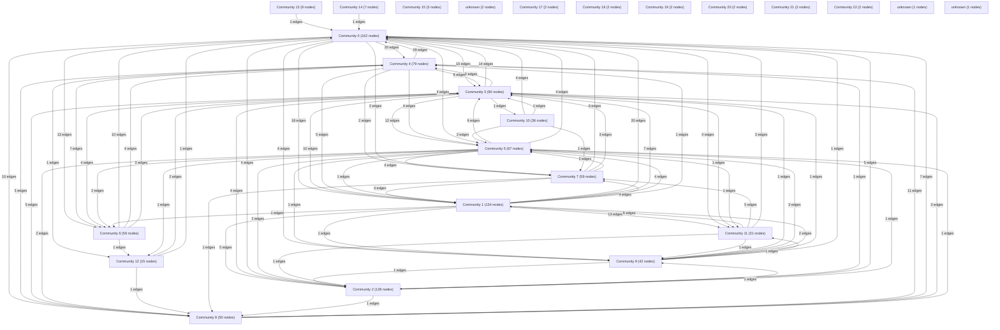

# Knowledge Graph Index

> Auto-generated by graphify. Start here — read community articles for context, then drill into god nodes for detail.

**987 nodes · 2345 edges · 25 communities**

---

## System Architecture Flowchart

## Communities
(sorted by size, largest first)

- [[Community 0]] — 162 nodes
- [[Community 1]] — 134 nodes
- [[Community 2]] — 128 nodes
- [[Community 3]] — 90 nodes
- [[Community 4]] — 79 nodes
- [[Community 5]] — 67 nodes
- [[Community 6]] — 59 nodes
- [[Community 7]] — 59 nodes
- [[Community 8]] — 50 nodes
- [[Community 9]] — 42 nodes
- [[Community 10]] — 36 nodes
- [[Community 11]] — 31 nodes
- [[Community 12]] — 15 nodes
- [[Community 13]] — 9 nodes
- [[Community 14]] — 7 nodes
- [[Community 15]] — 3 nodes
- [[unknown]] — 2 nodes
- [[Community 17]] — 2 nodes
- [[Community 18]] — 2 nodes
- [[Community 19]] — 2 nodes
- [[Community 20]] — 2 nodes
- [[Community 21]] — 2 nodes
- [[Community 22]] — 2 nodes
- [[unknown]] — 1 nodes
- [[unknown]] — 1 nodes

## God Nodes
(most connected concepts — the load-bearing abstractions)

- [[$()]] — 58 connections
- [[api()]] — 39 connections
- [[Order]] — 29 connections
- [[CryptoUtil]] — 26 connections
- [[Trade]] — 23 connections
- [[Block]] — 22 connections
- [[toast()]] — 21 connections
- [[PaymentAccount]] — 19 connections
- [[loadWallets()]] — 19 connections
- [[Wallet]] — 18 connections

---

*Generated by [graphify](https://github.com/safishamsi/graphify)*