# toast()

> God node · 21 connections · [D:\block-chain-crypto-money-electronic-transaction-quantum\src\main\resources\static\app.js](file:///D:/block-chain-crypto-money-electronic-transaction-quantum/src/main/resources/static/app.js#L63)

## Call Trace Diagram

```mermaid
sequenceDiagram
    participant P0 as toast()
    participant P1 as $()
    participant P2 as loadWallets()
    participant P3 as api()
    participant P4 as refreshView()
    participant P5 as .all()
    participant P6 as doMine()
    participant P7 as createHdWallet()
    participant P8 as sendTx()
    participant P9 as submitAuth()
    participant P10 as refreshFx()
    participant P11 as createSelfWallet()
    participant P12 as boot()
    participant P13 as submitFunding()
    participant P14 as getSelfWallets()
    participant P15 as createHybridWallet()
    participant P16 as createWallet()
    participant P17 as onDisplayCurChange()
    participant P18 as fillIdentity()
    participant P19 as fillSelect()
    participant P20 as loadDashboard()
    participant P21 as loadExchange()
    participant P22 as loadProfile()
    participant P23 as mine()
    participant P24 as loadTicker()
    participant P25 as loadLiveMarkets()
    participant P26 as showView()
    participant P27 as renderConverter()
    participant P28 as validateChain()
    participant P29 as askAssistant()
    participant P30 as loadPeers()
    participant P31 as setUser()
    participant P32 as recalcTotal()
    participant P33 as loadOrderBook()
    participant P34 as loadTrades()
    participant P35 as toggleFunding()
    participant P36 as apEl()
    participant P37 as updateAvailHint()
    participant P38 as loadAccount()
    participant P39 as placeOrder()
    participant P40 as loadInfo()
    participant P41 as linkAccount()
    participant P42 as updateFxStatus()
    participant P43 as loadBlocks()
    participant P44 as addPeer()
    participant P45 as syncOrderForm()
    participant P46 as onIdentityChange()
    participant P47 as loadWalletHistory()
    participant P48 as updateSideNet()
    participant P49 as runPqBenchmark()
    participant P50 as onUnauthorized()
    participant P51 as toggleAssistant()
    participant P52 as loadOrders()
    participant P53 as setFundAsset()
    participant P54 as fillDisplayCur()
    participant P55 as renderAccounts()
    participant P56 as openAuth()
    participant P57 as setAuthMode()
    participant P58 as sendAssistant()
    participant P59 as gotoDeposit()
    participant P60 as renderPairList()
    participant P61 as fillPrice()
    participant P62 as renderFundAccount()
    participant P63 as browseAsGuest()
    participant P64 as syncNow()
    participant P65 as refreshMarkets()
    participant P66 as removeAccount()
    participant P67 as cancelOrder()
    P0->>+ P1: calls
    P1-->>- P0: return
    P1->>+ P0: calls
    P0-->>- P1: return
    P1->>+ P2: calls
    P2-->>- P1: return
    P2->>+ P1: calls
    P1-->>- P2: return
    P2->>+ P3: calls
    P3-->>- P2: return
    P2->>+ P4: calls
    P4-->>- P2: return
    P2->>+ P5: calls
    P5-->>- P2: return
    P2->>+ P6: calls
    P6-->>- P2: return
    P2->>+ P7: calls
    P7-->>- P2: return
    P2->>+ P8: calls
    P8-->>- P2: return
    P2->>+ P9: calls
    P9-->>- P2: return
    P2->>+ P10: calls
    P10-->>- P2: return
    P2->>+ P11: calls
    P11-->>- P2: return
    P2->>+ P12: calls
    P12-->>- P2: return
    P2->>+ P13: calls
    P13-->>- P2: return
    P2->>+ P14: calls
    P14-->>- P2: return
    P2->>+ P15: calls
    P15-->>- P2: return
    P2->>+ P16: calls
    P16-->>- P2: return
    P2->>+ P17: calls
    P17-->>- P2: return
    P2->>+ P18: calls
    P18-->>- P2: return
    P2->>+ P19: calls
    P19-->>- P2: return
    P1->>+ P20: calls
    P20-->>- P1: return
    P1->>+ P21: calls
    P21-->>- P1: return
    P1->>+ P22: calls
    P22-->>- P1: return
    P1->>+ P23: calls
    P23-->>- P1: return
    P1->>+ P24: calls
    P24-->>- P1: return
    P1->>+ P25: calls
    P25-->>- P1: return
    P1->>+ P6: calls
    P6-->>- P1: return
    P1->>+ P26: calls
    P26-->>- P1: return
    P1->>+ P27: calls
    P27-->>- P1: return
    P1->>+ P28: calls
    P28-->>- P1: return
    P1->>+ P29: calls
    P29-->>- P1: return
    P1->>+ P7: calls
    P7-->>- P1: return
    P1->>+ P8: calls
    P8-->>- P1: return
    P1->>+ P30: calls
    P30-->>- P1: return
    P1->>+ P31: calls
    P31-->>- P1: return
    P1->>+ P9: calls
    P9-->>- P1: return
    P1->>+ P32: calls
    P32-->>- P1: return
    P1->>+ P33: calls
    P33-->>- P1: return
    P1->>+ P34: calls
    P34-->>- P1: return
    P1->>+ P35: calls
    P35-->>- P1: return
    P1->>+ P11: calls
    P11-->>- P1: return
    P1->>+ P36: calls
    P36-->>- P1: return
    P1->>+ P37: calls
    P37-->>- P1: return
    P1->>+ P38: calls
    P38-->>- P1: return
    P1->>+ P39: calls
    P39-->>- P1: return
    P1->>+ P13: calls
    P13-->>- P1: return
    P1->>+ P40: calls
    P40-->>- P1: return
    P1->>+ P41: calls
    P41-->>- P1: return
    P1->>+ P42: calls
    P42-->>- P1: return
    P1->>+ P15: calls
    P15-->>- P1: return
    P1->>+ P16: calls
    P16-->>- P1: return
    P1->>+ P43: calls
    P43-->>- P1: return
    P1->>+ P44: calls
    P44-->>- P1: return
    P1->>+ P45: calls
    P45-->>- P1: return
    P1->>+ P18: calls
    P18-->>- P1: return
    P1->>+ P46: calls
    P46-->>- P1: return
    P1->>+ P17: calls
    P17-->>- P1: return
    P1->>+ P47: calls
    P47-->>- P1: return
    P1->>+ P48: calls
    P48-->>- P1: return
    P1->>+ P49: calls
    P49-->>- P1: return
    P1->>+ P50: calls
    P50-->>- P1: return
    P1->>+ P51: calls
    P51-->>- P1: return
    P1->>+ P52: calls
    P52-->>- P1: return
    P1->>+ P53: calls
    P53-->>- P1: return
    P1->>+ P54: calls
    P54-->>- P1: return
    P1->>+ P55: calls
    P55-->>- P1: return
    P1->>+ P19: calls
    P19-->>- P1: return
    P1->>+ P56: calls
    P56-->>- P1: return
    P1->>+ P57: calls
    P57-->>- P1: return
    P1->>+ P58: calls
    P58-->>- P1: return
    P1->>+ P59: calls
    P59-->>- P1: return
    P1->>+ P60: calls
    P60-->>- P1: return
    P1->>+ P61: calls
    P61-->>- P1: return
    P1->>+ P62: calls
    P62-->>- P1: return
    P1->>+ P63: calls
    P63-->>- P1: return
    P0->>+ P22: calls
    P22-->>- P0: return
    P0->>+ P6: calls
    P6-->>- P0: return
    P0->>+ P28: calls
    P28-->>- P0: return
    P0->>+ P7: calls
    P7-->>- P0: return
    P0->>+ P8: calls
    P8-->>- P0: return
    P0->>+ P9: calls
    P9-->>- P0: return
    P0->>+ P10: calls
    P10-->>- P0: return
    P0->>+ P11: calls
    P11-->>- P0: return
    P0->>+ P12: calls
    P12-->>- P0: return
    P0->>+ P39: calls
    P39-->>- P0: return
    P0->>+ P13: calls
    P13-->>- P0: return
    P0->>+ P41: calls
    P41-->>- P0: return
    P0->>+ P15: calls
    P15-->>- P0: return
    P0->>+ P16: calls
    P16-->>- P0: return
    P0->>+ P44: calls
    P44-->>- P0: return
    P0->>+ P64: calls
    P64-->>- P0: return
    P0->>+ P65: calls
    P65-->>- P0: return
    P0->>+ P66: calls
    P66-->>- P0: return
    P0->>+ P67: calls
    P67-->>- P0: return
```

## Connections by Relation

### calls
- [[$()]] `EXTRACTED`
- [[loadProfile()]] `EXTRACTED`
- [[doMine()]] `EXTRACTED`
- [[validateChain()]] `EXTRACTED`
- [[createHdWallet()]] `EXTRACTED`
- [[sendTx()]] `EXTRACTED`
- [[submitAuth()]] `EXTRACTED`
- [[refreshFx()]] `EXTRACTED`
- [[createSelfWallet()]] `EXTRACTED`
- [[boot()]] `EXTRACTED`
- [[placeOrder()]] `INFERRED`
- [[submitFunding()]] `INFERRED`
- [[linkAccount()]] `EXTRACTED`
- [[createHybridWallet()]] `EXTRACTED`
- [[createWallet()]] `EXTRACTED`
- [[addPeer()]] `EXTRACTED`
- [[syncNow()]] `EXTRACTED`
- [[refreshMarkets()]] `EXTRACTED`
- [[removeAccount()]] `EXTRACTED`
- [[cancelOrder()]] `INFERRED`

### contains
- [[app.js]] `EXTRACTED`

---

*Part of the graphify knowledge wiki. See [[index]] to navigate.*