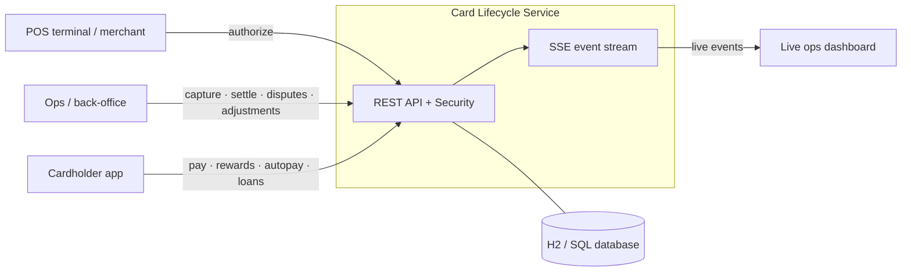
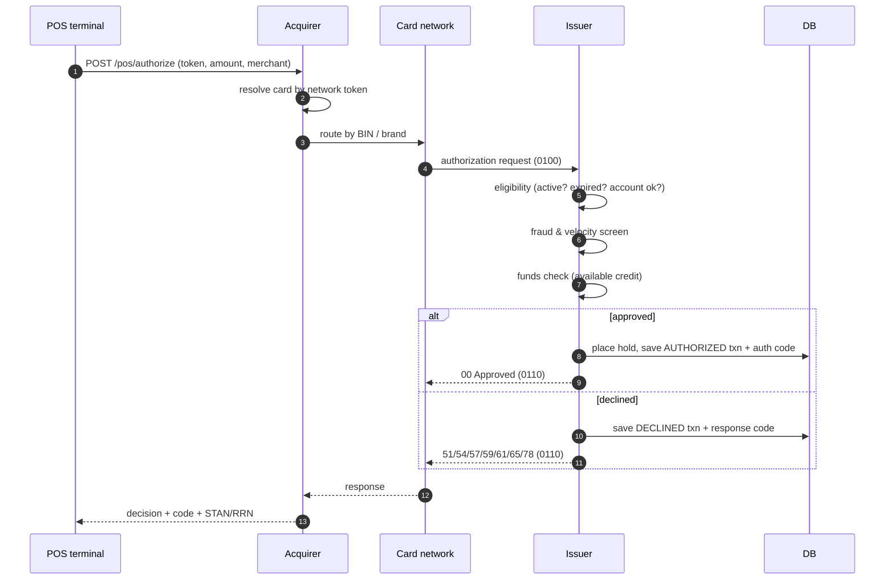
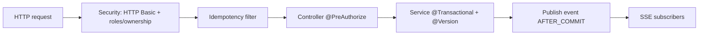
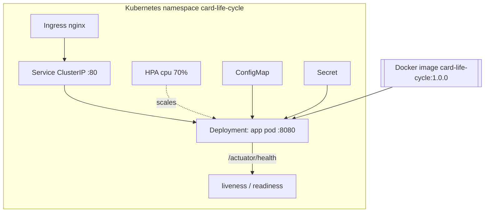

# High-Level Design — Credit Card Lifecycle

> Scope: an end-to-end credit-card processing simulation covering the card journey from a POS
> swipe to the issuer, plus billing, payments, loans/EMI, disputes & chargebacks, rewards and
> autopay — behind an authenticated, idempotent, concurrency-safe REST API.

---

## 1. System context

The service is the **issuer + acquirer + network** rolled into one deployable, so a single
call chain can demonstrate the whole four-party model.

---

## 2. Architecture (layered)

```mermaid
flowchart TB
    subgraph WEB[web · controllers]
      C1[Card / POS / Transaction]
      C2[Billing / Payment / Loan]
      C3[Dispute / Posting / Rewards / Autopay / Events]
      FILT[IdempotencyFilter + Security filter chain]
    end
    subgraph SVC[service · business logic]
      S1[Acquirer → Network → Issuer]
      S2[Fraud · Transaction · Billing · Payment]
      S3[Loan · Dispute · Posting · Rewards · Autopay]
    end
    subgraph SUP[support]
      SUP1[Money · EmiCalculator · ReferenceGenerator · BatchExecutor]
      EV[LifecycleEvents → EventBroadcaster - SSE]
    end
    subgraph DATA[repository · JPA]
      R[(Spring Data repositories)]
    end
    JOBS[Scheduled jobs: settlement · posting · autopay · hold-expiry]

    WEB --> SVC --> DATA
    SVC --> SUP
    SVC --> EV
    JOBS --> SVC
```

**Layering rules:** controllers map DTOs and enforce `@PreAuthorize`; services own the
business rules and transactions; repositories are Spring Data JPA; events are published from
services and fanned out to SSE subscribers after commit.

---

## 3. The four-party authorization flow

Clearing (`capture`) and settlement follow asynchronously; see the LLD state machine.

---

## 4. Core components

| Component | Responsibility |
|---|---|
| **AcquirerService / NetworkService / IssuerService** | The auth rail; issuer runs eligibility → fraud → funds and places holds. |
| **FraudService** | Real-time risk: per-txn ceiling, blocked MCC/country, spend velocity. |
| **TransactionService** | Capture, reversal, settlement, refund, hold expiry. |
| **PostingService** | Memo/posted ledger: memo-post, hard-post (posting cycle), adjustments. |
| **BillingService** | Statement generation, average-daily-balance interest, late fees. |
| **PaymentService** | Minimum / total / custom payments; statement paid-status. |
| **LoanService** | Underwriting, reducing-balance EMI schedules, EMI conversion. |
| **DisputeService** | Dispute/chargeback lifecycle + fraud tagging. |
| **RewardsService / AutopayService** | Points earn/redeem; standing-instruction debits. |
| **EventBroadcaster** | Fans lifecycle events to SSE subscribers (after commit). |

---

## 5. Cross-cutting concerns

- **Security** — stateless HTTP Basic; `ADMIN` (ops) vs `CUSTOMER` (own accounts) via `@PreAuthorize` + ownership guard.
- **Idempotency** — `Idempotency-Key` on mutating POSTs → execute-once with replayed responses.
- **Concurrency** — optimistic locking (`@Version`) on the account; lost updates surface as `409`.
- **Eventing** — every state change is broadcast on `/api/stream/events` after commit.
- **Batch** — settlement, posting, autopay and hold-expiry run on schedules, each item in its own transaction with retry.

---

## 6. Data stores

- **Relational DB** (H2 in-memory for the simulation; swappable for Postgres): customers, accounts, cards, merchants, transactions, statements, payments, loans, installments, disputes, idempotency records, app users.
- **DB sequence** `reference_seq` — cluster-safe transaction references.
- **In-memory ring buffer** — the last 200 lifecycle events for late SSE joiners.

---

## 7. Deployment view

- **Docker** — multi-stage build → non-root JRE image with a `HEALTHCHECK`.
- **Kubernetes** — Namespace, ConfigMap, Secret, Deployment (probes, resource limits, non-root securityContext), Service, Ingress, HPA. Manifests in [`k8s/`](../k8s).

---

## 8. Non-functional notes & scaling path

| Concern | Today | Production path |
|---|---|---|
| Persistence | In-memory H2, `create-drop` | Managed Postgres + Flyway/Liquibase migrations |
| Horizontal scale | 1 logical instance (per-pod H2) | Shared DB → HPA scales pods; references/idempotency already DB-backed |
| Transport security | HTTP Basic | TLS termination at ingress; OAuth2 / JWT |
| Eventing | In-JVM SSE fan-out | Broker (Kafka/Redis) for multi-instance fan-out |
| Observability | Actuator health | + metrics (Micrometer/Prometheus), tracing |

---

## 9. Tech stack

Java 21 · Spring Boot 3.3 (Web, Data JPA, Validation, **Security**, **Actuator**) · H2 ·
springdoc/Swagger UI · Maven · Docker · Kubernetes.

See the **[Low-Level Design](LLD.md)** for the domain model, algorithms and sequence diagrams.
