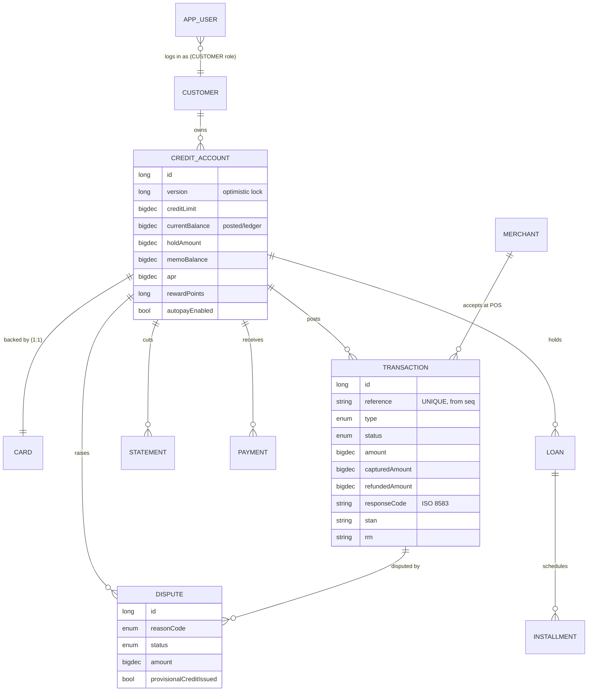
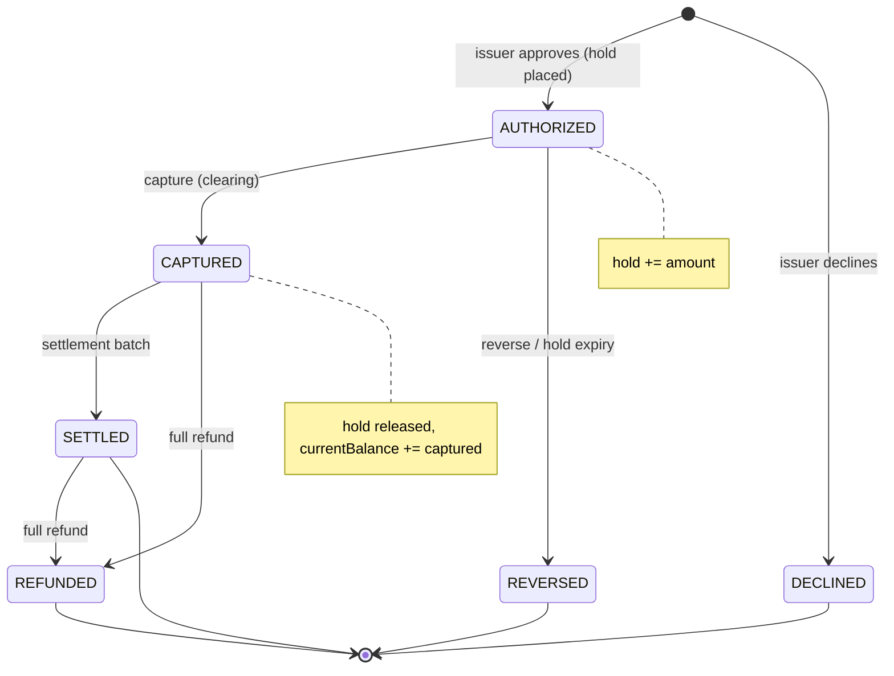
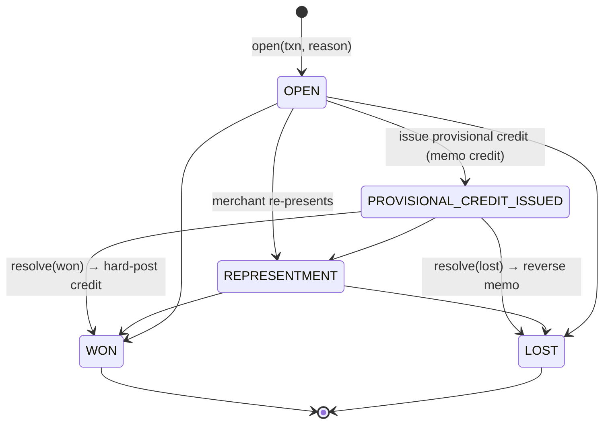
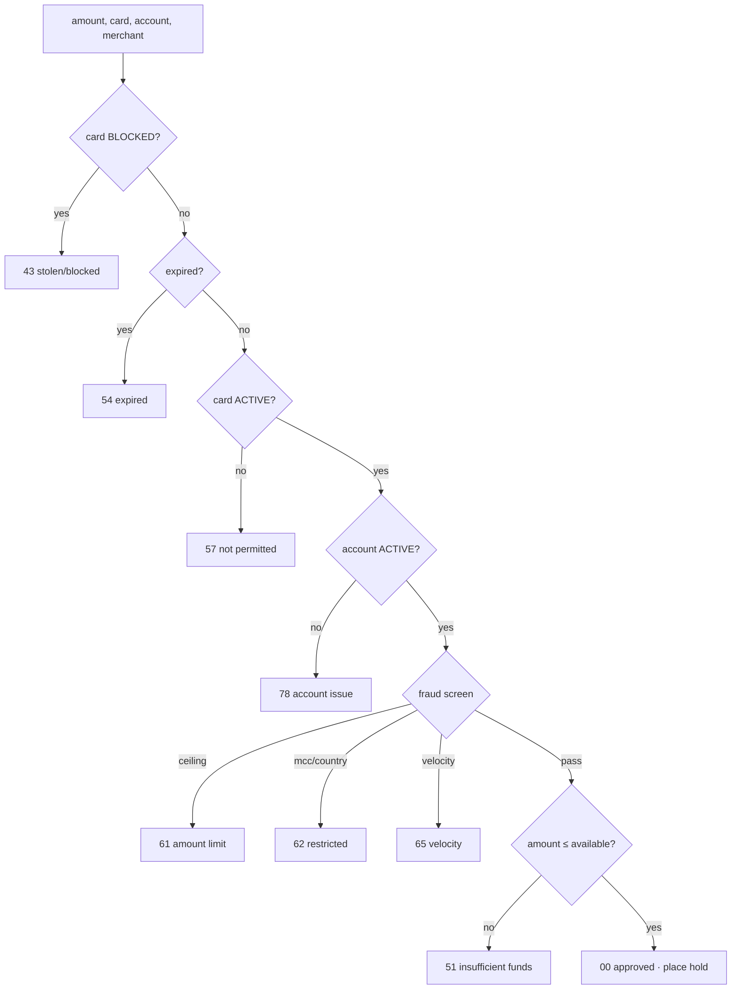
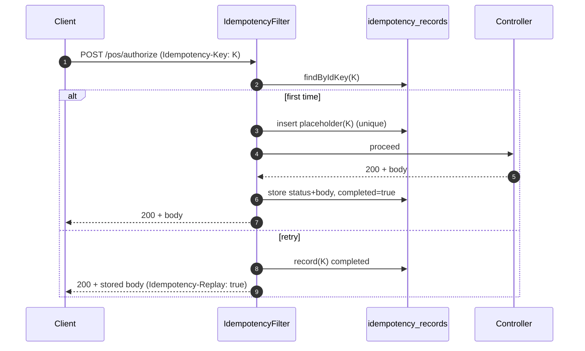

# Low-Level Design — Credit Card Lifecycle

Companion to the **[High-Level Design](HLD.md)**. Covers the domain model, state machines,
key algorithms and sequence diagrams.

---

## 1. Package structure

```
com.creditcard.lifecycle
├── model            JPA entities + enums (domain state)
├── repository       Spring Data JPA repositories
├── service          business logic (Acquirer/Network/Issuer, Billing, Payment, Loan,
│                    Dispute, Posting, Rewards, Autopay, Fraud, Transaction, Card, Customer)
├── web              REST controllers + DTOs + IdempotencyFilter + GlobalExceptionHandler
├── event            LifecycleEvent(s) + EventBroadcaster (SSE)
├── security         SecurityConfig, AppUserDetailsService, AppUserPrincipal, AccessGuard
├── support          Money, EmiCalculator, ReferenceGenerator, BatchExecutor, References
└── config           BankProperties + DataSeeder + DemoRunner + scheduled jobs
```

---

## 2. Domain model (ER)



### Balance invariant

```
availableCredit = creditLimit − currentBalance(posted) − holdAmount − memoBalance
```

- `currentBalance` — hard-posted ledger balance (drives statements).
- `holdAmount` — authorization holds (memo debits from auths).
- `memoBalance` — other pending memo posts (e.g. dispute provisional credit = negative).

---

## 3. Transaction clearing — state machine



Booked entries (PAYMENT, FEE, INTEREST, EMI, ADJUSTMENT) are `POSTED` directly; memo
adjustments and provisional credits are `MEMO` until the posting cycle hard-posts them.

---

## 4. Dispute / chargeback — state machine



A **fraud tag** (`/transactions/{id}/report-fraud`) flags the txn, blocks the card, and
auto-opens a FRAUD dispute in one step.

---

## 5. Authorization decision (issuer)



---

## 6. Key algorithms

### 6.1 EMI (reducing balance)
```
r   = annualRate / 12 / 100
EMI = P · r · (1+r)^n / ((1+r)^n − 1)
```
The schedule splits each instalment into interest (`outstanding · r`) and principal; the
final instalment absorbs rounding so the balance clears to exactly zero.

### 6.2 Average-daily-balance interest
1. Cycle window = `[lastStatementAt, now]`, opening balance = previous statement closing.
2. Replay posted ledger movements in time order; weight each balance level by seconds held.
3. `ADB = Σ(balance × seconds) / totalSeconds` (sub-day cycles use the ending balance).
4. `interest = ADB × APR/100 × cycleDays/365`, charged only when the prior statement was
   left revolving (full-payment grace otherwise).

### 6.3 Memo-post → hard-post
```
memoPost:  memoBalance += signed(amount)              (available changes now)
hardPost:  memoBalance -= signed; currentBalance += signed   (ledger updated)
reverse:   memoBalance -= signed; status = REVERSED   (never posts)
```
`signed = +amount` for debits, `−amount` for credits (`TransactionType.sign()`).

### 6.4 Optimistic locking
`CreditAccount.version` (`@Version`) increments on every update. Concurrent writers that read
the same version collide on commit → `ObjectOptimisticLockingFailureException` → **HTTP 409**.
Batch jobs retry the item (see 6.5).

### 6.5 Resilient batch (per-item)
```
ids = service.dueIds()                     # read
for id in ids:
    batchExecutor.call(() -> service.processOne(id))   # REQUIRES_NEW + retry(3)
```
`BatchExecutor` runs each item in its own transaction; an optimistic-lock conflict is retried,
other errors skip the item — the batch never rolls back wholesale.

---

## 7. Sequence — purchase: authorize → capture → settle

```mermaid
sequenceDiagram
    autonumber
    actor POS
    participant AC as Acquirer
    participant IS as Issuer
    participant TX as TransactionService
    participant RW as RewardsService
    participant DB as DB

    POS->>AC: authorize(token, amount, merchant)
    AC->>IS: route
    IS->>DB: save AUTHORIZED (hold += amount)
    IS-->>POS: 00 approved (auth, STAN, RRN)
    POS->>TX: capture(txnId)
    TX->>DB: hold -= auth; currentBalance += captured; status=CAPTURED
    TX->>RW: accrue points
    Note over TX,DB: settlement job (scheduled)
    TX->>DB: status=SETTLED
```

## 8. Sequence — dispute won (provisional credit)

```mermaid
sequenceDiagram
    autonumber
    actor CH as Cardholder
    participant DS as DisputeService
    participant PS as PostingService
    participant DB as DB

    CH->>DS: open(txn, reason)
    DS->>DB: Dispute OPEN + chargeback event
    CH->>DS: issue provisional credit
    DS->>PS: memoPost(PROVISIONAL_CREDIT, amount)
    PS->>DB: memoBalance -= amount (available ↑)
    CH->>DS: resolve(won)
    DS->>PS: hardPost(provisional credit)
    PS->>DB: memoBalance += amount; currentBalance -= amount
    DS->>DB: Dispute WON
```

## 9. Sequence — idempotent retry



---

## 10. Security model

- **Authentication** — stateless HTTP Basic; `AppUserDetailsService` loads `AppUser` → `AppUserPrincipal` (carries `customerId`).
- **Authorization** — `@PreAuthorize` on controllers:
  - `hasRole('ADMIN')` for ops (capture/settle/refund, statements, disputes, adjustments, posting, disburse, merchant/customer/card create, autopay run, report-fraud).
  - `@access.ownsAccount(authentication, #accountId)` / `ownsCard(...)` for customer-scoped endpoints (ADMIN passes through).
- **Open paths** — Swagger, `/v3/api-docs`, `/h2-console`, `/actuator/health/**`.
- Unauthenticated → `401`; authenticated but not permitted → `403`.

---

## 11. HTTP status mapping (`GlobalExceptionHandler`)

| Exception | Status |
|---|---|
| `ResourceNotFoundException` | 404 |
| `BusinessException` | 422 |
| `IllegalArgumentException` / bean validation | 400 |
| `ObjectOptimisticLockingFailureException` | 409 |
| `DataIntegrityViolationException` | 409 |

---

## 12. Persistence & configuration

- **OSIV off** (`spring.jpa.open-in-view=false`); mapper-visible associations are `EAGER` so DTOs map inside the service transaction.
- **DB sequence** `reference_seq` created by `schema.sql` (`defer-datasource-initialization=true`); `ReferenceGenerator` draws `NEXT VALUE FOR reference_seq`.
- **Tuning** — all business rules under `bank.*` in `application.yml` / `BankProperties`
  (APR, min-payment, grace, fraud ceilings & velocity, settlement/posting/autopay intervals,
  hold-expiry days, rewards multipliers, loan underwriting).
