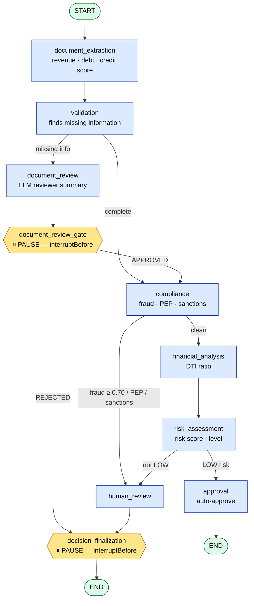
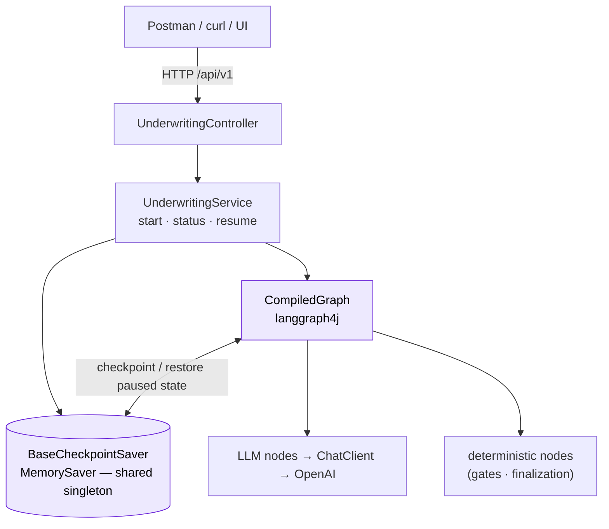
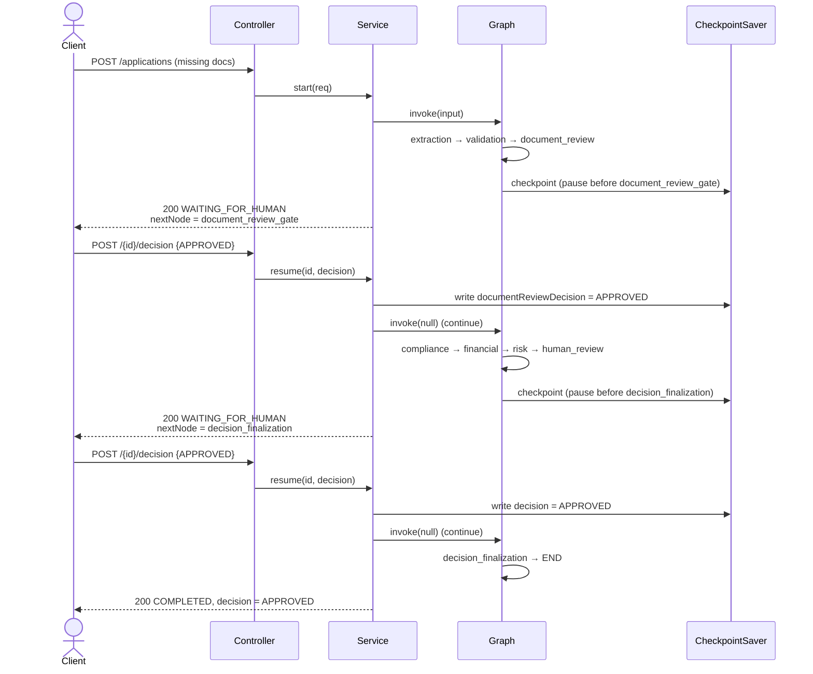

# Commercial Loan Underwriting — Realtime (LLM + Human‑in‑the‑Loop)

An LLM-backed commercial loan underwriting workflow built with **Spring Boot** and
**[langgraph4j](https://github.com/bsorrentino/langgraph4j)**. Each analysis stage is a
graph node that calls an LLM (via Spring AI / OpenAI). The workflow can **pause** for a
human at two points (missing documents, and the final loan decision), persist its state
in a checkpoint, and **resume** later from a separate HTTP call.

> The diagrams below use [Mermaid](https://mermaid.js.org/), which GitHub renders
> automatically in Markdown.

---

## ⚠️ Disclaimer

This is a **personal learning / demonstration project**. It is **not** production software
and must **not** be used to make real lending, credit, or financial decisions.

- **Educational use only** — built to explore LLM-backed workflows, langgraph4j, and
  human-in-the-loop patterns. It is not a regulated underwriting system.
- **Not financial, legal, or compliance advice.** LLM outputs (fraud scores, risk levels,
  DTI, summaries) are illustrative, can be wrong, and are not a substitute for a qualified
  human underwriter or any legal/regulatory requirement.
- **Synthetic data only.** All sample payloads use fabricated figures. Do not submit real
  personal, financial, or confidential information.
- **No security hardening.** Authentication is wide open (`permitAll`) and checkpoints are
  in-memory — for local experimentation only.
- **Bring your own API key.** The app calls the OpenAI API via your `OPENAI_API_KEY` and
  will incur usage costs on your account. Never commit secrets.
- Provided **as-is, without warranty of any kind.** Use at your own risk.

---

## Table of contents
1. [Tech stack](#tech-stack)
2. [Business flow (what happens and why)](#business-flow)
3. [High-Level Design (HLD)](#high-level-design-hld)
4. [Sequence — pause & resume](#sequence--pause--resume)
5. [Low-Level Design (LLD)](#low-level-design-lld)
6. [The two human-in-the-loop gates](#the-two-human-in-the-loop-gates)
7. [State model](#state-model)
8. [REST API](#rest-api)
9. [Running locally](#running-locally)
10. [End-to-end examples (Postman/curl)](#end-to-end-examples)
11. [Design notes & limitations](#design-notes--limitations)

---

## Tech stack

| Area | Choice |
|------|--------|
| Language / runtime | Java 21 |
| Framework | Spring Boot 4.1.1 (web-mvc, security, actuator, devtools) |
| Workflow engine | langgraph4j-core 1.8.27 |
| LLM | Spring AI 2.0.1 — `spring-ai-starter-model-openai` (`gpt-4o-mini`) |
| Checkpoint store | `MemorySaver` (in-memory) |
| Build | Maven (`./mvnw`) |

---

## Business flow

An application is submitted as **plain-text document content** (not file uploads). The
workflow extracts figures, validates completeness, screens for compliance, computes
financial ratios, scores risk, and either **auto-approves low-risk clean applications**
or **routes to a human** when something needs a person's judgment.



**Three outcomes:**
- **Auto-approved** — clean docs, no compliance hit, LOW risk → `approval` → `END` (`COMPLETED`).
- **Paused for human** — missing docs, or compliance hit, or non-LOW risk → graph checkpoints and returns `WAITING_FOR_HUMAN`.
- **Declined** — missing-docs gate rejected, or final decision `REJECTED`.

---

## High-Level Design (HLD)



**Key HLD decisions**
- **One compiled graph + one shared checkpoint saver**, created as Spring singletons in
  `GraphConfig`. The saver is the memory that links the *start* HTTP call to a later
  *resume* call; a per-request saver would be empty on resume.
- **`threadId = applicationId`** ties every `start` / `status` / `resume` call for one
  application to the same checkpoint history.
- **Pause/resume via `interruptBefore`** — the graph stops *before* a deterministic node
  that applies a human decision, checkpoints, and returns to the caller.
- **LLM nodes never decide** — they extract/score/summarize. Approve/decline is either a
  deterministic rule (LOW risk auto-approve) or a human.

---

## Sequence — pause & resume

The full two-gate path for a missing-docs application that is approved twice:



---

## Low-Level Design (LLD)

### Package layout
```
com.tekmaturix.commercialloanunderwritingrealtime
├── config/
│   ├── GraphConfig                 @Bean CompiledGraph + MemorySaver
│   ├── SecurityConfiguration       permitAll (dev)
│   └── OpenApiConfiguration
├── controller/
│   └── UnderwritingController       POST /applications, GET /{id}, POST /{id}/decision
├── dto/
│   ├── StartApplicationRequest      request body for start
│   ├── HumanDecisionRequest         request body for a decision
│   └── UnderwritingResponse         flattened state snapshot returned to clients
├── model/
│   └── UnderwritingState            graph state + channel SCHEMA + typed getters
├── service/
│   ├── UnderwritingStateGraph       builds nodes + edges + CompileConfig
│   ├── UnderwritingService          start / status / resume
│   ├── DocumentExtractionNode       LLM  → revenue, annualDebt, creditScore
│   ├── ValidationNode               LLM  → missingDocuments
│   ├── DocumentReviewGateNode       deterministic — applies missing-docs decision
│   ├── ComplianceNode               LLM  → fraudScore, pepMatch, sanctionsMatch
│   ├── FinancialAnalysisNode        LLM  → dtiRatio
│   ├── RiskAssesmentNode            LLM  → riskScore, riskLevel
│   ├── ApprovalNode                 LLM  → decision (auto-approve path)
│   ├── HumanReviewNode              LLM  → reviewer summary + WAITING_FOR_HUMAN
│   └── DecisionFinalizationNode     deterministic — applies final decision, COMPLETED
└── converter/                       BeanOutputConverter records (one per LLM node)
```

### Nodes

| Node | Type | Reads | Writes |
|------|------|-------|--------|
| `document_extraction` | LLM | documents | revenue, annualDebt, creditScore |
| `validation` | LLM | documents | **missingDocuments** |
| `document_review` | LLM | state | humanReviewRequired, humanReviewReason, status=WAITING_FOR_HUMAN |
| `document_review_gate` | deterministic | documentReviewDecision | status / decision (routes) |
| `compliance` | LLM | documents | fraudScore, pepMatch, sanctionsMatch |
| `financial_analysis` | LLM | documents | dtiRatio |
| `risk_assessment` | LLM | state | riskScore, riskLevel |
| `approval` | LLM | state | decision, status=COMPLETED |
| `human_review` | LLM | state | humanReviewRequired, humanReviewReason, status=WAITING_FOR_HUMAN |
| `decision_finalization` | deterministic | decision | decision, status=COMPLETED, clears humanReviewReason |

### Edges (routing logic)

| From | Condition | To |
|------|-----------|----|
| `START` | — | `document_extraction` |
| `document_extraction` | — | `validation` |
| `validation` | `missingDocuments` non-empty | `document_review` |
| `validation` | otherwise | `compliance` |
| `document_review` | — | `document_review_gate` |
| `document_review_gate` | `documentReviewDecision == APPROVED` | `compliance` |
| `document_review_gate` | otherwise | `decision_finalization` |
| `compliance` | fraud ≥ 0.70 **or** pepMatch **or** sanctionsMatch | `human_review` |
| `compliance` | otherwise | `financial_analysis` |
| `financial_analysis` | — | `risk_assessment` |
| `risk_assessment` | `riskLevel == LOW` | `approval` |
| `risk_assessment` | otherwise | `human_review` |
| `approval` | — | `END` |
| `human_review` | — | `decision_finalization` |
| `decision_finalization` | — | `END` |

### Compile config (the two pause points)
```java
CompileConfig.builder()
    .checkpointSaver(saver)
    .interruptBefore(DOCUMENT_REVIEW_GATE, DECISION_FINALIZATION)
    .build();
```

### Service operations
- **`start(req)`** → build input → `graph.invoke(input, config)` → runs until `END` or a pause → `toResponse`.
- **`resume(id, decision)`** → check `snapshot.next()` to learn *which* gate is paused →
  write the decision into the checkpoint (`documentReviewDecision` for the doc gate,
  `decision` for the final gate) → `graph.invoke(null, config)` to continue → `toResponse`.
- **`status(id)`** → read-only `toResponse`.

---

## The two human-in-the-loop gates

The design has **two distinct** human reviews — this is the core of the workflow:

| | Missing-docs gate | Final decision gate |
|---|---|---|
| Pause node | `document_review_gate` | `decision_finalization` |
| Reached when | `validation` finds missing info | compliance hit, or risk not LOW |
| Decision field | `documentReviewDecision` | `decision` |
| **APPROVE means** | *proceed with underwriting* → continues to `compliance` | *approve the loan* → `COMPLETED` / `APPROVED` |
| **REJECT means** | decline the application | decline the loan |

> Both gates are answered through the **same** `POST /{id}/decision` endpoint. The service
> inspects where the run is paused (`snapshot.next()`) to know which gate you're answering,
> so a single application may require **two** decision calls (approve docs, then decide the loan).

---

## State model

`UnderwritingState` (langgraph4j `AgentState`) with these channels:

| Field | Type | Default | Notes |
|-------|------|---------|-------|
| applicationId | String | "" | also the `threadId` |
| companyName | String | "" | |
| loanAmount | BigDecimal | 0 | |
| documents | List<String> | [] | raw text content |
| missingDocuments | List<String> | [] | set by validation |
| revenue / annualDebt | BigDecimal | 0 | from extraction |
| creditScore | Integer | 0 | from extraction |
| fraudScore | BigDecimal | 0 | compliance; threshold 0.70 |
| pepMatch / sanctionsMatch | Boolean | false | compliance |
| dtiRatio | BigDecimal | 0 | financial analysis |
| riskScore | BigDecimal | 0 | risk assessment |
| riskLevel | String | "" | `LOW` → auto-approve |
| decision | String | "" | final loan decision |
| documentReviewDecision | String | "" | missing-docs gate decision |
| humanReviewRequired | Boolean | false | |
| humanReviewReason | String | "" | cleared on finalization |
| status | String | "" | `WAITING_FOR_HUMAN` / `COMPLETED` / `IN_PROGRESS` |
| auditLog | List<String> | [] | **append-only** trail |

---

## REST API

Base path: `/api/v1` — all POST bodies are JSON (`Content-Type: application/json`).

| Method | Path | Body | Purpose |
|--------|------|------|---------|
| POST | `/applications` | `StartApplicationRequest` | Start a run; returns at `END` or a pause |
| GET | `/applications/{id}` | — | Current status / result |
| POST | `/applications/{id}/decision` | `HumanDecisionRequest` | Answer whichever gate is paused |

**`StartApplicationRequest`**
```json
{ "applicationId": "string", "companyName": "string", "loanAmount": 0, "documents": ["string"] }
```
**`HumanDecisionRequest`**
```json
{ "decision": "APPROVED | REJECTED", "reviewer": "string", "notes": "string" }
```
**`UnderwritingResponse`** (key fields): `status`, `decision`, `humanReviewRequired`,
`humanReviewReason`, `nextNode`, `missingDocuments`, `auditLog`, plus the scores.
When `nextNode` is `document_review_gate` or `decision_finalization`, the run is **paused**.

Errors: resuming a run that isn't paused, or an unknown id, returns **409** with
`{"error": "..."}`.

---

## Running locally

```bash
# set your OpenAI key (preferred over the value in application.properties)
export OPENAI_API_KEY=sk-...        # PowerShell: $env:OPENAI_API_KEY = "sk-..."

./mvnw spring-boot:run              # default port 8080
# or a different port:
./mvnw spring-boot:run -Dspring-boot.run.arguments="--server.port=8085"
```

> The app reads the OpenAI key from the `OPENAI_API_KEY` environment variable — it must be
> set before startup, and no secret is stored in source.

---

## End-to-end examples

> Use a **new `applicationId`** per run — the id is the checkpoint thread key, so reusing
> one resumes the old run instead of starting fresh.

### A) Missing documents → approve docs → approve loan

**1. Start** — `POST /api/v1/applications`
```json
{
  "applicationId": "LOAN-001",
  "companyName": "Northwind Traders",
  "loanAmount": 15000000,
  "documents": ["We are a wholesale distributor seeking INR 1.5 crore working capital. Financials, bank statements and tax returns can be provided on request."]
}
```
→ `status: WAITING_FOR_HUMAN`, `nextNode: document_review_gate`, `missingDocuments` populated.

**2. Approve the missing-docs gate** — `POST /api/v1/applications/LOAN-001/decision`
```json
{ "decision": "APPROVED", "reviewer": "suhel", "notes": "Docs to follow." }
```
→ resumes through compliance/financial/risk → `nextNode: decision_finalization`.

**3. Final loan decision** — `POST /api/v1/applications/LOAN-001/decision`
```json
{ "decision": "APPROVED", "reviewer": "suhel", "notes": "Final approval." }
```
→ `status: COMPLETED`, `decision: APPROVED`, `humanReviewReason: ""`, `nextNode: __END__`.

### B) Missing documents → reject
At step 2 send `"decision": "REJECTED"` → goes straight to `decision_finalization` →
`status: COMPLETED`, `decision: REJECTED` (compliance/financial/risk are **not** run).

### C) Clean application
Submit full balance sheet / P&L / bank / tax text in `documents`. Validation finds nothing
missing, so it skips the doc gate. If LOW risk and no compliance hit → auto-approved; else
it pauses at `decision_finalization`.

### D) Check status
`GET /api/v1/applications/LOAN-001`

---

## Design notes & limitations

- **In-memory checkpoints** (`MemorySaver`): paused applications are lost on restart and
  not shared across instances. For production swap in a durable saver (file / Redis / JDBC).
- **LLM nodes are null-safe**: the model may return `null` for values it can't find
  ("missing stays missing"). Each node writes only the fields it actually produced, so the
  state keeps its defaults instead of crashing on `Map.of` (which rejects nulls).
- **`humanReviewReason` is a live field**, cleared by `decision_finalization` once a decision
  is recorded — a `COMPLETED` application reports no stale "manual review" text. Full history
  is preserved in `auditLog`.
- **LLM output is treated as untrusted data** — prompts instruct the model to ignore
  embedded instructions in document text.
- **Security is `permitAll`** (dev convenience). Lock this down before any real deployment.
- Sample payloads live in [`samples/`](samples/).
